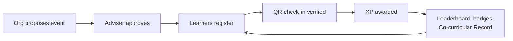

# CLAUDE.md — Hiraya

Instructions for Claude Code sessions working in this repository. Read this before acting.

---

## 1. What Hiraya is

Hiraya is a **school engagement platform for a Philippine public high school**. It turns co-curricular
participation into a verified, rewarded, and recorded thing.

The entire product is one loop. Every module either feeds this loop or displays its result:



**The load-bearing claim:** *a point in Hiraya means a teacher confirmed you were there.* Everything
else — leaderboards, badges, the Co-curricular Record — is worthless the moment that claim is
falsifiable. When a change would weaken verification in exchange for convenience, the change is wrong.

**Objectives.** Increase and recognize learner participation; cut adviser paperwork; give every learner
a portable record of involvement from Grade 7 to Grade 12; give the school data to find and support
disengaged learners.

**Source of truth.** `docs/PRD.md` for what to build, `docs/MILESTONE_ROADMAP.md` for when. The original
proposal PDF is not in the repo and should not need to be read — if something is missing from `docs/`,
that is a documentation bug worth fixing. (The proposal's working title was *Kasali*; the system is
**Hiraya**, and that older name appears nowhere else.)

**Delivery targets.** One codebase → a web PWA **and** an installable Android/iOS app (Capacitor),
sharing one Supabase database.

---

## 2. Repository structure

```
Hiraya/
├── CLAUDE.md                       # you are here
├── SKILLS.md                       # skills + agents catalogue and combined workflow
├── docs/
│   ├── PRD.md                      # what to build, for whom, with acceptance criteria
│   ├── TECHNICAL_ARCHITECTURE.md   # stack, decisions D1-D17, trade-offs
│   ├── SYSTEM_DESIGN.md            # modules, roles, workflows, entities, API contracts
│   ├── DATA_FLOW.md                # data lifecycle, auth flow, sensitive-data handling
│   ├── MILESTONE_ROADMAP.md        # phases, gates, acceptance criteria
│   ├── DESIGN_SYSTEM.md            # tokens, dual register, component inventory
│   ├── ASSET_CHECKLIST.md          # every asset needed, tiered by what it blocks
│   └── PROGRESS.md                 # append-only checkpoint log
├── .claude/skills/                 # 5 project skills
├── .claude/agents/                 # 5 project agents
├── src/                            # (from Phase 0)
├── assets/                         # authored SVG source
└── tests/{unit,e2e}/
```

Application layout (created in Phase 0):

```
src/
├── app/
│   ├── (auth) (learner) (officer) (adviser) (admin)/   # route groups
│   └── api/v1/               # THE data layer — web and native both call this
├── features/<feature>/       # events orgs checkin xp announcements identity
│   ├── service.ts            # business logic — the only place it lives
│   ├── schema.ts             # Zod contracts (request + response)
│   ├── queries.ts            # Drizzle queries
│   └── components/
├── db/                       # Drizzle schema, migrations, RLS policy SQL
├── lib/
│   ├── auth/                 # session, role resolution
│   ├── qr/                   # Ed25519 sign/verify
│   ├── native/               # Capacitor wrappers, each with a web fallback
│   ├── db/client.ts          # anon key + RLS  <- the default
│   └── db/admin.ts           # service role  <- server-only, import-banned
├── design/                   # tokens, primitives
└── i18n/                     # next-intl catalogues
```

---

## 3. Architecture rules

These are rules, not preferences. A change that breaks one of them does not ship.

### R1 — Every table carries `school_id`, and RLS enforces it

Every core table has `school_id uuid NOT NULL REFERENCES schools(id)`. RLS is **enabled on every table**,
with policies comparing `school_id` against `current_school_id()` (which reads a JWT claim stamped at
login). Tenancy is a database invariant, never an application convention — application code that
"remembers" to filter is application code that will one day forget.

### R2 — The service-role key is confined to one file

`src/lib/db/admin.ts` is the only module that may construct a service-role client. It is `server-only`,
and a lint rule bans importing it anywhere else. Default to `src/lib/db/client.ts` (anon key + RLS). If
you reach for the admin client, state why in a comment — it is almost always the wrong answer.

It exposes two entry points, because they are not the same privilege: `withServiceRole(reason, fn)` runs
a Drizzle transaction as `service_role` (tables), and `adminAuthApi(reason)` returns only the GoTrue
`auth.admin` surface (accounts). Each validates that the reason belongs to its half. **There is no
supabase-js table access anywhere** — the project's Data API is disabled (D22), so `.from()` reaches
nothing.

Note what this does *not* buy: `service_role` holds no UPDATE or DELETE on `xp_ledger` or `audit_log`
(R4), because Supabase's default privileges grant it everything on new tables and a `REVOKE … FROM
PUBLIC` does not reach a named role. Any new append-only table must revoke from `service_role`
explicitly, and `npm run db:verify-rls` is what catches you forgetting.

### R3 — `/api/v1` is the single data layer. No Server Actions.

A Capacitor shell ships a static bundle and cannot run Server Actions or RSC. Rather than let web and
native diverge into two data layers with two sets of authorization checks, **both call `/api/v1`**.
Business logic lives once in `src/features/*/service.ts`; route handlers are thin. This costs Server
Action ergonomics and form progressive enhancement; it buys **one authorization path instead of two**,
which is the trade that matters for an app holding minors' data maintained by one person.

### R4 — The XP ledger is append-only

`xp_ledger` has no UPDATE or DELETE grant, for any role, including admins. Corrections are reversal rows.
Balances are a materialized view. Every row cites its source (`checkin_id`, `feedback_id`, …) so any
point can be audited back to a verified action. This is what makes the anti-farming story enforceable
rather than aspirational.

### R5 — QR verification is asymmetric and works offline

Learner ID tokens are **Ed25519**-signed (`sub`, `sid`, `exp` ≈ 60s, rotating `nonce`). Officer devices
verify with a cached **public** key and never hold a secret — this is the entire reason the scheme is
asymmetric, and it is what makes offline check-in possible. The private key lives only in server
environment settings. **Never ship a signing key in a Capacitor bundle**: a native binary is trivially
unpacked, so anything on a device is public.

### R6 — Check-in sync is idempotent

Queued scans de-duplicate server-side on `(event_id, profile_id, jti)`. Replaying an entire offline queue
must be a no-op. Assume every queue will be replayed, because flaky connections guarantee it.

### R7 — Validate at the boundary, with Zod

Every `/api/v1` handler parses its input with a Zod schema from `features/<f>/schema.ts` before touching
a service. Responses are typed from the same file. No `any` crosses a boundary.

### R8 — Never log PII

Log `profile_id`. Never log LRN, full name, section, or email — not to Sentry, not to `console`, not in
an error message rendered to a user. Admin actions go to the `audit_log` table, which stores actor and
target ids, not names.

---

## 4. Coding standards

- **TypeScript strict.** No `any`; no non-null `!` on values crossing a boundary. Use `unknown` plus a
  Zod parse instead.
- **Server/client discipline.** Server Components by default. `"use client"` only where interaction
  demands it, and as far down the tree as possible.
- **Naming.** `snake_case` in the database, `camelCase` in TypeScript; Drizzle maps between them. Tables
  plural (`events`), types singular (`Event`).
- **Files.** One feature per folder under `src/features/`. Shared UI in `src/design/`. Nothing shared
  goes in a feature folder; nothing feature-specific goes in `design/`.
- **Errors.** Typed taxonomy in `src/lib/errors.ts` (see `docs/SYSTEM_DESIGN.md` §8). Handlers map errors
  to HTTP codes in one place; services throw domain errors and never know about HTTP.
- **Comments.** Explain *why*, never *what*. A comment restating the code is noise; a comment recording a
  trade-off, a policy citation, or a non-obvious constraint earns its place.
- **i18n.** Every user-facing string goes through `next-intl` from the first commit. No bare string
  literals in JSX, ever — retrofitting i18n across a finished UI is the refactor that never happens.
- **Native.** Anything touching a Capacitor plugin is wrapped in `src/lib/native/` with a web fallback,
  so the web build never breaks and tests can run headless.

---

## 5. Testing and validation

| Layer | Tool | Must cover |
|---|---|---|
| Unit | Vitest | XP calculation, level thresholds, Ed25519 sign/verify, Zod schemas, clock-skew logic |
| Integration | Vitest + test Supabase | RLS policies (**including the cross-tenant denial case**), append-only ledger grants, idempotent sync |
| E2E | Playwright MCP | The full loop: propose → approve → register → check-in → XP → leaderboard |
| Offline | `hiraya-offline-scenario-tester` agent | Queue, replay, clock skew, duplicate scan, mid-sync disconnect, capacity race |
| Mobile / a11y | `hiraya-mobile-audit` skill | 360×800 viewport, WCAG 2.1 AA a11y tree, ≤500 KB first load |
| Security | `/security-review` + `hiraya-privacy-auditor` | Required on any diff touching auth, RBAC, tenancy, QR, or PII |

**Non-negotiable tests.** Two must exist and pass before anything else counts as done:

1. A user from school A cannot read *any* row belonging to school B (R1).
2. Replaying a full offline scan queue produces zero duplicate XP (R4, R6).

**Performance budget.** First load ≤ 500 KB. Check-in throughput ≥ 15/minute at the gate. These come
from the product KPIs, not from taste — treat a regression as a failing test.

---

## 6. Security and privacy requirements

Most users are **minors**. Privacy and child safety are requirements, not a review stage.

- **Legal frame.** The school is the data controller; the developer is a processor under a written
  agreement. Compliance target: Data Privacy Act of 2012 (RA 10173) and DepEd child-protection policy.
- **Data minimization.** Collect only: name, grade, section, school ID or LRN, org memberships. **Not**
  home address, birthday, family data, or photographs of learners.
- **LRN handling.** Stored only as `lrn_hmac` (HMAC-SHA256 + server pepper) for import de-duplication,
  in its own table `profile_identifiers` — **not on `profiles`**. RLS is row-level and cannot hide a
  column from a role, so separating the row is what makes "never returned below School Admin" a database
  invariant rather than a query-writing habit. Never rendered to another learner.
- **Avatars.** Curated SVG set only. **No photo uploads** — that would create a moderation queue for
  images of minors and a biometric-adjacent data store, for a cosmetic gain.
- **No adult↔learner private messaging.** There is no DM feature and must not be one. Adult-to-learner
  contact happens on moderated, visible surfaces only.
- **Analytics on non-participants** are restricted to guidance staff and advisers, for supportive
  outreach. That list is sensitive; treat it as such.
- **Audit.** Every admin action writes to `audit_log`. Every XP movement is a ledger row.
- **Consent.** `consent_records` gates account activation. **No real learner data enters any environment
  before Gate B** (DPO review + signed processor agreement + guardian consent). Demo tenants use
  synthetic data that renders its own "DEMO DATA" marker.
- **Store policy.** Google Play Families and Apple Kids Category rules apply to a child-directed app. No
  SDK that collects an advertising ID. Settle this in Phase 5, not at submission.

---

## 7. Checkpoint policy

Keeping docs, progress, and the remote current is part of the work, not an afterthought.

**Run `/hiraya-checkpoint` when any of these happen — the six triggers:**

1. A roadmap phase completes, or a gate passes
2. A feature slice merges
3. A schema migration lands
4. A decision in the `docs/TECHNICAL_ARCHITECTURE.md` D-table is added or changed
5. A risk materializes or is retired
6. The stack or a dependency changes

**Git policy.** Commit freely as work completes — no need to ask. **Push at checkpoints**, and say so in
one line. Never force-push, and never commit directly to `main` without asking first. Conventional commit
messages; tag `phase-N-complete` at phase boundaries.

**Never commit:** real learner data, `.env` files, the Supabase service-role key, the QR Ed25519 private
key, database dumps or exports, guardian-consent scans, Android keystores, iOS provisioning profiles.
When in doubt, it does not go in the repo.

---

## 8. Common commands

```bash
npm run dev              # Next.js dev server
npm run build            # production build
npm run typecheck        # tsc --noEmit
npm run lint             # eslint, includes the db/admin.ts import ban
npm run test             # vitest unit + integration
npm run test:e2e         # playwright
npm run db:generate      # drizzle-kit generate  (after editing src/db/schema.ts)
npm run db:check         # drizzle-kit check - migration consistency
npm run db:migrate       # apply migrations AND RLS policies, in that order
npm run db:rls           # apply RLS policy SQL only (idempotent; db:migrate calls it)
npm run db:verify-rls    # assert the tenancy invariants actually landed
npm run db:seed:demo     # synthetic demo tenant
npm run cap:sync         # copy web build into android/ + ios/
npm run cap:android      # open Android Studio
```

*(All but `test:e2e`, `cap:sync` and `cap:android` are wired as of 2026-09-21; Playwright lands
alongside the first walkable loop, Capacitor in Phase 5. `db:seed:demo` reads `seed/demo-*.json` —
see `seed/README.md` — writes as School Admin under RLS rather than around it, and refuses to run if
any school in the database is not flagged `is_demo`.)*

---

## 9. Tools, MCP servers, skills and agents

**Project skills** (`.claude/skills/`) — procedures to follow inline. Full detail in `SKILLS.md`.

| Skill | Use when |
|---|---|
| `hiraya-feature-slice` | Starting any module or feature |
| `hiraya-checkin-integrity` | Writing QR, check-in, or XP code |
| `hiraya-mobile-audit` | Any user-facing UI change |
| `hiraya-design-system` | Any new screen or component |
| `hiraya-checkpoint` | The six triggers above |

**Project agents** (`.claude/agents/`) — delegated, separate-context work.

| Agent | Use when |
|---|---|
| `hiraya-tenancy-auditor` | Any migration or new query path |
| `hiraya-privacy-auditor` | Any diff touching PII, forum, exports, or analytics |
| `hiraya-gamification-balancer` | Changing XP rules, or pilot data shows farming/decay |
| `hiraya-adviser-advocate` | Designing any flow an adviser must perform |
| `hiraya-offline-scenario-tester` | Any change to the scan queue or sync endpoint |

**MCP servers.**

- **Playwright** — the primary verification tool. `browser_resize` to 360×800 for budget-Android checks,
  `browser_snapshot` for the a11y tree (WCAG AA), `browser_network_requests` to enforce the 500 KB
  budget, offline emulation for check-in sync. Prefer it over screenshots for correctness questions: a
  screenshot shows what a page looks like, the a11y tree shows what it *is*.
- **IDE** — `getDiagnostics` for TypeScript errors without a full rebuild.
- **Claude Docs** — only if a human-shareable document is explicitly requested. Repo Markdown is the
  default, and nothing here should be duplicated there.

**Platform skills worth reaching for:** `frontend-design` (visual direction on new UI), `dataviz`
(**required** before writing any analytics chart), `security-review` (mandatory gate, see §5),
`code-review`, `run`.

**Do not spawn subagents for ordinary work.** Use the five project agents for what they are scoped to,
and handle everything else inline.

---

## 10. Instructions for future sessions

1. **Read `docs/PRD.md` and `docs/MILESTONE_ROADMAP.md` before proposing work.** Know which phase you
   are in. Do not build Phase 2 features during Phase 1 — scope creep is how a 17-week plan becomes 40.
2. **Check `docs/PROGRESS.md`** for what the last session actually did and what it flagged.
3. **Respect the phase gates.** Gate A (school buy-in) and Gate B (DPO + consent + repo transfer) are
   hard blockers, not checklists. Nothing touches real learner data before Gate B.
4. **When the docs and the code disagree, say so.** Do not silently pick a side — a doc set that quietly
   contradicts itself is worse than one that flags the conflict, because trust in it decays invisibly.
5. **When a request conflicts with §3 or §6, raise it before building.** These rules exist because the
   alternative is a platform that either leaks a child's data or awards points nobody believes in.
6. **Prefer boring.** This is maintained by one person and must survive being handed to a school's ICT
   club. Clever is a liability here. If a junior developer could not read it a year from now, simplify.
7. **Ask with `AskUserQuestion`, not in prose.** Every confirmation, decision, and surfaced risk goes
   through the tool — see §11 for what always warrants a question and what does not.

---

## 11. Asking before acting — use `AskUserQuestion`

When you need a decision, a confirmation, or a go/no-go from the maintainer, **ask with the
`AskUserQuestion` tool**, not with a question in prose. Prose questions at the end of a turn get lost in
scrollback and are easy to answer ambiguously; a structured question forces the options to be named and
records the answer as a choice. This repo is maintained by one person, holds minors' data, and has rules
in §3 and §6 that are cheaper to confirm than to unwind.

### Always ask before proceeding

Stop and call `AskUserQuestion` — do not pick a default and continue — when any of these is true:

1. **A rule in §3 or §6 is in tension with the request.** Tenancy, the service-role key, the `/api/v1`
   data layer, the append-only ledger, QR asymmetry, idempotent sync, PII handling, LRN, avatars,
   adult↔learner contact. Present the conforming option and the requested option, and let the
   maintainer choose knowingly.
2. **A phase gate or roadmap phase would be crossed.** Building ahead of the current phase, or anything
   that touches real learner data before Gate B.
3. **An irreversible or outward-facing action.** Force-push, history rewrite, commit to `main`, deleting
   or rewriting a migration that has been applied, dropping a table or column, destructive `db:*`
   commands, anything that leaves the machine.
4. **A design fork with real consequences.** Two or more reasonable approaches whose costs differ in
   schema shape, authorization path, dependency count, or bundle budget — ask before writing the
   version that is hard to back out of.
5. **The docs and the code disagree** (§10.4) and resolving it requires knowing which one was intended.
6. **A risk or blocker surfaces mid-task.** A failing non-negotiable test, a budget regression, a
   missing asset or credential, an agent or `/security-review` finding that changes the plan. Report
   what you found, then ask how to proceed rather than routing around it.
7. **Scope is about to grow.** Anything beyond what was asked — a refactor discovered en route, an
   extra module, a dependency added. Ask; do not fold it in silently.

### Do not ask

Asking about everything is as unhelpful as never asking. Handle these yourself:

- Routine judgement a careful developer would make alone: file naming, test structure, where a helper
  lives, phrasing of an i18n key, commit message wording.
- Anything already settled in `docs/` or in this file — read it instead of asking.
- Permission to start work the maintainer already asked for, or to commit as work completes (§7).

If you can state a defensible default and the cost of being wrong is one small edit, take the default,
say which default you took in one line, and keep going.

### How to ask

- **One question per decision**, 2–4 concrete options, each with its consequence — not "A or B?" but
  what each buys and costs. Put your recommendation first and mark it `(Recommended)`.
- **Batch related questions** into a single call rather than interrogating across several turns.
- **Do everything that does not depend on the answer first**, then ask at the point it actually blocks
  you. Only stop with nothing delivered when proceeding either way would be unsafe or wasted work.
- **Reaffirmation ends the debate.** If the maintainer picks an option after you have flagged the
  concern, that is the decision: build it in full, and record the trade-off in
  `docs/TECHNICAL_ARCHITECTURE.md` (D-table) or `docs/PROGRESS.md` if it is one a future session would
  otherwise re-litigate.

<!-- BEGIN:nextjs-agent-rules -->

# This is NOT the Next.js you know

This version has breaking changes — APIs, conventions, and file structure may all differ from your training data. Read the relevant guide in `node_modules/next/dist/docs/` (resolved from this file's directory; in monorepos the `next` package may not be visible from the repo root) before writing any code. Heed deprecation notices.

This block is written and re-added by `next dev` — verify at `node_modules/next/dist/server/lib/generate-agent-files.js`. Removing it from a diff only re-creates the uncommitted change; committing it with your work keeps the tree clean.

<!-- END:nextjs-agent-rules -->
