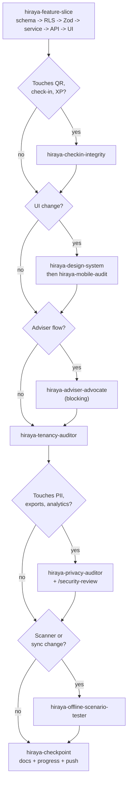

# Hiraya — Skills and Agents

**Status:** Approved for Phase 0 · **Version:** 1.0 · **Last updated:** 2026-09-21

The capabilities needed to build and maintain Hiraya: six project skills, five project agents, the
platform skills and MCP servers worth reaching for, and how to combine them.

---

## 1. Skills vs agents — why both

**Skills are procedures followed inline.** They encode the right order to do something in this codebase.
They keep working context in the main session, where it is needed.

**Agents are delegated work in a separate context.** Two jobs qualify: broad read-only sweeps that would
flood the main context with file dumps, and *adversarial review that must not be biased by the reasoning
that produced the code*. The second is the important one — an auditor that watched you write the code
has already accepted your assumptions.

**Nothing appears in both lists.** Where a concern needs both an implementation procedure and a review
pass, the procedure is a skill and the review is an agent, with a named boundary between them.

None of these are generic. There is no "write tests" or "review code" skill here, because the platform
already does those. Each of the ten below encodes something specific to Hiraya that is cheap to violate
and expensive to discover late.

---

## 2. Project skills

### `hiraya-next`

**Purpose.** Answer one question — *what should I build next?* — and end with the literal line to type.

**Trigger.** The start of any session; after a PR merges; "what's next", "where are we", "what's
blocked". Invocable directly as `/hiraya-next`.

**Inputs.** `git log main`, open PRs, `docs/WORKSTREAMS.md` §0 and its task tables, the current phase's
unticked acceptance criteria, and the newest `docs/PROGRESS.md` entry.

**Workflow.** Gather state → reconcile it against §0 → sort every open task into WAITING, BLOCKED ON
YOU, NEXT or QUEUED → report at most three under NEXT, and finish with one `→ Type:` line.

**Output.** A short status block and a single prompt to type. Read-only; it never edits or builds.

**Why it exists.** A task board answers "what is open"; it does not answer "what do I do now", and the
gap between those two is where a session stalls. It also reports *reality over the board* when the two
disagree, which makes a stale checkpoint visible instead of quietly misleading.

---

### `hiraya-feature-slice`

**Purpose.** Build a feature in the order that makes tenancy and validation impossible to forget.

**Trigger.** Starting any new module or feature; adding an endpoint; extending an existing slice.

**Inputs.** Feature name, the PRD requirement IDs it satisfies, the roadmap phase.

**Workflow.** Schema → RLS policy → Zod contract → `service.ts` → `/api/v1` handler → UI → tests.

**Output.** A vertical slice, plus a named list of which agents the resulting diff requires.

**Why this order.** RLS comes second, before any code can read the table. A policy written after the
queries is a policy written around the queries — it ends up permitting what the code already does rather
than what the rules allow.

---

### `hiraya-checkin-integrity`

**Purpose.** Correctly *write* code on the QR → check-in → XP path, where the product's core claim lives.

**Trigger.** Any diff touching `lib/qr`, `features/checkin`, `features/xp`, the scanner, the sync
endpoint, or the ledger schema.

**Inputs.** The diff and which part of the path it touches.

**Workflow.** Verify asymmetric signing and that no private key can reach a device → verify expiry and
skew handling → verify idempotency key → verify the ledger stays append-only → verify server-side window
validation → write the matching tests.

**Output.** Code plus tests, and an explicit statement of which threat (T2–T7 in `docs/SYSTEM_DESIGN.md`)
each change affects.

**Boundary.** This skill *writes*. `hiraya-offline-scenario-tester` *tests*. Both exist because writing
the code correctly and proving it survives a hostile network are different jobs.

---

### `hiraya-mobile-audit`

**Purpose.** Prove a UI change works on the device learners actually own.

**Trigger.** Any user-facing UI change, before merge.

**Inputs.** The route(s) changed.

**Workflow.** Playwright at 360×800 → a11y tree snapshot for WCAG AA → `browser_network_requests` against
the 500 KB budget → offline behaviour → home-screen PWA install (D35: there is no native shell to
check parity against).

**Output.** Pass/fail per criterion with specific violations, never a general impression.

**Why the a11y tree rather than a screenshot.** A screenshot shows what a page looks like; the
accessibility tree shows what it *is*. Contrast failures, missing labels, and broken heading order are
invisible in an image and obvious in the tree.

---

### `hiraya-design-system`

**Purpose.** Keep one visual language across two registers and inside a hard performance budget.

**Trigger.** Any new screen or component; any new asset.

**Inputs.** The surface and which register it belongs to (learner vs adviser/admin).

**Workflow.** Confirm the register → use tokens only, never literal hex → check contrast against the
token table → reject raster where SVG works → confirm 360px layout → confirm both locales have strings.

**Output.** A component consistent with `docs/DESIGN_SYSTEM.md`, or a specific list of deviations.

**Hard rejections.** Any daily-streak UI (FR-5.10 bans it). Raster art where SVG would do. `--ink-subtle`
used for body text. Meaning carried by color alone. A bare string literal in JSX.

---

### `hiraya-checkpoint`

**Purpose.** Keep docs, progress log, and the remote current — automatically, on real milestones.

**Trigger.** Any of the six in CLAUDE.md §7: phase complete or gate passed; feature slice merged; schema
migration landed; decision added or changed; risk materialized or retired; stack or dependency changed.
Also invocable directly as `/hiraya-checkpoint`.

**Inputs.** Git history since the last checkpoint tag.

**Workflow.** Read `git log` and `git diff --stat` → map changes to affected docs → append a dated entry
to `docs/PROGRESS.md` → run consistency checks → commit, push per D16, tag at phase boundaries.

**Output.** Updated docs, a new PROGRESS entry, a pushed commit, and an explicit list of any
contradictions found.

**The rule that matters.** When documents disagree, **report it — never silently resolve it**. A doc set
that quietly contradicts itself is worse than one that flags the conflict, because trust in it decays
invisibly and you find out when you rely on it.

---

## 3. Project agents

All are read-only (no Edit/Write) except the offline tester, which needs Playwright MCP.

### `hiraya-tenancy-auditor`

**Purpose.** Prove no path can read across schools.

**Trigger.** Any migration, new table, or new query path. Mandatory before a phase closes.

**Checks.** Every table has `school_id NOT NULL` · RLS enabled on every table · a policy exists and
compares against `current_school_id()` · no `db/admin.ts` import outside its allowlist · no raw SQL
bypassing RLS · the cross-tenant denial test exists and passes.

**Why an agent.** It reads the whole schema and every query file. Inline, that is a context flood for a
result that is one line long.

---

### `hiraya-privacy-auditor`

**Purpose.** Adversarial review against RA 10173 and DepEd child protection.

**Trigger.** Any diff touching PII, exports, analytics, or the forum. Mandatory before Gate B.

**Checks.** Data minimization — is anything collected that is not on the approved list? · LRN never
returned below School Admin or rendered to a learner · no PII in logs, Sentry, or error text · no
adult↔learner private channel · non-participant list restricted and audited · `audit_log` written on
sensitive access · consent gating intact · retention honoured.

**Why an agent.** Separate context is the entire point. An auditor that watched the code being written
has already absorbed the assumptions that need challenging.

---

### `hiraya-gamification-balancer`

**Purpose.** Find ways to earn XP without doing the thing XP is meant to reward — and find out whether
the reward system is discouraging the learners it was built for.

**Trigger.** Changing `xp_rules` or level thresholds; pilot data showing farming or decay; before launch;
monthly during the pilot.

**Checks.** Exploit search — cheapest path to high XP, self-approval loops, feedback farming, colluding
officers · concentration — top-decile XP share · decay — weekly-active trend after week 3 · fairness —
can a learner with one free afternoon a week still reach Lingkod? · verification — does every rule trace
to a confirmed action?

**Output.** Named exploits with the path to reproduce them, plus concrete point-value proposals.

**Why it exists.** Point farming and novelty decay are the proposal's own #1 and #4 risks, and neither is
a code review question. This agent reasons about the economy, not the implementation.

---

### `hiraya-adviser-advocate`

**Purpose.** Role-play a teacher with five sections and no spare hours, and reject flows that add work.

**Trigger.** Designing or changing any flow an adviser performs. **Blocking gate** on event approval
(Phase 2) and the accomplishment report (Phase 2).

**Checks.** Tap count from notification to done (approval must be ≤3) · decisions required · minutes per
event vs. the paper process it replaces · is everything needed to decide on one screen? · does it work
one-handed on a phone, between classes? · does it ever require a laptop?

**Output.** A verdict — faster or slower than paper — with the count, and specific cuts.

**Why it exists.** "Advisers see it as extra work" is rated Medium/High and is what actually kills school
platforms. A flow that is elegant and slower than a signature on paper is a failure, and no code review
would catch it.

---

### `hiraya-offline-scenario-tester`

**Purpose.** Prove check-in survives a hostile network.

**Trigger.** Any change to the scanner, the queue, or `/checkins/sync`. Mandatory before Phase 3 closes
and again after Phase 5 native packaging.

**Matrix.** Queue while offline → sync on reconnect · replay a full queue (must be a no-op) · duplicate
scan of the same learner · device clock ±10 minutes · disconnect mid-sync · capacity race at the
boundary · force-quit and restart with a queue pending · expired token · wrong-event token ·
wrong-school token · 15+ scans/minute sustained.

**Output.** Pass/fail per scenario with reproduction steps.

**Tools.** Playwright MCP, with network emulation.

---

## 4. Platform skills and MCP servers

| Capability | When |
|---|---|
| **Playwright MCP** | The primary verification tool. `browser_resize` 360×800, `browser_snapshot` for the a11y tree, `browser_network_requests` for the budget, offline emulation for sync |
| **IDE MCP** (`getDiagnostics`) | TypeScript errors without a full rebuild |
| `dataviz` skill | **Required** before writing any chart — analytics dashboard, participation charts, health signals |
| `frontend-design` skill | Visual direction when creating a genuinely new surface |
| `security-review` skill | **Mandatory** on any diff touching auth, RBAC, tenancy, QR, or PII |
| `code-review` skill | Before merging a substantial slice |
| `run` skill | Launching the app to confirm a change works for real |
| **Claude Docs MCP** | Only when a human-shareable document is explicitly asked for. Repo Markdown is the default; nothing here is duplicated there |

**Do not spawn general-purpose subagents for ordinary work.** The five project agents are scoped; use
them for what they cover and handle everything else inline.

---

## 5. Combined workflow

### Building a feature

### By phase

| Phase | Skills | Agents |
|---|---|---|
| **0** Foundation | design-system, feature-slice, mobile-audit | tenancy-auditor |
| **1** Identity, orgs | feature-slice, design-system, mobile-audit | tenancy-auditor, **privacy-auditor** |
| **2** Events | feature-slice, design-system, mobile-audit | **adviser-advocate (blocking)**, tenancy-auditor |
| **3** Check-in, XP | **checkin-integrity**, feature-slice, mobile-audit | **offline-scenario-tester**, gamification-balancer, tenancy-auditor |
| **4** Visibility | design-system, mobile-audit + `dataviz` | privacy-auditor, gamification-balancer |
| **5** Native | mobile-audit | offline-scenario-tester (re-run on the shell) |
| **6** Hardening | all | **all five must run clean** |
| **7** Pilot | checkpoint | gamification-balancer monthly |

`hiraya-checkpoint` runs at every one of the six triggers, in every phase.

---

## 6. Human skills this project needs

Not everything is automatable. The build also depends on:

- **Stakeholder conversation** — Gate A is won in a room with a teacher, not in a repo.
- **Plain-language privacy writing** — the notice and consent form must be readable by a guardian who is
  not technical and may not read English comfortably.
- **Filipino translation** — the Phase 2 locale is best authored by SSLG officers, which also builds the
  ownership the handover depends on.
- **Training and handover** — the custodian relationship is the difference between a pilot and a system
  that survives.

These carry the same weight as the technical work. A platform nobody was trained to run is a platform
that stops.

---

## 7. Related documents

`CLAUDE.md` §9 · `docs/MILESTONE_ROADMAP.md` for testing checkpoints per phase ·
`docs/WORKSTREAMS.md` for which lane owns which agent run · `CONTRIBUTING.md` §7 for the three that
matter most on the data lane · `.claude/skills/` and `.claude/agents/` for the definitions themselves.
