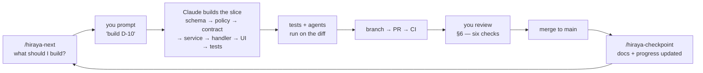

# Hiraya — Build Guide

**Status:** Active · **Version:** 1.0 · **Last updated:** 2026-09-22

**How Hiraya actually gets built, one task at a time.** `docs/MILESTONE_ROADMAP.md` says *what* and in
*what order*. `docs/WORKSTREAMS.md` says *who* and *what is next*. This document says **how** — the
loop you run every session, what you type, what happens, and what you check before it lands.

Written for someone early in their career who builds with Claude Code. Nothing here is dumbed down —
the technical terms stay, because you are going to need them at Gate B when a DPO asks you what RLS is.
Each one is defined the first time it appears, in §2.

> **The one sentence the whole project hangs on:** *a point in Hiraya means a teacher confirmed you were
> there.* Every rule below exists to keep that sentence true. When a shortcut would make it falsifiable,
> the shortcut is wrong even when it works.

---

## 1. The loop

Building this project is one loop, repeated. Not a big-bang build.



One turn of this loop is **one task** from the board — not one feature, not one phase. A task is sized
to be reviewable in one sitting. That sizing is deliberate, and §3 explains why it is the right default
for you specifically.

**Where you sit in the loop:** you start it (§3), you review it (§6), and you do the handful of things
nobody can do for you (§5). Everything between is automated, and the automation is checked by tests, by
CI, and by five adversarial agents that read the diff without having written it.

---

## 2. The vocabulary

The terms that appear in every other document. Learn these and the rest of the docs open up.

| Term | What it means here | Why you should care |
|---|---|---|
| **Phase** | A numbered block of the roadmap (0–7). Closed by its acceptance criteria, never by a date | Building Phase 2 work during Phase 1 produces a phase nobody can honestly tick as done |
| **Gate** | A decision that cannot be coded past. **Gate A** = the school says yes. **Gate B** = DPO review, signed agreement, guardian consent, repo transferred | Gate B is the line before which **no real learner data exists anywhere**. It is a legal boundary, not a milestone |
| **Lane** | A *kind* of work — D (data and API), P (product surface), Q (quality and docs). Anyone can claim any lane | Lanes stop two people editing the same file on the same day. They are not job titles |
| **Slice** | One feature built top to bottom: table → policy → contract → service → endpoint → screen → tests | The unit of work. A slice that stops at "the endpoint works" is half a slice |
| **Migration** | A numbered `.sql` file in `drizzle/` that changes the database shape. Generated by `npm run db:generate` | Applied migrations are **permanent history**. You never edit one that has run — you write a new one that corrects it |
| **RLS** — Row-Level Security | Postgres rules deciding which *rows* a query may see, enforced by the database itself | This is rule R1. It is why a learner in school A physically cannot read school B's rows even when application code has a bug |
| **Policy** | One RLS rule, written in `src/db/rls/*.sql` | Every table has one. A table without a policy is a table the database will not protect |
| **Tenancy** | Keeping one school's data separate from another's, via `school_id` on every table | The demo seeds two schools specifically so a test can prove the separation holds |
| **Claims** | Facts stamped into your login token — who you are, which school, which role | RLS policies read these. `current_school_id()` is a claim being read by the database |
| **Zod contract** | `features/<f>/schema.ts` — the shape of a request and its response, as runnable code | Rule R7. It is also the **handshake**: it merges before anyone builds either side (§4) |
| **Service** | `features/<f>/service.ts` — the business logic, the only place it lives | Services throw domain errors and know nothing about HTTP. Handlers translate |
| **Handler** | A file under `src/app/api/v1/` — thin. Parse with Zod, call the service, map errors | Rule R3: this is the **single data layer**. Web and the future mobile app both call it |
| **Ledger** | `xp_ledger` — append-only. No UPDATE, no DELETE, for anyone, including admins | Rule R4. A correction is a *reversal row*. A points record you can edit is a points record nobody believes |
| **Idempotent** | Doing it twice has the same effect as doing it once | Rule R6. Offline scan queues get replayed. Always. Assume it |
| **Seed** | Synthetic demo data — `npm run db:seed:demo`. 44 fake people, 6 orgs, 12 events | It renders its own "DEMO DATA" marker. There is no real data to leak because there is none |
| **Fixture** | Fake data a screen renders from before its endpoint exists | Temporary by design. A fixture that outlives its endpoint becomes a second source of truth for what the API returns |
| **CI** | GitHub Actions — typecheck, lint, tests, migration check, on every push and PR | Since PRs now self-merge on green (§5), CI is the **only** automated gate. Treat red CI as a full stop, never as noise |
| **Agent** | An adversarial reviewer in a fresh context — five of them, in `.claude/agents/` | They did not write the code, so they have not accepted its assumptions. That is the entire value |

---

## 3. How to start work — the three prompts

### Prompt A — one task *(recommended, and here is why)*

```
build D-10
```

That is the whole prompt. The task id comes from the board in `docs/WORKSTREAMS.md`, or from
`/hiraya-next`, which hands you the exact line to type.

**This is the right default for you right now**, for one honest reason: **your review capacity is the
bottleneck, not the typing.** A one-task PR is 200–400 lines and you can walk every screen it touches.
A whole-phase PR is several thousand lines across a dozen files, and reviewing it degrades into
scrolling until it looks fine. On a project holding minors' data, where PRs now merge themselves on
green CI, "it looked fine" is not a review.

A one-task loop also fails cheaply. If a slice takes the wrong shape, you have lost one slice — not a
phase.

### Prompt B — a whole phase

```
build Phase 1
```

Claude plans the phase, breaks it into the board's tasks, and works them in dependency order —
**stopping at each task boundary** so you can review before it continues. Same loop, batched.

**Use this from Phase 4 onward**, once you have watched the loop enough times to tell a good slice from
a bad one at a glance. Phase 3 (check-in and XP) is the one phase never to batch: it is the highest-risk
phase in the plan, offline sync is the hardest thing in the build, and it is where the product's core
claim is either true or false.

### Prompt C — anything else

```
why does the leaderboard hide me?
fix the failing test in checkin-xp.test.ts
explain what award_checkin_xp does, line by line
```

Free-form. Worth using far more than you would expect — **"explain X" costs nothing and is where the
learning actually happens.** You are going to be the person answering a DPO's questions about this
system. Asking it to explain its own SQL is not a detour from the build; it is part of it.

### Starting a session

```
/hiraya-next
```

Reads the board and the repository state and reports the current phase, what just landed, the next
tasks you can prompt, what is blocked on *you*, and what is waiting on a merge. It ends with the exact
line to type next. Start every session with it.

---

## 4. What happens when you prompt a task

Seven steps, always in this order. The order is the point — it puts the security-critical layers
*before* the code that would otherwise be written around them. This is the `hiraya-feature-slice` skill.

| # | Step | What lands | Why it is here and not later |
|---|---|---|---|
| 1 | **Drizzle schema** | A table in `src/db/schema.ts`, `school_id` included | Rule R1: there is no such thing here as a table without a tenant column |
| 2 | **RLS policy** | `src/db/rls/<table>.sql` | Written **before** any query. A policy written after the queries permits whatever the code already does instead of what the rules allow — the single most common way tenancy quietly breaks |
| 3 | **Zod contract** | `features/<f>/schema.ts` | The handshake. Merges in its own small PR *first*, so screen work and endpoint work proceed at once with nothing to renegotiate at the end |
| 4 | **Service** | `features/<f>/service.ts` | Business logic, once. Throws domain errors, knows nothing of HTTP |
| 5 | **Handler** | `src/app/api/v1/.../route.ts` | Thin: Zod-parse, call service, map errors. Rule R7 |
| 6 | **UI** | `features/<f>/components/` and a route-group screen | Typed off `z.infer` of step 3, so it cannot drift from the API |
| 7 | **Tests** | `tests/unit/` and `tests/integration/` | Including the cross-tenant denial case whenever a table was added |

Then, depending on what the diff touched, the agents run **on the finished diff**:

| If the diff touches | This runs | It is checking |
|---|---|---|
| A migration, a new table, a new query path | `hiraya-tenancy-auditor` | Missing `school_id`, absent RLS, service-role leaks |
| PII, exports, analytics, the forum | `hiraya-privacy-auditor` | LRN exposure, PII in logs, adult↔learner contact paths |
| QR, check-in, XP, the ledger | `hiraya-checkin-integrity` + `/security-review` | Signing, expiry, idempotency, append-only grants |
| The scan queue or sync | `hiraya-offline-scenario-tester` | Replay, clock skew, mid-sync disconnect, capacity races |
| Any flow a teacher performs | `hiraya-adviser-advocate` | **Blocking gate** — a flow that adds work for an adviser is rejected |
| Any user-facing UI | `hiraya-mobile-audit` | 360×800, WCAG 2.1 AA, ≤500 KB first load |

**A lesson this project already learned, worth internalizing.** On 2026-09-22 `hiraya-tenancy-auditor`
returned CLEAN twice and `hiraya-privacy-auditor` found nothing critical — and `/security-review` still
found two real authorization holes in the same diff. Three passes, three different findings. **No single
clean audit is sufficient.** That is not pessimism about the tools; it is how review actually works.

---

## 5. Who does what

### Claude does these without asking (standing permission, granted 2026-09-22 — D32)

- Commits as work lands, pushes feature branches, opens PRs with the checklist filled in
- Runs local database commands: `db:migrate`, `db:rls`, `db:verify-rls`, `db:seed:demo`, `npm test`
- Applies migrations and RLS to the Supabase project through the Supabase MCP server
- **Squash-merges its own PRs into `main` once CI is green**

Never, under any permission: a force-push, a rewrite of `main`'s history, a direct push to `main`, an
edit to an applied migration, or a `docs/PROGRESS.md` entry rewritten rather than appended.

> **What the self-merge grant costs, stated plainly.** CI is now the only thing standing between a diff
> and `main`. That is a real reduction in safety and you should know its exact shape. CI runs typecheck,
> lint (which is what enforces the service-role import ban), the full test suite including cross-tenant
> denial, and the migration consistency check. It does **not** catch a bad product decision, a confusing
> screen, or a policy that is technically valid and substantively too permissive. Those remain yours, in
> §6. Recorded as **D32** in `docs/TECHNICAL_ARCHITECTURE.md` with its trade-off.

### Claude asks first — with `AskUserQuestion`, never a question buried in prose

Per `CLAUDE.md` §11: a rule in §3 or §6 in tension with the request; a phase or gate about to be
crossed; anything irreversible or outward-facing; a design fork whose cost differs in schema shape or
authorization path; docs and code disagreeing; a risk surfacing mid-task; scope about to grow.

### Only you can do these

Nothing in this list can be delegated, and nothing should ever be *planned* as though it could.
Step-by-step instructions for each live in **`docs/SETUP_GUIDE.md`**.

| # | Task | Where | Roughly |
|---|---|---|---|
| 1 | Create and hold the Supabase, Vercel and GitHub accounts | `SETUP_GUIDE.md` §2–§4 | one-time |
| 2 | Generate and hold the real secrets — service-role key, `LRN_HMAC_PEPPER`, `QR_SIGNING_PRIVATE_KEY` | §3, §6 | one-time, then rotations |
| 3 | Deploy to Vercel and hold the public demo URL | §5 | per phase |
| 4 | **Gate A** — walk the demo to the ICT coordinator and SSLG adviser, on a phone, in person | §8 | once |
| 5 | **Gate B** — DPO review, signed processor agreement, guardian consent, repository transfer | §9 | once, before any real data |
| 6 | Invite collaborators and set repository visibility | §7 | as needed |
| 7 | Buy the Google Play ($25 once) and Apple ($99/year) developer accounts | §10 | Phase 5 |

Items 4 and 5 decide whether this project becomes real. They are conversations with people and they
move at the school's pace — start Gate B's paperwork while Phases 5 and 6 are still being built, not
after.

---

## 6. Reviewing a PR when you cannot read every line

You will not read 400 lines of SQL and spot a missing policy. Nobody does, reliably. Check these six
things instead. Each catches a *class* of failure rather than an instance.

```bash
gh pr checks             # 1. is CI green? if not, stop here
gh pr diff --name-only   # 2. what files does this touch?
```

1. **Is CI green?** Red CI is a full stop. It is the only automated gate left.
2. **Does the file list match the task?** A registration task touching `src/lib/db/admin.ts` or
   `src/design/tokens.css` is a question, not a detail. Ask: *why is this file in this PR?*
3. **New table → is its `src/db/rls/<table>.sql` policy and its fixture in
   `tests/integration/helpers/fixtures.ts` in the same PR?** If either is missing, that is the bug.
   `.github/pull_request_template.md` asks for exactly this.
4. **Run it.** `npm run dev`, open `/demo`, pick a persona, click the thing the task built. Two minutes.
   This catches more real problems than reading the diff does.
5. **Look for hardcoded user-facing strings** in any new `.tsx`. Every string goes through `next-intl`,
   in **both** catalogues. Retrofitting i18n across a finished UI is the refactor that never happens.
6. **Ask for the tour.** Type `walk me through PR #12 and tell me what could go wrong with it`. Make it
   argue against its own work. This is the highest-value two minutes in the review.

If something feels wrong and you cannot articulate why — **say exactly that.** "I don't understand why
this needs a SECURITY DEFINER function" is a completely legitimate review comment. The answer either
teaches you something or exposes something.

---

## 7. When it breaks

In order. Stop at the first one that explains it.

| Symptom | First thing to check |
|---|---|
| `npm test` fails on a clean clone of `main` | That is a `main` problem, not yours. Say so — do not start fixing around it |
| Tests refuse to run at all | `TEST_DATABASE_URL` equals `DATABASE_URL`. The suite disables RLS mid-test and will not do that to a database that could hold something real. Use two databases |
| A query returns nothing and you expected rows | Almost always a missing **policy** or a missing **claim** — not a permissions problem to solve with the admin client. Reaching for `src/lib/db/admin.ts` here is the wrong instinct, and lint will stop you |
| `npm run db:verify-rls` fails | Read the failure text; it names the invariant that did not land. Do not proceed to seed or deploy |
| A screen shows fake data | `NEXT_PUBLIC_HIRAYA_FIXTURES=on` is set in `.env.local`. Unset it to see the truth |
| Supabase is unreachable before a pitch | **R13** — the free project pauses when idle. Wake it the morning of, every time |
| A migration went in wrong | Write a **new** migration correcting it. Never edit or delete an applied one |

---

## 8. Definition of done, for one task

Not "the code works". All of these:

- [ ] `npm run lint && npm run typecheck && npm test` pass locally
- [ ] A new table has its RLS policy **and** its fixture, in this same PR
- [ ] `npm run db:verify-rls` passes
- [ ] Every new endpoint Zod-parses its input at the boundary (R7)
- [ ] No new import of `src/lib/db/admin.ts` — or a comment in the D-table saying why
- [ ] No LRN, name, section or email in any log line, error, or response below School Admin (R8)
- [ ] New strings go through `next-intl`, in **both** catalogues
- [ ] `.env.example` updated if a variable was added
- [ ] The required agents ran **on the finished diff**, not while it was being written
- [ ] The task is struck from the board in `docs/WORKSTREAMS.md`, naming the commit that closed it

The last line is not bookkeeping. A board describing last month's plan is worse than no board, because
people read it and act in opposite directions.

---

## 9. Learning path

You are building this to learn it. Here is the order the project itself teaches, and the one concept per
phase worth stopping to genuinely understand rather than accept.

| While building | Stop and learn | Ask Claude |
|---|---|---|
| **Phase 0** (now) | **Row-Level Security.** Why tenancy in the database beats tenancy in application code | `explain the RLS policy on profiles, line by line` |
| **Phase 1** | **Authentication vs authorization**, and how a JWT claim reaches an RLS policy | `trace what happens to my claims from login to a policy check` |
| **Phase 2** | **State machines.** Draft → submitted → approved → published, and why an illegal transition must be impossible rather than merely unused | `show me every state an event can be in and what moves it` |
| **Phase 3** | **Idempotency and asymmetric cryptography.** Why the officer's phone holds only a public key | `why is the QR scheme asymmetric instead of a shared secret?` |
| **Phase 4** | **Query performance.** Why a leaderboard reads a snapshot instead of aggregating a ledger per request | `what would break if the leaderboard aggregated the ledger live?` |
| **Phase 5** | **Build targets.** How one `src/` becomes a PWA and two native binaries | `what exactly does cap sync do to my Next.js build?` |
| **Phase 6** | **Threat modelling.** Reading your own system the way an attacker would | `pretend you are a student trying to farm XP. what do you try?` |

Two habits worth more than any of the above.

**Read the diff before you merge it, every time, even when you do not follow all of it.** Pattern
recognition comes from exposure, not from study. Six weeks of this and you will notice the odd file in a
PR without thinking about it.

**Learn to write the tests, even while Claude writes the features.** A test is where you state what you
believe to be true. The two tests this project refuses to ship without — a user from school A cannot
read any row of school B, and replaying a full offline scan queue produces zero duplicate XP — are the
two sentences the entire product rests on. Being able to write that kind of test yourself is what makes
you the person who *owns* this system rather than the person who prompted it.

---

## 10. Related documents

| Document | When you need it |
|---|---|
| [`docs/SETUP_GUIDE.md`](SETUP_GUIDE.md) | Anything only you can do — accounts, secrets, deploys, gates |
| [`docs/WORKSTREAMS.md`](WORKSTREAMS.md) | What is next, who owns what, what blocks what |
| [`docs/MILESTONE_ROADMAP.md`](MILESTONE_ROADMAP.md) | Phases, gates, acceptance criteria, the risk register |
| [`CONTRIBUTING.md`](../CONTRIBUTING.md) | Onboarding a contributor, local setup, PR rules |
| [`CLAUDE.md`](../CLAUDE.md) | The eight architecture rules and the privacy rules, in enforceable form |
| [`docs/PROGRESS.md`](PROGRESS.md) | What every past session actually did, newest first |
