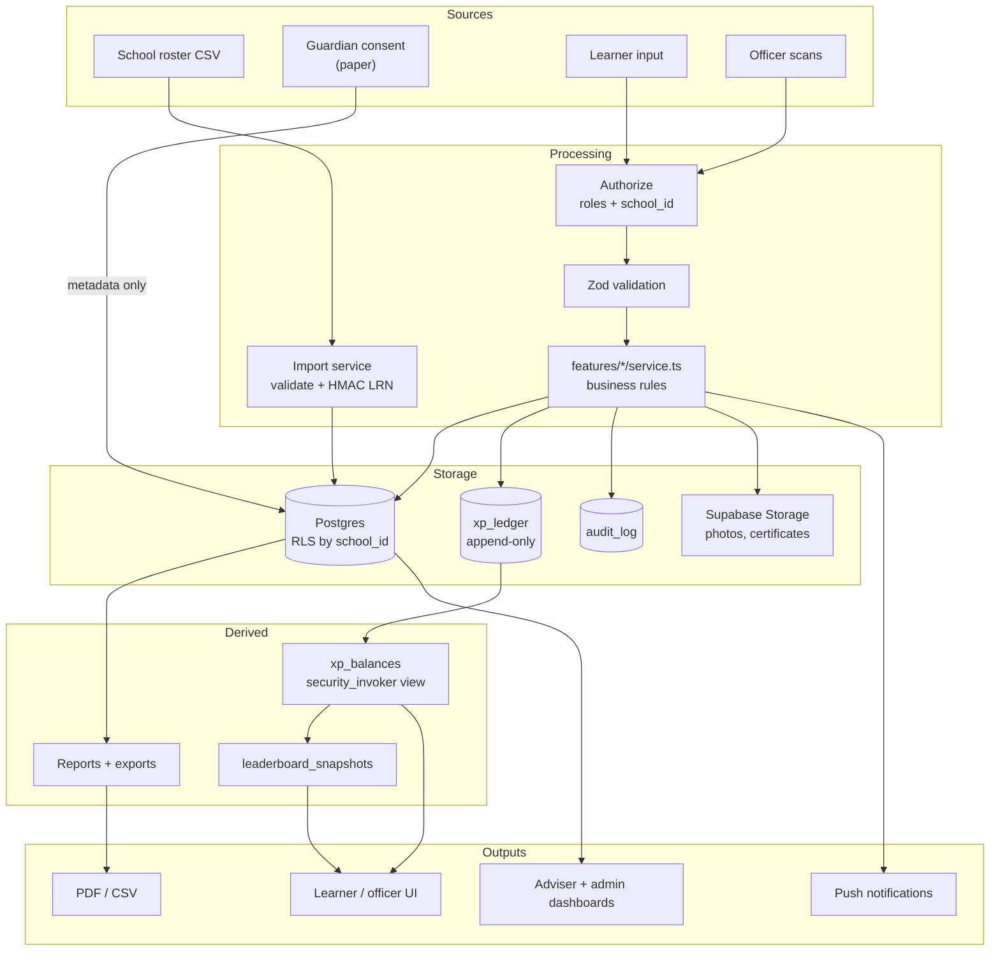
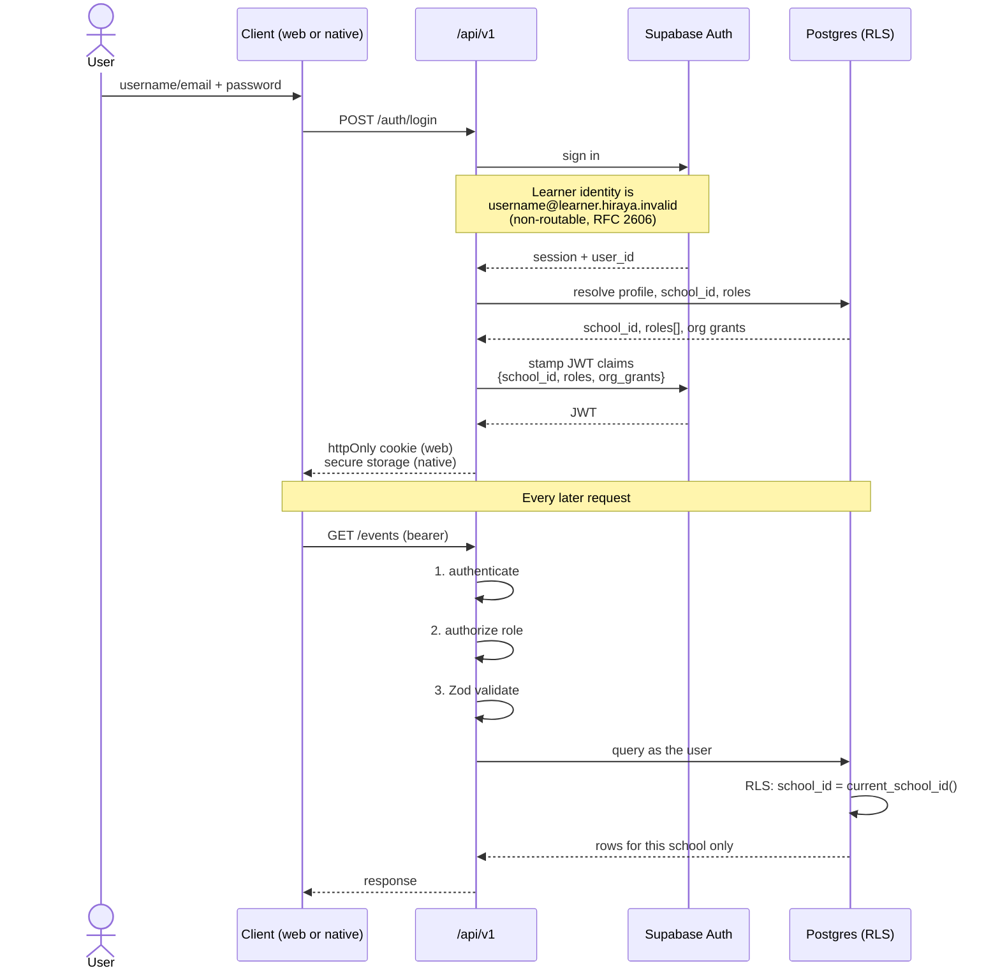
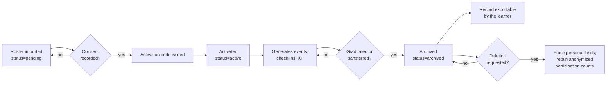
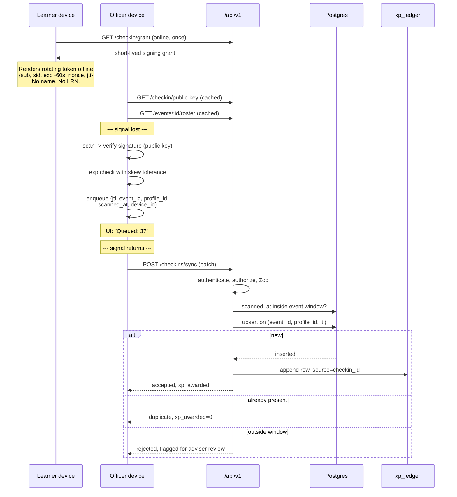

# Hiraya — Data Flow

**Status:** Approved for Phase 0 · **Version:** 1.0 · **Last updated:** 2026-09-21

Where data comes from, how it moves, how long it lives, and how the sensitive parts are handled. Entity
definitions live in `docs/SYSTEM_DESIGN.md` §4.

---

## 1. Sources and destinations

### Inputs

| Source | Data | Entry point | Sensitivity |
|---|---|---|---|
| School roster (CSV, from the school) | Name, grade, section, LRN or school ID | `POST /admin/import` | **High — minors' PII** |
| Guardian consent (paper) | Consent granted, date, recorded by | `consent_records` (metadata only) | **High** |
| Learner | Password, avatar choice, locale, board visibility, registrations, feedback | App | Medium |
| Org Officer | Event drafts, org profile, photos, scans | App | Low–Medium |
| Org Adviser | Approvals, rejection reasons, manual overrides | App | Low |
| School Admin | Orgs, adviser assignments, point rules, module toggles | App | Low |
| Officer device | Queued scans `{jti, event_id, profile_id, scanned_at, device_id}` | `POST /checkins/sync` | Medium |
| Learner device | Rotating signed QR token | Scanner | Low (short-lived, no PII in payload) |

### Outputs

| Destination | Data | Trigger | Control |
|---|---|---|---|
| Learner | Own profile, XP ledger, rank, record | In-app | Own records only |
| Leaderboards | Display name, avatar, **grade level, section**, XP, rank, level title | Published | Opt-out honoured — a hidden learner is absent from the rows entirely and still sees their own rank; **no LRN**. Org boards are readable school-wide, like the org directory itself (FR-2.5) |
| Org Officer | Event roster, attendance, report | Own org events | Org-scoped |
| Adviser / guidance | Participation analytics, non-participant list | In-app | Role-restricted, **every access audited** |
| School Admin | All school data, full export | On demand | School-scoped |
| PDF / CSV exports | Attendance, accomplishment reports, Co-curricular Record | On demand | Generated server-side, never cached publicly |
| Public verification page *(P2)* | Only the entries a learner chose to share | Certificate QR scan | Learner-controlled subset |
| Push services (FCM / APNs / Web Push) | Notification title + body, no PII beyond a display name | Event | Minimal payload |
| Sentry | Errors with `profile_id` only | Error | `beforeSend` scrubber |
| Resend (email) | **Staff addresses only** | Staff account events | Learners have no email |

**Data that deliberately never exists:** home address, birthday, guardian contact details, family data,
photographs of learners, grades, class attendance, health information, precise geolocation, and any
advertising identifier.

---

## 2. End-to-end flow

Note the one-way arrow into `xp_ledger`: data enters and is never modified. Everything a learner sees
about their points is derived from it.

---

## 3. Authentication flow

### Authorization, in two deliberately redundant layers

1. **RLS in the database.** `current_school_id()` reads the JWT claim; every policy compares `school_id`
   against it. This catches anything a handler forgets.
2. **Explicit role checks in each handler.** These produce a useful error (`FORBIDDEN`, and *which* role
   is needed) where RLS alone would silently return an empty set.

The redundancy is intentional. RLS is the guarantee; the handler check is the good experience.

**Activation is consent-gated.** `POST /auth/activate` refuses with `CONSENT_REQUIRED` unless a
`consent_records` row exists for that profile. There is no path around it — this is the technical
expression of the processor arrangement, not a courtesy.

---

## 4. Sensitive data handling

| Data | At rest | In transit | Who can read | Never |
|---|---|---|---|---|
| **LRN** | `lrn_hmac` only — HMAC-SHA256 with a server pepper, in its own table `profile_identifiers` | TLS; only during import | School Admin (match, not value) | Returned below School Admin; shown to a learner; logged |
| Name, grade, section | Plain in Postgres, RLS-protected | TLS | Own + school staff by role | Logged; sent to Sentry; in a push payload beyond a display name |
| Password | Supabase Auth (bcrypt) | TLS | No one | Logged or exported |
| Consent record | Metadata only — granted, date, recorder, paper reference | TLS | School Admin, DPO | **Scans or images of consent forms are never uploaded** |
| QR token | Not stored; `jti` retained for de-duplication | Displayed on screen | — | Contains no name or LRN |
| Signing key | **Private:** server environment only. **Public:** cached on devices | TLS | — | In the repo; in any client bundle or service-worker cache; in a log |
| Non-participant list | Derived at query time, never materialized | TLS | Guidance + advisers, **audited** | Exported casually; shown to officers or learners |
| Event photos | Supabase Storage, access-controlled | TLS | School-scoped | Public buckets |
| Avatars | Curated SVG keys — a reference, not an upload | — | Anyone | Photo uploads do not exist |

**The reasoning behind two of these**, because they are the ones most likely to be "improved" by a future
session into something worse:

- *LRN as HMAC.* Import must recognize the same learner across re-runs without the system ever being able
  to display an LRN. A hash gives matching without retrieval. If a future requirement genuinely needs the
  plaintext LRN back, that is a new decision requiring DPO review — not a quiet schema change.
- *Consent metadata, not scans.* Storing photographs of signed forms would create a store of guardian
  signatures and handwriting, for no functional gain. The metadata proves consent exists; the paper stays
  with the school.

---

## 5. Lifecycle and retention

| Data | Retention | Basis |
|---|---|---|
| Active learner profile | While enrolled | Service delivery |
| Archived profile | Archived on graduation or transfer; retained while the school needs the record | School recordkeeping |
| XP ledger | Retained with the profile — **append-only, never deleted** | Auditability; the Co-curricular Record depends on it |
| Check-ins | Retained with the event | Attendance record |
| Consent records | Retained as long as the profile exists, plus the school's required period | Proof of lawful basis |
| `audit_log` | 2 years minimum | Accountability |
| Event photos | Per school policy; deletable by the org | Org-owned |
| Push tokens | Cleared on logout or 90 days idle | Minimization |
| Sentry events | 90 days (default retention) | Debugging |
| Demo tenant data | Deleted when the demo is retired | Synthetic; no basis needed |

**Deletion.** A learner may request deletion except for records the school must keep. Honouring it
erases personal fields (`display_name`, `avatar_key`, and the whole `profile_identifiers` row) and retains anonymized participation
counts, because removing ledger rows would corrupt the leaderboard history of every other learner. The
ledger row survives; the person it points at does not. This trade-off should be stated in the privacy
notice in plain language rather than buried.

**Data subject rights.** View, correct, and download own data — all available in-app under
`/me`. Export is a first-class feature, not a support request (NFR-12).

---

## 6. The check-in data path, in detail

The most sensitive and highest-volume path in the system.

**Three properties worth stating explicitly:**

- The QR payload carries **no personal data** — an identifier, a school, an expiry, a nonce. A
  photographed code reveals nothing about the learner.
- The officer device holds a **roster and a public key**, never a secret and never an LRN.
- A scan outside the event window is **flagged, not discarded**. Discarding hides a clock problem;
  flagging lets an adviser resolve it and lets you find the misconfigured device.

---

## 7. Demo tenant data

The demo tenant (Phase 0, for the school pitch) contains **only synthetic data**.

- Fake school name, fake org names, obviously fictional learner names.
- `schools.is_demo = true` drives a persistent **"DEMO DATA"** marker in the UI, so no one mistakes it
  for a real record — including the person being pitched to.
- Seeded via `npm run db:seed:demo` from committed files under `/seed/demo-*`.
- **No real learner data enters any environment before Gate B.** The `/seed/real-*` and `/seed/import-*`
  paths are gitignored precisely so a real roster cannot be committed by accident.

---

## 8. Related documents

`docs/SYSTEM_DESIGN.md` — entities, API contracts, threat model · `docs/TECHNICAL_ARCHITECTURE.md` —
stack and security controls · `docs/PRD.md` — requirements · `docs/MILESTONE_ROADMAP.md` — Gate B.
