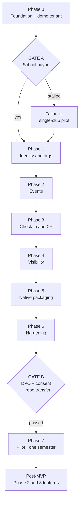

# Hiraya — Milestone Roadmap

**Status:** Approved for Phase 0 · **Version:** 2.1 · **Last updated:** 2026-09-22

Seven phases and two gates, in order, then a one-semester pilot with a real school.

**How to use this document.** It says *what* and *in what order*, and nothing else.
[`docs/WORKSTREAMS.md`](WORKSTREAMS.md) says *who* and *what is next* — start there, or run
`/hiraya-next`. [`docs/BUILD_GUIDE.md`](BUILD_GUIDE.md) says *how* a task actually gets built.
[`docs/SETUP_GUIDE.md`](SETUP_GUIDE.md) covers everything only the maintainer can do, including both
gates. Work is claimed per task across three lanes (D31), by however many contributors there are.

**To build a phase**, prompt it by name — `build Phase 1` — and it is broken into the board's tasks and
worked in dependency order, stopping at each task boundary for review. **One task at a time**
(`build D-10`) is the recommended default until Phase 4; `BUILD_GUIDE.md` §3 explains why.

**There is no week-by-week schedule, and that is deliberate** (D27). The earlier plan put calendar weeks
on every phase; they were estimates for one developer working alone, and they were wrong in both
directions at once. What is binding is the **order** and the **exit criteria**: a phase is finished when
its acceptance criteria pass, not when a week ends, and the two gates are decisions that cannot be
scheduled into existence.

**What is still genuinely time-bound**, and is not up to us:

- **The school calendar.** Gate A wants a term in session, and the pilot needs a whole semester ahead of
  it. Miss the start of a semester and the pilot waits for the next one — this, not developer velocity,
  is the real clock on this project
- **Gate B's paperwork.** DPO review, a signed processor agreement and guardian consent move at the
  school's pace, measured in weeks. Start them while Phase 5 and 6 are still running
- **App store review** — days, sometimes more, and a child-directed rejection costs a full round trip
- **R13:** the free Supabase project pauses when idle. Wake it before any pitch, whatever the date

---

## 1. Shape of the plan

**Relative weight, for planning only.** Not durations — a way to know which phases deserve room and
which will not take long however fast the work goes.

| Phase | Weight | Why |
|---|---|---|
| 0 · Foundation and demo | Medium | Mostly landed. What remains is the walkable loop and Tier 1 assets |
| 1 · Identity and orgs | Large | Import edge cases — duplicate LRNs, mid-year transfers, missing sections — take longer than the happy path, always |
| 2 · Events | Medium | The state machine is small; the adviser flow is where the care goes |
| 3 · Check-in and XP | **Largest** | The highest-risk phase, and the one that parallelizes worst. Offline sync is the hardest thing in the build |
| 4 · Visibility | Medium | Parallelizes well across lanes — a good phase to have help on |
| 5 · Native packaging | Small, but externally blocked | Store accounts, store review, and a policy question that has to be settled first |
| 6 · Hardening | Medium | Hardening always finds something. Give it more room than feels necessary |

**Priority order, when something has to give.** Cut from the bottom: (1) verified check-in works offline;
(2) adviser approval is faster than paper; (3) learners can see XP that traces to a real action;
(4) admin can import and export; (5) leaderboards; (6) announcements and push; (7) the analytics
dashboard. Anything below line 4 can slip into the pilot. Nothing above it can.

---

## 2. Phase 0 — Foundation, design system, demo tenant

**Purpose.** Have something a teacher can hold in their hand. Teachers approve what they can touch; a
proposal document from an outside developer stalls.

**Deliverables**

- Next.js 16 + TypeScript strict + Tailwind; `/api/v1` skeleton; Drizzle configured
- Supabase project, core schema, **RLS enabled on every table from the first migration**
- Design tokens and primitives per `docs/DESIGN_SYSTEM.md`
- Tier 1 assets authored per `docs/ASSET_CHECKLIST.md` (wordmark, PWA icons, 4 level badges, 6 category
  icons, 12–16 avatars, 5 empty states, hero)
- Synthetic demo tenant seeded, with the **DEMO DATA marker** visible
- Deployed to a public Vercel URL
- CI pipeline green: typecheck, lint, test, migration check
- Pitch kit: 1-page PDF, 5-slide deck, 3-minute phone demo script
- `git init`, first push, repo confirmed **private**

**Dependencies.** None. This phase is deliberately independent of the school.

**Acceptance criteria**

- [ ] Demo tenant loads on a real phone over mobile data in under 3 seconds
- [ ] The full loop is walkable in the demo: browse → register → check in → see XP → see leaderboard
- [x] Cross-tenant denial test passes against seeded schools A and B — all 21 tenant tables, plus a case proving the test fails when RLS is disabled (2026-09-21)
- [ ] First load ≤ 500 KB, verified via `browser_network_requests`
- [ ] WCAG AA passes on every demo screen via the a11y tree
- [ ] No real learner data exists anywhere

**Testing checkpoint.** `hiraya-mobile-audit` on every demo screen; `hiraya-tenancy-auditor` on the
initial schema; CI green.

**Risks.** Building before commitment exists (accepted — it is what makes the pitch land). Over-building
the demo: it needs to be *walkable*, not complete.

---

## 3. GATE A — School buy-in · after Phase 0

**Not a checklist. A decision point.**

**Required to pass**

- [ ] Demo walked through with the ICT coordinator and the SSLG adviser, on a phone, in person
- [ ] Verbal support from the school head
- [ ] An ICT coordinator or teacher named as prospective custodian
- [ ] Device and connectivity survey scheduled or done (validates assumptions A1–A3 in `docs/PRD.md`)
- [ ] School's DPO or focal person identified for Gate B

**If it stalls.** Do not wait. Partner with **one organization and its adviser** — an ICT or programming
club is the natural first mover. Run the loop for that club's events only. Smallest consent surface,
fastest real usage, and that adviser becomes the internal champion for a school-wide rollout. A
single-club pilot is a real pilot, not a consolation prize.

**If it fails outright.** The platform is school-agnostic by construction (`school_id` from day one).
Approach a second school with a demo that now has a real click-path behind it.

---

## 4. Phase 1 — Identity and organizations

**Deliverables.** CSV roster import (idempotent, per-row errors); activation codes in printable
per-section batches; consent-gated activation; ten roles with RBAC; admin-assisted password reset;
org profiles with officers, advisers and terms; membership applications with officer review; Discover
Orgs with the six category filters; School Admin console; full data export.

**Dependencies.** Gate A. A sample roster CSV in the school's real shape.

**Acceptance criteria**

- [ ] Importing 1,000 rows twice produces 1,000 profiles, not 2,000
- [ ] Activation is refused with `CONSENT_REQUIRED` when no consent record exists
- [ ] LRN is not present in any API response below School Admin — verified by `hiraya-privacy-auditor`
- [ ] A learner in school A cannot read any row of school B
- [ ] Discover Orgs filters work and are usable at 360×800
- [ ] Export produces complete, openable CSV/JSON

**Testing checkpoint.** `hiraya-tenancy-auditor` + `hiraya-privacy-auditor` must both run clean before
this phase closes. `/security-review` on the auth diff.

**Risks.** The school's roster shape differs from the template (mitigate: ask for a real sample the day
this phase opens, not the day the importer is written). Import edge cases — duplicate LRNs, mid-year
transfers, missing sections — eat more time than expected; budget for it.

---

## 5. Phase 2 — Events

**Deliverables.** Event draft → submit → adviser approval → publication; rejection with a required
reason; SSLG dual approval; registration with capacity, eligibility filters and waitlist; reminders;
school-wide calendar with conflict flags; post-event feedback and photo upload; auto-generated
accomplishment report exportable as PDF; attendance CSV.

**Dependencies.** Phase 1. The school's current accomplishment report template.

**Acceptance criteria**

- [ ] **Approval reachable in ≤3 taps from a push notification** — the number that decides adviser adoption
- [ ] Unapproved events are invisible to learners
- [ ] Rejection without a reason is impossible
- [ ] Registering a full event offers the waitlist; cancelling promotes from it
- [ ] Ineligible learners are told *which* criterion excluded them
- [ ] The generated report matches the school's expected shape
- [ ] `hiraya-adviser-advocate` confirms the approval flow is **faster than the paper process**

**Testing checkpoint.** `hiraya-adviser-advocate` is a **blocking gate** on the approval flow, not
advisory. If it says the flow adds work, the flow is wrong.

**Risks.** Adviser flow feels like extra work (the Med/High adoption risk — mitigated by the advocate
gate). Report template mismatch (mitigate: obtain the school's current template before designing the
report, not after generating one).

---

## 6. Phase 3 — Check-in and XP

The highest-risk phase. Everything the product claims rests here.

**Deliverables.** Digital ID with rotating Ed25519 QR; officer scanner (primary path); learner-scans-event
(fallback); offline verification against a cached public key; local scan queue; idempotent
`/checkins/sync`; clock-skew tolerance with server-side window validation; append-only `xp_ledger`;
`xp_rules`; levels with the four Filipino titles; manual override with audit; point disputes.

**Dependencies.** Phase 2. Confirmation of officer device capability (assumption A3).

**Acceptance criteria**

- [ ] Scanner opens in under 2 seconds and stays open between scans
- [ ] A valid scan confirms in under 500 ms with **both** visual and audible feedback
- [ ] **≥15 check-ins/minute sustained**
- [ ] Scanning with the network fully disabled works, and the UI shows the queue count
- [ ] **Replaying an entire offline queue produces zero duplicate XP**
- [ ] An expired or wrong-event token is rejected with a clear reason
- [ ] A scan outside the event window is flagged for adviser review, not silently dropped
- [ ] Every XP row cites a source; no UPDATE or DELETE grant exists on the ledger
- [ ] `xp_rules` cannot be written by an Org Officer

**Testing checkpoint.** `hiraya-offline-scenario-tester` runs the full matrix: queue, replay, clock skew,
duplicate scan, mid-sync disconnect, capacity race. `hiraya-checkin-integrity` on every diff.
`/security-review` on the QR implementation. **Both non-negotiable tests from CLAUDE.md §5 must pass.**

**Risks.** Offline sync is the hardest thing in the build — **open this phase with the queue and the
sync endpoint, not with the scanner UI.** It is the part most likely to be wrong in a way that only
shows up at a real gate with real phones, and the part that benefits least from being left until the
easy work is done. Clock skew on cheap Android is a real field problem, not theoretical. Camera
performance varies wildly across budget devices: test on the cheapest phone available, not a flagship.

---

## 7. Phase 4 — Visibility

**Deliverables.** Seasonal leaderboards at four scopes (section, grade, org, school); section-vs-section
and grade team standings; hide-from-board option; "Most Improved"; merged announcement feed; in-app and
web push with per-category preferences and quiet hours; clean Facebook/Messenger share previews; admin
analytics dashboard including the audited non-participant list and the three pilot health signals.

**Dependencies.** Phase 3 (leaderboards need a populated ledger).

**Acceptance criteria**

- [ ] Leaderboard reads from the materialized view, not a per-request ledger aggregation
- [ ] A hidden learner is absent from public boards but still sees their own rank
- [ ] Non-participant list is invisible to officers and learners, and **every access writes to `audit_log`**
- [ ] Share links render a correct preview card on Facebook and Messenger
- [ ] **No daily-login streak exists anywhere in the UI** (FR-5.10 — deliberately excluded)
- [ ] Charts follow the `dataviz` skill and remain legible at 360px
- [ ] Health signals visible: weekly-active decay, top-decile XP share, check-in-to-registration ratio

**Testing checkpoint.** `hiraya-mobile-audit` on every new surface; `hiraya-privacy-auditor` on the
analytics endpoints; `hiraya-gamification-balancer` on the XP rules before launch.

**Risks.** Leaderboards discouraging less active learners (mitigated by scopes, opt-out, Most Improved —
and by watching top-decile XP share during the pilot).

---

## 8. Phase 5 — Native packaging

**Deliverables.** Capacitor Android and iOS shells; native camera scanner replacing `getUserMedia`;
native push (FCM + APNs); native secure storage and SQLite queue; store listings; **Play Families and
Apple Kids policy compliance review**; internal-testing builds.

**Dependencies.** Phases 1–4. Google Play developer account ($25 one-time), Apple Developer account
($99/year).

**Acceptance criteria**

- [ ] Android and iOS builds ship from the same `src/` as the web build
- [ ] Native scanner is measurably faster than the browser path — this is the reason the app exists
- [ ] Offline queue survives force-quit and device restart
- [ ] Native push arrives on both platforms
- [ ] **No SDK collects an advertising identifier**
- [ ] No signing key, secret, or `.env` value is present in either bundle
- [ ] Web PWA still installs and works — the app is an addition, never a replacement

**Testing checkpoint.** `hiraya-offline-scenario-tester` re-run against the native shell.
`/security-review` on the bundle. Manual test on the cheapest Android device available.

**Risks.** **App-store rejection under child-directed policies** — settle the policy question at the
start of this phase, not at submission. Store review latency is days and occasionally longer, and it is
the one wait no amount of working faster removes: submit with slack in hand, and never with a pitch or a
launch date immediately behind it. Apple's fee is a real, recurring cost the ₱15,400 pilot budget does
not currently allocate — decide who pays before Phase 5 opens.

---

## 9. Phase 6 — Hardening

**Deliverables.** `/security-review` across the codebase; all five agents run clean; WCAG 2.1 AA audit;
500 KB budget verified; load test at ≥15 check-ins/min; error taxonomy complete and localized; admin
manual, officer quick-start, adviser quick-start, homeroom onboarding script; backup and restore verified.

**Acceptance criteria**

- [ ] `hiraya-tenancy-auditor`, `hiraya-privacy-auditor`, `hiraya-gamification-balancer`,
      `hiraya-adviser-advocate`, `hiraya-offline-scenario-tester` — all clean
- [ ] `/security-review` findings resolved or explicitly accepted in writing
- [ ] WCAG AA passes on every screen
- [ ] First load ≤ 500 KB; ≥15 check-ins/min sustained
- [ ] **A restore from backup has actually been performed, not merely configured**
- [ ] Every document exists and is current (`/hiraya-checkpoint` passes clean)

**Risks.** Hardening always finds something, and the temptation to call it done early is strongest here,
because everything visible already works. Take the time here rather than at Gate B — shipping unhardened
software holding minors' data is not an option, and this is the last phase where finding a problem is
cheap.

---

## 10. GATE B — Legal and ownership · after Phase 6

**A hard blocker. No real learner data enters any environment until every box is ticked.**

- [ ] School DPO or focal person has reviewed the system
- [ ] **Data processing agreement signed** — school as controller, developer as processor, naming
      purpose, retention, security measures, and deletion obligations
- [ ] Privacy notice published in English and Filipino
- [ ] Guardian consent collected for every learner to be activated
- [ ] `consent_records` populated; activation refuses without it
- [ ] **Repository transferred to a school-owned GitHub organization** (D17)
- [ ] Supabase, Vercel and domain accounts transferred to school ownership; custodian holds credentials
- [ ] Custodian trained; admin manual handed over
- [ ] Backup, restore, and export all demonstrated to the custodian
- [ ] **D32's standing permissions re-decided** (R23) — Supabase write access and self-merge were
      reasoned against a project holding only synthetic data. Real rosters change that calculation

Gate B exists because, without a school research protocol behind it, nothing else establishes a lawful
basis for one person to hold a thousand minors' records. The repository and infrastructure transfer sits
in the same gate deliberately: a deferred transfer is precisely how "no one maintains it after the team
moves on" — the proposal's own High/High risk — comes true.

---

## 11. Phase 7 — Pilot · one semester

The one part of this plan that **is** measured in weeks, because it runs on the school's calendar and on
real learners rather than on how fast code gets written. Weeks below are counted from the pilot's own
first day, not from the start of the project.

**Week 1:** one organization only. Verify the loop with real learners and a real adviser.
**Weeks 2–3:** homeroom onboarding; launch-week quests; SSLG promotion; school-wide open.
**Rest of the semester:** monthly check-ins with the Steering Group; KPI tracking; point-rule tuning via
`hiraya-gamification-balancer`; Phase 2 features built alongside as capacity allows.

**Watch from week 3 of the pilot.** Weekly-active decay is the earliest signal the design is failing, and
the literature predicts it. Also: top-decile XP share (leaderboard discouragement) and
check-in-to-registration ratio (farming). All three are on the admin dashboard so they are noticed while
there is still time to act.

**KPI targets** in `docs/PRD.md` §9.

---

## 12. Post-MVP

**Phase 2 features** (can begin during the pilot): badges, quests, credits and rewards catalog;
e-certificates with QR verification; Co-curricular Record; *Tambayan* forum; digital suggestion box;
Filipino locale; org transparency board.

**Phase 3 features** (after evaluation): polls and SSLG elections; scholarship board; research
repository; peer tutoring match; lost and found; multi-school tenancy via subdomains; division-level
dashboards and inter-school events, subject to Schools Division Office approval.

**The forum is deliberately late.** It is the largest child-safety surface in the product and should
ship only once moderators are trained and the Child Protection Committee escalation path has been walked
through with real people.

---

## 13. Risk register

| # | Risk | L | I | Mitigation | Owner phase |
|---|---|---|---|---|---|
| R1 | **School declines or stalls** | Med | High | Demo before pitch; single-club fallback; school-agnostic build | Gate A |
| R2 | Learners farm points without real participation | High | High | Verified check-in only; rotating signed tokens; officer scanning; append-only ledger; balancer agent | 3 |
| R3 | **No one maintains it after the developer moves on** | High | High | Docs; school-owned repo and infra at Gate B; ICT club custodian; full export | Gate B |
| R4 | Advisers see it as extra work | Med | High | Auto-generated reports; ≤3-tap approval; `hiraya-adviser-advocate` as a blocking gate | 2 |
| R5 | Novelty wears off after a few weeks | High | Med | Quarterly seasons; rotating quests; team competition; real-world recognition; weekly-active monitoring | 7 |
| R6 | Low learner adoption after launch | Med | High | Homeroom onboarding; launch-week quests; SSLG promotion; share links | 7 |
| R7 | Leaderboards discourage less active learners | Med | Med | Section and grade scopes; hide option; Most Improved; top-decile monitoring | 4 |
| R8 | Weak signal or no data at venues | High | Med | Offline scanning with sync; low-data mode | 3 |
| R9 | Cyberbullying in the forum | Med | High | Moderation; reporting; Filipino/Taglish filtering; restricted anonymity; CPC escalation | Post-MVP |
| R10 | Data breach or misuse of learner data | Low | High | Minimization; RLS; role-based access; encryption; no-PII logging; DPO review | 6, Gate B |
| R11 | Organizations inflate event point values | Med | Med | `xp_rules` writable only by School Admin / SSLG adviser | 3 |
| R12 | Free hosting limits exceeded | Low | Med | Usage monitoring; budgeted paid tier; image optimization | 7 |
| R13 | **Supabase pauses the idle demo project** | Med | Med | Keep-alive before any pitch; verify the URL the morning of | 0 |
| R14 | **App store rejection under child-directed policy** | Med | Med | Policy review in Phase 5; no advertising-ID SDKs; early submission | 5 |
| R15 | Offline sync proves harder than estimated | Med | High | Open Phase 3 with the queue and sync endpoint; the offline tester agent; degrade to online-only check-in rather than ship it unverified | 3 |
| R16 | Apple's annual fee is unbudgeted | High | Low | Decide who pays before Phase 5; Android-only ships if unresolved | 5 |
| R17 | Toolchain versions break the lint chain that enforces R2 | Med | High | TypeScript and ESLint pinned (D20); lint is a required CI step | ongoing |
| R18 | **A contributor violates a rule that was never written down** | Med | High | Rules enforced by the database, lint and CI rather than by review; `CONTRIBUTING.md` §5 states the eight that cannot be inferred from the code; `main` protected with required CI (D26) | ongoing |
| R19 | Parallel work produces conflicting migrations, or a table without its policy or fixture | Med | Med | One open migration repo-wide; the PR template requires policy and fixture in the same PR; `db:verify-rls` in CI | ongoing |
| R20 | Migration round-trip through the maintainer becomes the bottleneck, or a Supabase-only surprise surfaces late | Med | Med | Lane D's local Postgres is bootstrapped with Supabase's roles *and* default privileges, so most surprises reproduce locally; batch migrations rather than trickling them | ongoing |

| R21 | **A `SECURITY DEFINER` function whose owner does not bypass RLS silently reads under the *caller's* policies** | Med | High | Every tenant table is FORCE ROW LEVEL SECURITY, so FORCE applies to the owner too. The failure under-reads rather than over-reads — a leaderboard ranks a learner against nobody, and a capacity count sees a full event as empty and overbooks it. `npm run db:verify-rls` fails CRITICAL on it (D28–D30 slice); **the local owner is a superuser, so only Supabase will actually answer this** — run it there at M-01 | open |

| R22 | **A moderate `esbuild` advisory reaches the repo through `drizzle-kit` → `@esbuild-kit/*`** | Low | Low | Dev-dependency only; the advisory affects an esbuild *dev server* this project never runs, and nothing from that chain reaches a build output or a deployment. The only offered fix downgrades `drizzle-kit` to 0.18.1, which is a breaking change to the migration tool that generates every migration — strictly worse than the exposure. **Accepted, not ignored:** re-check on each `drizzle-kit` minor, and revisit immediately if it ever becomes a production dependency | ongoing |
| R23 | **A standing permission outlives the conditions that made it safe** | Med | High | D32's grants — Supabase writes and self-merge — were reasoned against a project holding *only synthetic data* before Gate B. Gate B's checklist carries an explicit item to re-decide both once real rosters exist. The grant is written down in `CLAUDE.md` §11 with its expiry condition rather than held in memory, which is the whole point | Gate B |

R13, R14 and R16 are new relative to the original proposal and follow directly from D7, D11 and D17.
R17 follows from D20; R18–R20 from D26, and all three are about coordination rather than about the
product — which is what any additional contributor actually costs. R21 is the first risk found by the code
rather than by planning: it was invisible until three `SECURITY DEFINER` functions existed to be wrong.

---

## 14. Definition of MVP Complete

All seven, verified — not asserted:

1. A learner can discover, register for, attend, and be verified at an event, and see XP that traces to
   that specific check-in
2. An officer can propose an event and an adviser can approve it in **≤3 taps from a notification**
3. Officers can check learners in **with no connectivity**, and the queue syncs without duplicates
4. A School Admin can import learners, generate activation codes, and export all data
5. Cross-tenant denial and idempotent-sync tests pass in CI
6. WCAG 2.1 AA, ≤500 KB first load, and ≥15 check-ins/minute all verified
7. Web PWA and Android/iOS builds ship from one codebase against one database

Plus both gates: **Gate A** (school buy-in) and **Gate B** (DPO review, signed processor agreement,
guardian consent, repository and infrastructure transferred).

MVP is not complete when the features exist. It is complete when the features exist **and** the school
owns the thing.
