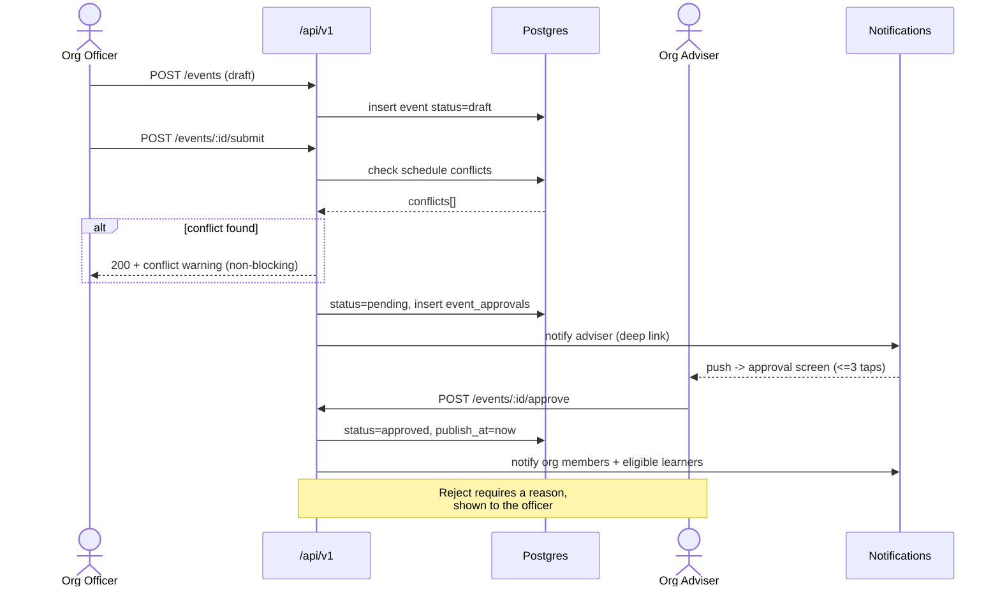
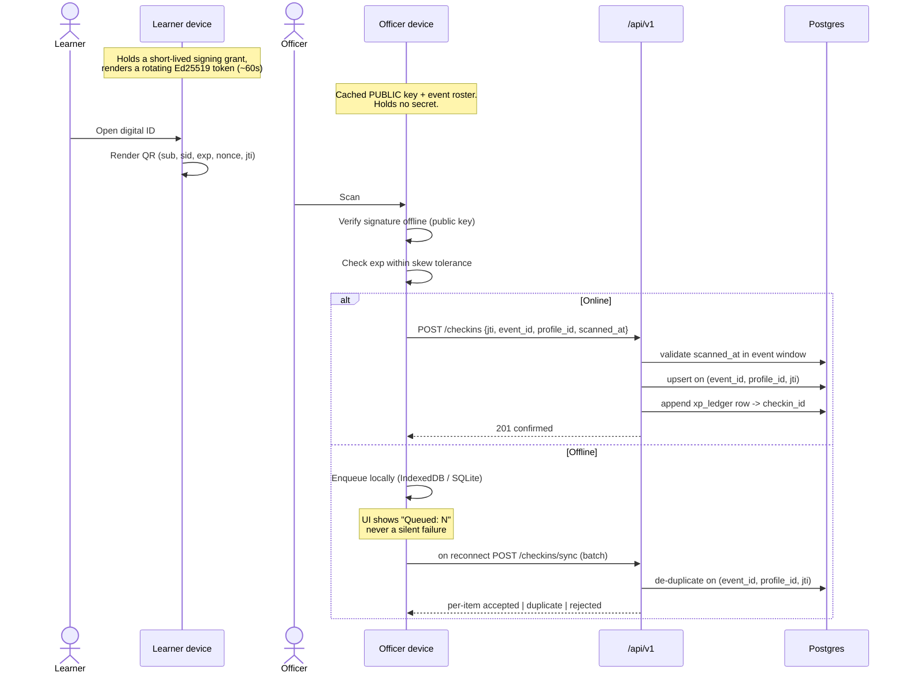
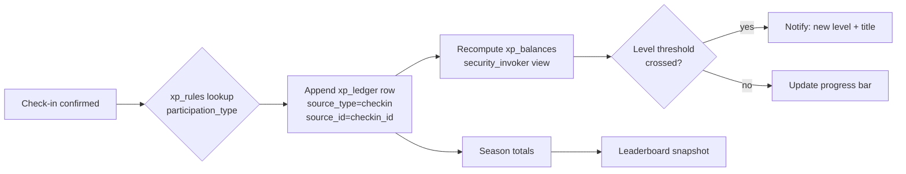
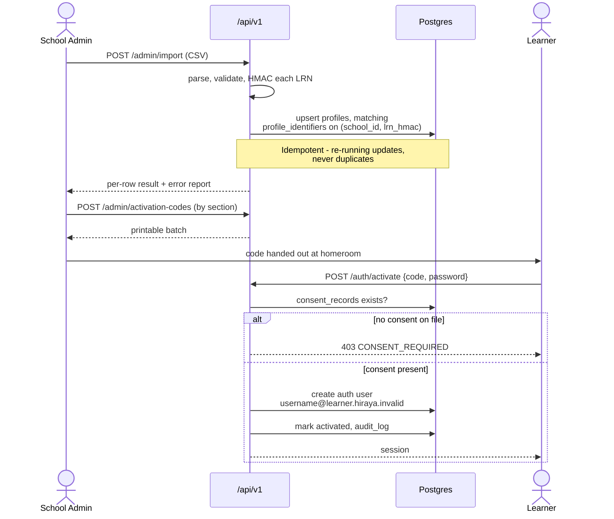
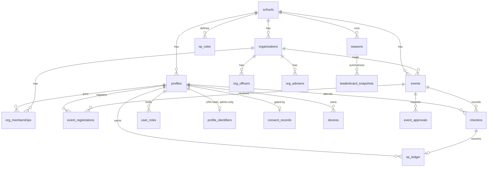

# Hiraya — System Design

**Status:** Approved for Phase 0 · **Version:** 1.0 · **Last updated:** 2026-09-21

Detailed design: modules, permissions, workflows, entities, API contracts, state, errors, logging,
offline behaviour, and threats. Stack rationale lives in `docs/TECHNICAL_ARCHITECTURE.md`.

---

## 1. Modules

| Module | Responsibility | Phase | Depends on |
|---|---|---|---|
| **identity** | Roster import, activation, sessions, roles, consent gating | M | — |
| **orgs** | Org profiles, officers, advisers, memberships, Discover directory | M | identity |
| **events** | Proposal, approval, publication, registration, waitlist, calendar | M | orgs, identity |
| **checkin** | Digital ID, QR issue/verify, offline queue, idempotent sync | M | events, identity |
| **xp** | Ledger, rules, levels, seasons, leaderboards, disputes | M | checkin |
| **announcements** | School and org feed, notifications, push subscriptions | M | orgs, identity |
| **analytics** | Participation rates, outreach list, exports, health signals | M | all |
| **reports** | Accomplishment reports, attendance exports, PDF | M | events, checkin |
| **recognition** | Badges, quests, credits, rewards, certificates, Co-curricular Record | 2 | xp |
| **forum** | *Tambayan* — categories, posts, moderation, reporting, escalation | 2 | identity |
| **appshub** | Module registry, per-school enablement, permissions | 3 | identity |

Dependencies point one way only. `xp` never imports `events`; it consumes check-in results through its
own service boundary. This is what keeps Phase 2 and 3 modules addable without touching the core loop.

---

## 2. Roles and permissions

`—` none · `own` own records · `org` within their organization · `school` school-wide · `R` read ·
`W` write · `A` approve

| Capability | Learner | Org Officer | Org Adviser | SSLG Officer | Moderator | School Admin | Super Admin |
|---|---|---|---|---|---|---|---|
| View published events | school R | school R | school R | school R | school R | school R | all R |
| Draft / edit event | — | org W | org W | school W | — | school W | — |
| **Approve event** | — | — | **org A** | — | — | school A | — |
| Register for event | own W | own W | — | own W | — | — | — |
| **Scan attendance** | — | **org W** | org W | school W | — | school W | — |
| Manual attendance override | — | — | org W | — | — | school W | — |
| View own XP and rank | own R | own R | — | own R | — | — | — |
| View others' XP | leaderboard only | org R | org R | school R | — | school R | all R |
| **Set point rules** | — | — | — | — | — | **school W** | — |
| File a point dispute | own W | own W | — | own W | — | — | — |
| Resolve a point dispute | — | — | org A | — | — | school A | — |
| Edit org profile | — | org W | org W | — | — | school W | — |
| Review membership application | — | org W | org W | — | — | school W | — |
| Assign officers | — | — | org A | — | — | school W | — |
| Post org announcement | — | org W | org W | — | — | school W | — |
| Post school announcement | — | — | — | **school W** | — | school W | — |
| Moderate forum *(P2)* | — | — | org W | — | **school W** | school W | — |
| Escalate to CPC *(P2)* | — | — | org W | — | school W | school W | — |
| View participation analytics | — | org R | org R | school R | — | school R | all R |
| **View non-participant list** | — | — | **org R** | — | — | school R | — |
| Import learners | — | — | — | — | — | **school W** | — |
| Export all data | — | — | — | — | — | **school W** | all |
| Enable Apps Hub modules *(P3)* | — | — | — | — | — | school W | — |
| Manage school tenants *(P3)* | — | — | — | — | — | — | all W |

**Read-only variants.** *Guidance staff* receive the non-participant list and participation analytics at
school scope, read-only, nothing else. *School heads* receive the full School Admin dashboard, read-only.

**Rules that are not obvious from the grid:**

- Point values are set by School Admin and the SSLG adviser, **never by an organization** — otherwise
  orgs inflate their own events, which is a named risk.
- An adviser cannot approve their own drafted event; a second adviser or School Admin must.
- SSLG-wide events require both the org adviser and the SSLG adviser.
- Every access to the non-participant list writes an `audit_log` row. It is an outreach tool, and it
  would be harmful if it circulated.

---

## 3. Core workflows

### 3.1 Event proposal and approval



An event is invisible to learners until `status=approved`. Rejection always carries a reason — a
silent rejection is how officers stop using a system.

### 3.2 Offline check-in and sync

The most important workflow in the product. Note where authority sits.



**Authority.** Offline verification is **advisory**; the server is authoritative. The device confirms the
signature and a skew-tolerant expiry so the officer gets instant feedback; the server independently
checks that `scanned_at` falls inside the event window before any XP is written. `jti` de-duplication
caps a replayed or captured token at exactly one check-in regardless of device clock manipulation.

### 3.3 XP award



XP is never computed from a stored total. The ledger is the truth; balances are derived. A correction is
a new reversal row citing the original — history is never rewritten, because an auditable trail is the
only thing that makes "your points are real" a defensible claim.

### 3.4 Learner import and activation



---

## 4. Data model

### 4.1 Entity relationships (MVP)



### 4.2 Key tables

Every table below also carries `school_id uuid NOT NULL`, `created_at`, `updated_at`, and has RLS
enabled. Only distinguishing columns are listed.

| Table | Notable columns | Notes |
|---|---|---|
| `schools` | `slug`, `name`, `settings_json`, `is_demo` | `is_demo=true` drives the DEMO DATA marker |
| `profiles` | `user_id`, `username`, `display_name`, `grade_level`, `section`, `avatar_key`, `locale`, `hidden_from_boards`, `status` | **No** address, birthday, family data, or photo. **No LRN** — see below. A learner may edit only `avatar_key`, `locale` and `hidden_from_boards`, enforced by trigger |
| `profile_identifiers` | `profile_id`, `lrn_hmac` | **The LRN hash, in its own table.** RLS is row-level, so a policy cannot hide one column from one role: the rule "never returned below School Admin" is a database invariant only because non-admins cannot select these rows at all. Unique `(school_id, lrn_hmac)` — what makes import idempotent |
| `user_roles` | `profile_id`, `role`, `org_id` (nullable) | Null `org_id` = school-scoped. Multiple rows per user |
| `consent_records` | `profile_id`, `consent_type`, `granted_at`, `recorded_by`, `reference` | **Gates activation.** `reference` points at the paper form; scans are never stored |
| `organizations` | `name`, `slug`, `category`, `logo_key`, `mission`, `status` | `category` drives the six-color palette |
| `org_memberships` | `org_id`, `profile_id`, `status`, `applied_at` | `status`: applied / active / inactive |
| `org_officers` | `org_id`, `profile_id`, `position`, `term_start`, `term_end` | Term bounds preserve history across turnover |
| `org_advisers` | `org_id`, `profile_id`, `is_primary`, `term_start`, `term_end` | Written by School Admin only — an adviser appointing advisers is a staffing decision |
| `events` | `org_id`, `title`, `starts_at`, `ends_at`, `venue`, `capacity`, `eligibility_json`, `status`, `requires_sslg_approval` | `status`: draft / pending / approved / rejected / cancelled / completed |
| `event_approvals` | `event_id`, `approver_id`, `role`, `decision`, `reason`, `decided_at` | Multiple rows when SSLG approval also applies. `reason` required on reject. An officer may insert only an **undecided** row; writing a `decision` requires an approver, enforced by two separate INSERT policies |
| `event_registrations` | `event_id`, `profile_id`, `status`, `waitlist_position` | Unique `(event_id, profile_id)` |
| `checkins` | `event_id`, `profile_id`, `jti`, `scanned_at`, `synced_at`, `device_id`, `method`, `direction` | **Unique `(event_id, profile_id, jti)`** — the idempotency key. `method`: officer_scan / learner_scan / manual |
| `xp_ledger` | `profile_id`, `season_id`, `delta`, `participation_type`, `source_type`, `source_id`, `reversal_of` | **Append-only. No UPDATE or DELETE grant, for any role** |
| `xp_rules` | `participation_type`, `xp_value`, `effective_from` | Set by School Admin / SSLG adviser only |
| `levels` | `threshold_xp`, `title`, `badge_key` | Kasapi, Lingkod, Tagapagtaguyod, Bayani |
| `seasons` | `name`, `starts_on`, `ends_on`, `is_current` | Quarterly reset; lifetime XP kept separately |
| `leaderboard_snapshots` | `season_id`, `scope`, `scope_ref`, `computed_at`, `rows_json` | Scopes: section, grade, org, school |
| `announcements` | `scope`, `org_id`, `title`, `body`, `publish_at`, `author_id` | — |
| `notifications` | `profile_id`, `type`, `payload_json`, `read_at` | — |
| `devices` | `profile_id`, `platform`, `push_token`, `is_scanner`, `last_seen_at` | Scanner registry and push targeting |
| `audit_log` | `actor_id`, `action`, `target_type`, `target_id`, `meta_json` | **Ids, never names.** Includes every non-participant-list access |

**Derived:** `xp_balances` (lifetime XP, season XP, level, rank per scope). **Not a materialized
view** — Postgres materialized views cannot carry RLS policies, so one would be readable across schools
by anyone granted SELECT on it, which is precisely the failure R1 exists to prevent. It is a regular view
declared `WITH (security_invoker = true)` so the caller's policies on `xp_ledger` still apply, and the
leaderboard reads from `leaderboard_snapshots` rather than aggregating per request. Revisit only with
measurements, and never by reaching for `MATERIALIZED`. Lands with the XP slice in Phase 3.

---

## 5. API contracts

All endpoints under `/api/v1`. JSON in, JSON out. Bearer session. Every handler: authenticate → authorize
→ Zod-parse → call service → map errors.

### Identity

| Method | Path | Role | Purpose |
|---|---|---|---|
| POST | `/auth/activate` | public | Redeem activation code, set password. 403 if no consent |
| POST | `/auth/login` | public | Username or email + password |
| POST | `/auth/logout` | any | End session |
| GET | `/me` | any | Profile, roles, level, XP, locale |
| PATCH | `/me` | any | Avatar, locale, `hidden_from_boards`, notification prefs |
| POST | `/admin/import` | school_admin | CSV roster import (idempotent) |
| POST | `/admin/activation-codes` | school_admin | Generate printable batch by section |
| POST | `/admin/password-reset/:profileId` | school_admin, org_adviser | Issue a fresh activation code (D4) |

### Organizations

| Method | Path | Role | Purpose |
|---|---|---|---|
| GET | `/orgs` | any | Discover directory; `?category=` filter |
| GET | `/orgs/:id` | any | Profile, officers, events, gallery |
| PATCH | `/orgs/:id` | org_officer+ | Edit profile |
| POST | `/orgs/:id/apply` | learner | Membership application |
| GET | `/orgs/:id/applications` | org_officer+ | Review queue |
| POST | `/orgs/:id/applications/:appId/decide` | org_officer+ | Accept or decline |

### Events

| Method | Path | Role | Purpose |
|---|---|---|---|
| GET | `/events` | any | Approved and upcoming; filters |
| POST | `/events` | org_officer+ | Create draft |
| PATCH | `/events/:id` | org_officer+ | Edit while draft or pending |
| POST | `/events/:id/submit` | org_officer+ | Submit for approval; returns conflicts |
| POST | `/events/:id/approve` | org_adviser+ | Approve and publish |
| POST | `/events/:id/reject` | org_adviser+ | Reject — **reason required** |
| POST | `/events/:id/register` | learner | Register or join waitlist |
| DELETE | `/events/:id/register` | learner | Cancel; promotes the waitlist |
| GET | `/events/:id/roster` | org_officer+ | Registrants; cached by the scanner |
| GET | `/events/:id/report` | org_officer+ | Accomplishment report (JSON or PDF) |
| GET | `/calendar` | any | School-wide with conflict flags |

### Check-in

| Method | Path | Role | Purpose |
|---|---|---|---|
| GET | `/checkin/grant` | learner | Short-lived signing grant for the rotating ID QR |
| GET | `/checkin/public-key` | any | Ed25519 public key for offline verification (cacheable) |
| POST | `/checkins` | org_officer+ | Single online scan |
| POST | `/checkins/sync` | org_officer+ | **Batch queue sync. Idempotent** |
| POST | `/checkins/manual` | org_adviser+ | Manual override — always audited |
| GET | `/events/:id/checkins` | org_officer+ | Attendance list; CSV export |

`POST /checkins/sync` request and response:

```jsonc
// Request
{ "event_id": "uuid",
  "scans": [ { "jti": "…", "profile_id": "uuid", "scanned_at": "2026-09-21T01:30:00Z",
               "device_id": "…", "direction": "in" } ] }

// Response — per item, never a single all-or-nothing status
{ "results": [ { "jti": "…", "status": "accepted",  "checkin_id": "uuid", "xp_awarded": 10 },
               { "jti": "…", "status": "duplicate", "checkin_id": "uuid", "xp_awarded": 0  },
               { "jti": "…", "status": "rejected",  "reason": "SCAN_OUTSIDE_EVENT_WINDOW" } ] }
```

### XP and leaderboards

| Method | Path | Role | Purpose |
|---|---|---|---|
| GET | `/me/xp` | learner | Ledger entries with sources, level, progress |
| GET | `/leaderboard` | any | `?scope=section\|grade\|org\|school&season=` |
| GET | `/admin/xp-rules` · PUT | school_admin | Read / set point values |
| POST | `/xp/disputes` | learner | File a dispute |
| POST | `/xp/disputes/:id/resolve` | org_adviser+ | Resolve — writes a reversal row, never an edit |

### Announcements and analytics

| Method | Path | Role | Purpose |
|---|---|---|---|
| GET | `/announcements` | any | Merged school + org feed |
| POST | `/announcements` | sslg_officer, org_officer+ | Publish within scope |
| POST | `/notifications/subscribe` | any | Register push token |
| GET | `/analytics/participation` | org_adviser+ | Rates by grade, section, org |
| GET | `/analytics/non-participants` | guidance, org_adviser+ | **Audited on every access** |
| GET | `/admin/export` | school_admin | Full data export (NFR-12) |

---

## 6. State management

| State | Lives in | Why |
|---|---|---|
| Session, roles, `school_id` | JWT claims + httpOnly cookie | Read by RLS; not re-derivable client-side |
| Server data (events, orgs, XP, leaderboards) | TanStack Query | One cache, one invalidation story, native and web identical |
| Scan queue | IndexedDB (web) / SQLite (native), surfaced via Zustand | Must survive a reload, a crash, and a dead battery |
| UI ephemera (filters, tabs, sheets) | Local component state or URL params | Shareable and back-button-correct |
| Locale | Cookie + `next-intl` provider | Server-rendered without a flash |

**No global client store beyond the scanner.** Recorded deliberately so a future session does not reach
for Redux: the server owns truth, and the one genuinely offline-first surface is the scanner.

---

## 7. Offline and low-connectivity behaviour

| Surface | Offline behaviour |
|---|---|
| **Scanner** | Fully functional. Verifies signatures against the cached public key, checks the cached roster, queues scans. UI shows a persistent "Queued: N" — never a silent failure, never a false success |
| **Digital ID** | Fully functional. Renders rotating tokens from the cached signing grant |
| Event list, org profiles | Last-cached content with a visible "as of" timestamp |
| Registration | Disabled offline with a clear reason. Queuing a registration would let a learner believe they hold a seat that may not exist — capacity is a server-side truth |
| Leaderboard, XP | Last-cached, marked stale |
| Announcements | Last-cached; new ones arrive on reconnect |

**Sync.** Background Sync where available; a manual "Sync now" control always present, because Safari
lacks Background Sync and a silent dependency on it would fail invisibly on iOS. Exponential backoff,
per-item results, and a queue that survives app restarts.

**Low-data mode.** ≤500 KB first load, SVG-only imagery, lazy routes, no autoplay, no background polling.

---

## 8. Error handling

Services throw domain errors; one mapper converts them to HTTP. Services never know about status codes.

| Code | HTTP | Meaning | User-facing behaviour |
|---|---|---|---|
| `UNAUTHENTICATED` | 401 | No or expired session | Re-login prompt |
| `FORBIDDEN` | 403 | Role lacks capability | Explain what role is needed |
| `CONSENT_REQUIRED` | 403 | No consent record | Direct to School Admin — never a generic failure |
| `NOT_FOUND` | 404 | Absent, or in another tenant | Identical message either way — **never reveal cross-tenant existence** |
| `VALIDATION_FAILED` | 422 | Zod rejection | Field-level messages, localized |
| `EVENT_FULL` | 409 | At capacity | Offer the waitlist |
| `NOT_ELIGIBLE` | 403 | Grade, section, or membership filter | State which criterion, not a generic refusal |
| `DUPLICATE_CHECKIN` | 200 | Already checked in | **Success, not an error** — the officer did nothing wrong |
| `TOKEN_EXPIRED` | 422 | QR past expiry + skew | "Ask them to refresh their ID" |
| `TOKEN_INVALID` | 422 | Bad signature or wrong school | Generic reason; log the detail |
| `SCAN_OUTSIDE_EVENT_WINDOW` | 422 | `scanned_at` outside the event | Flag for adviser review rather than discarding |
| `IMPORT_ROW_INVALID` | 207 | Some rows failed | Per-row report; valid rows still import |
| `RATE_LIMITED` | 429 | Abuse guard | Retry-after |

**Principles.** Fail loudly on the scanner and quietly on cosmetics. `NOT_FOUND` and cross-tenant denial
must be indistinguishable. Error text never contains PII. Every error surfaced to a learner is written in
both locales and says what to do next.

---

## 9. Logging and monitoring

**Hard rule: log `profile_id`. Never LRN, name, section, or email** — not to Sentry, not to `console`,
not inside an error message. A `beforeSend` scrubber in the Sentry client enforces it as a second line
of defence.

| Signal | Where | Watch for |
|---|---|---|
| Errors and traces | Sentry (scrubbed) | Scanner failures above all |
| Web Vitals, bundle size | Vercel Analytics + CI budget | Regression past 500 KB |
| Admin actions | `audit_log` | Every non-participant-list access |
| XP movements | `xp_ledger` | Unusual velocity per profile |
| Sync health | Structured logs | Queue depth, replay rate, rejected-window scans |
| **Pilot health signals** | Admin dashboard | Weekly-active decay after week 3; XP share of the top decile; check-in-to-registration ratio |

Those last three are on the dashboard rather than in a report because they are what tell you the design
is failing while there is still time to change it.

---

## 10. Threat model

| # | Threat | Actor | Control | Residual |
|---|---|---|---|---|
| T1 | Read another school's learner data | Any authenticated user | RLS on every table; cross-tenant denial test in CI; service role in one file | Low |
| T2 | Farm points without attending | Learner | XP only on verified check-in; rotating 60s tokens; officer scanning; append-only ledger; balancer agent | Medium — a colluding officer remains possible; ledger audits detect the pattern |
| T3 | Share a screenshot of a QR | Learner | ~60s rotation; `jti` single-use per event | Low |
| T4 | Replay a captured offline queue | Anyone with the device | `(event_id, profile_id, jti)` de-duplication | Low |
| T5 | Manipulate the device clock to widen the token window | Officer | Server validates `scanned_at` against the event window; `jti` caps at one check-in | Low — accepted trade for offline usability |
| T6 | Extract a signing key from the app | Anyone | **Asymmetric** — devices hold only the public key | Very low |
| T7 | Admin rewrites point history | School Admin | No UPDATE/DELETE grant on the ledger; corrections are reversal rows; `audit_log` | Very low |
| T8 | Non-participant list circulates | Adviser, guidance | Restricted roles; every access audited; framed for outreach | Medium — **social, not technical**; mitigated by policy and training |
| T9 | Cyberbullying in the forum *(P2)* | Learner | Moderation, one-tap reporting, Filipino/Taglish filtering, restricted anonymity, CPC escalation | Medium |
| T10 | Adult contacts a learner privately | Staff | **No DM feature exists** | Low by design |
| T11 | PII leaks through logs | Developer error | No-PII rule + Sentry scrubber + privacy auditor agent | Low |
| T12 | Org inflates its own point values | Org Officer | `xp_rules` writable only by School Admin / SSLG adviser | Low |
| T13 | Credential stuffing on learner accounts | External | Rate limiting, lockout, no public sign-up, non-routable identifiers | Low |
| T14 | Data persists after a learner leaves | — | Archive on graduation/transfer; deletion on request except records the school must keep | Low |

T2 and T8 are the two that cannot be fully closed in software. Both are managed by process — ledger
auditing for one, role restriction plus training for the other — and both should be revisited with real
pilot data rather than assumed solved.

---

## 11. Related documents

`docs/PRD.md` · `docs/TECHNICAL_ARCHITECTURE.md` · `docs/DATA_FLOW.md` · `docs/DESIGN_SYSTEM.md` ·
`docs/MILESTONE_ROADMAP.md`
