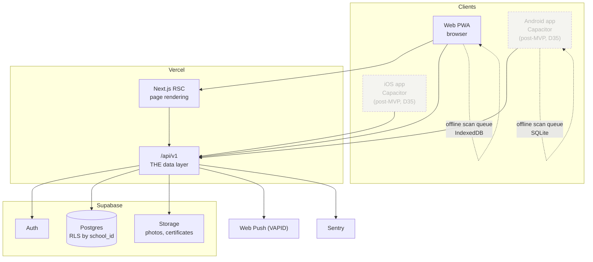

# Hiraya — Technical Architecture

**Status:** Approved for Phase 0 · **Version:** 1.2 · **Last updated:** 2026-09-21

---

## 1. Constraints that drive every choice

Before the stack, the five constraints it has to satisfy. Nearly every decision below is downstream of
one of these.

1. **Budget-Android, low-data, unreliable venue connectivity.** ≤500 KB first load, offline check-in.
2. **Minors' data.** Minimization, RLS-enforced isolation, auditability, no photo uploads.
3. **A two-person team, one of them accountable.** Every moving part is a part that can rot. Fewer
   vendors, fewer codebases, boring choices. Additional contributors add throughput, not slack: the rules
   in `CLAUDE.md` §3 and §6 have to hold without the person who wrote them reading every line, which is
   why they live in RLS, lint and CI rather than in habit (D26).
4. **Near-zero budget.** Free tiers through the pilot.
5. **Must outlive its author.** Handed to a school ICT club. Legible beats clever, always.

---

## 2. Decision register

| # | Decision | Rationale | Trade-off accepted |
|---|---|---|---|
| **D1** | Next.js 16 (App Router) + Supabase (Postgres + RLS, Auth, Storage), Drizzle ORM, hosted on Vercel | One vendor; free tier; RLS makes tenancy a *database* invariant rather than a convention app code must remember | Vendor concentration — mitigated by plain Postgres and full export (NFR-12) |
| **D1a** | **`/api/v1` is the single data layer. No Server Actions.** | **One authorization path instead of two** — a second data layer means a second set of checks, and the second set is the one nobody audits. Originally forced by D11 (a Capacitor bundle runs neither Server Actions nor RSC); **that reason went dormant with D35 and the rule stands without it**, since it is also what lets native resume later without re-deriving every check | Loses Server Action ergonomics and form progressive enhancement |
| **D2** | MVP is the full Phase 1 list, offline check-in and push included | Offline scanning mitigates the High-likelihood "weak signal at venues" risk and protects the ≥15/min KPI | More Phase 3 complexity than a thin MVP |
| **D3** | Solo developer + Claude Code. **Amended by D26:** a second developer joins from 2026-09-21. **Amended by D31:** the project takes contributors across three claimable lanes | — | Automation and agents substitute for a QA role |
| **D4** | LRN-derived username + password; one-time activation code at homeroom | Public-HS learners have no reliable email | **No self-service password reset for learners** (§6) |
| **D5** | Both QR paths, officer-scan primary | Officer scanning puts the offline queue on 1–5 known devices instead of hundreds of unknown ones | Two scan paths to build and test |
| **D6** | i18n scaffolding in MVP, Filipino locale in Phase 2 | Retrofitting i18n across a finished UI is the refactor that never happens | Launch is English-first |
| **D7** | Demo tenant first, then pitch | Teachers approve what they can touch on a phone | Builds before any commitment exists |
| **D8** | School is controller, developer is processor; infra in a school-owned account | Puts learner data under the school's existing consent channel rather than a private individual | Slower setup; needs a written agreement |
| **D9** | Free `*.vercel.app` until the school commits | Do not defend a name before there is a partner | Less polished pitch URL |
| **D10** | git + GitHub Actions CI; `/security-review` required on auth/RBAC/tenancy/QR/PII diffs | The only reviewer is automated | CI minutes; setup time |
| **D11** | ~~**Capacitor** — one codebase → web PWA + Android AAB + iOS IPA~~ **Superseded by D35: the MVP is a web PWA only.** Kept for the record, and because D11's reasoning is what Phase 3 now has to disprove | Native camera is what the ≥15 check-ins/min target actually depends on; native push works on iOS without home-screen install | Forces D1a; store review; Apple's annual fee |
| **D12** | Dual visual register, shared tokens | Advisers judge the tool on paperwork saved; playful chrome reads as a student toy | Two component moods to maintain |
| **D13** | Curated avatar set, no photo uploads | No moderation queue for images of minors, no biometric-adjacent store | Less personalization |
| **D14** | Assets authored as hand-written SVG + vetted free libraries | Free, tiny, token-recolorable — the only way this visual style fits 500 KB | Author time; no photorealism |
| **D15** | `hiraya-checkpoint` skill is the doc/progress/git engine; CLAUDE.md holds policy; optional `Stop` hook guards | A skill cannot guarantee it runs; a hook cannot write prose; CLAUDE.md cannot execute | Three layers to keep coherent |
| **D16** | Commit freely, push at milestones; never force-push. **Superseded in part by D26:** `main` is protected and work lands by PR | Clean history without approving every commit | Remote lags local slightly |
| **D17** | Repo private now; transfer to a school-owned GitHub org is a **Gate B deliverable** | Reconciles the personal account with D8 ownership; a gate item cannot quietly not happen | Transfer friction at Gate B |
| **D18** | **Check-in XP is written by a `SECURITY DEFINER` function, not by the scanning session.** `xp_ledger` INSERT is granted only to School Admin and the SSLG adviser | An officer session that could insert ledger rows is an XP faucet on a phone at the gate. The function verifies the citing `checkins` row exists, so a point cannot be created without the attendance it claims | One more database object to review; XP and check-in must commit in one transaction. Lands with the Phase 3 check-in slice |
| **D19** | **`xp_balances` is a regular view with `security_invoker = true`, never a materialized view** | Materialized views cannot carry RLS policies — one would be readable across schools by anyone granted SELECT, the exact failure R1 exists to prevent. Leaderboards read `leaderboard_snapshots` instead, so the performance argument for materializing does not apply | Balances are computed per read. Revisit with measurements, never by reaching for `MATERIALIZED` |
| **D20** | **TypeScript pinned to 6.x and ESLint to 9.x**, against the latest of each | TypeScript 7 is unsupported by `typescript-eslint`, and ESLint 10 breaks the `eslint-plugin-react` that `eslint-config-next` depends on. Either would have silently disabled `npm run lint` — and with it the import ban that is the only thing enforcing R2 | Two pins to revisit; the newest compiler waits until the lint chain catches up |
| **D21** | Column-level rules that RLS cannot express are enforced by **triggers**, not by services alone | `authenticated` is one database role for learners and admins alike, so a column GRANT cannot distinguish them. A learner able to edit `section` or `grade_level` can enter events they are not eligible for and move themselves into an easier leaderboard | A little PL/pgSQL to maintain; the rule holds against direct database access, which a service check does not |
| **D22** | **The Supabase Data API (PostgREST) is disabled; `anon`/`authenticated` keys are for Supabase Auth only.** New tables are not auto-exposed, and an event trigger enables RLS on every new table in `public` | An exposed PostgREST is a second data layer whose authorization rests entirely on no policy ever being missed, which contradicts R3's one-authorization-path argument. Disabling it means a forgotten policy is a bug, not a public leak, because the only reachable path is `/api/v1` | No supabase-js `.from()`, `.rpc()` or Realtime-on-tables anywhere — service-role table writes go through `withServiceRole()` over Drizzle, and the dashboard's table editor loses its API-backed features. RLS stays load-bearing regardless: `withTenant` drops to `authenticated` on purpose |
| **D23** | **The Phase 0 demo gets its session from an `is_demo`-gated persona switcher, not from a bypass.** It issues real `TenantClaims` through `withTenant`, and `resolveSession` accepts that source only when the tenant row says `is_demo` | The demo has to walk browse -> register -> check in -> XP -> leaderboard before Phase 1 exists, and the two honest options were a switcher or reading the database past RLS. The switcher exercises the claims plumbing Phase 1 needs anyway, so nothing is thrown away, and the demo runs under the policies the pilot will | A second session source exists, and it must stay gated on a database fact rather than an env var, which an env var would make trivially forgeable. Wants `/security-review` before it ships. Lands with the session work |
| **D24** | **The Phase 0 scanner is a simulate-scan button, not a camera.** It writes a `checkins` row through officer claims and is narrated as the camera in the demo script | `src/lib/qr` does not exist until Phase 3 and the Ed25519 keypair is deliberately empty. A demo-grade unsigned token path is exactly the shape R5 forbids, and it would have to be deleted rather than extended | The pitch shows a button where a camera will be, which is less persuasive than a real scan. The XP that results is still real and still cites a real check-in row |
| **D25** | **A demo tenant is two independent facts, not one.** `schools.is_demo` (immutable after creation, by trigger) **and** the school's slug in this deployment's `HIRAYA_DEMO_SCHOOLS` allowlist. Both are checked; either alone serves nothing | The privacy audit of D23 found that one boolean column was the entire authorization boundary for an unauthenticated endpoint returning learners' names, grades and sections. Safe only while no real school exists. After Gate B a real tenant sits in the same table, and a single wrong row publishes a roster - so a database mistake and a configuration mistake now have to happen together | One more environment variable, which fails closed: unset means no demo at all, so a deployment that forgets it shows an empty switcher rather than a leak. The trigger also means a demo tenant can never be promoted to a real one, which is the right constraint and worth knowing before someone tries |
| **D26** | **A second developer joins on the data-and-API lane, with no access to production infrastructure or secrets.** They run against a local Postgres seeded with the synthetic tenant; the maintainer alone holds `SUPABASE_SERVICE_ROLE_KEY`, `LRN_HMAC_PEPPER`, `QR_SIGNING_PRIVATE_KEY`, the Supabase project and the Vercel account, and applies migrations to Supabase. `main` becomes protected — **enforced on GitHub from 2026-09-26**, and aspirational until then (see `docs/PROGRESS.md`, that date): the required check is `typecheck · lint · test · tenancy`, strict, with `enforce_admins`, no force-push and no deletion. Before that the only thing refusing a direct push was `.githooks/pre-push`, which is local and bypassable: PR with green CI, no direct pushes. **Amended 2026-09-21:** GitHub gates both classic branch protection and rulesets behind a paid plan for *private* repositories, and D17 keeps this one private until Gate B — so `main` is held by a committed `.githooks/pre-push`, by CI on every push and PR, and by `CONTRIBUTING.md`, not by the server | Throughput was the constraint (D3 assumed one person), and the lanes in `docs/WORKSTREAMS.md` split cleanly because `/api/v1` already separates services from screens. The access boundary is what keeps the Gate B story simple: **D8 names one processor**, and a second person holding production credentials would make them a sub-processor the data processing agreement has to name and the school has to accept. Local-only means there is nothing to name — and before Gate B there is no real data for the boundary to protect, which is exactly when a boundary is cheap to establish | Lane D cannot verify their own migration against Supabase, where `postgres` is not a superuser and default privileges differ — so every migration has a round-trip through the maintainer, and a surprise surfaces a day late. Branch protection also means the maintainer can no longer push a one-line docs fix straight to `main`. Both were preferred to handing out a service-role key |
| **D27** | **The roadmap is a sequence, not a schedule.** Phase durations in weeks are removed; what binds is the phase order, the exit criteria of each phase, and the two gates. `docs/MILESTONE_ROADMAP.md` §1 keeps a relative-weight table for planning, and the *pilot* keeps real weeks because it runs on the school's calendar | There is no external deadline — no thesis defense, no client contract — so the week counts were estimates presented as commitments, and estimates of that kind decay into either false comfort or false pressure. Phases already carry acceptance criteria that say precisely when they are done; a date said nothing the criteria did not say better. The real clock is the school's: Gate A needs a term in session and the pilot needs a whole semester ahead of it | Loses the ability to say "we are behind", which is a genuine loss — slippage now shows up only as a phase that will not close, and nobody is counting. Mitigated by the gates, which cannot be passed by asserting progress, and by `docs/PROGRESS.md`, where a phase that stops moving is visible in the dates. Anyone needing a delivery date must derive it from the school calendar, not from this document |
| **D28** | **A leaderboard row publishes display name, avatar, grade level, section, XP, rank and level title — school-wide, to any authenticated learner.** Org boards are readable by anyone in the school, not only by members | A board is a *publication*: it deliberately turns rows a learner's own `xp_ledger` policy would never return into a ranked list, so the scope is a decision rather than a consequence. Grade and section are what make a school-wide board readable at all — five hundred first names are not a ranking anybody can use — and both are already on every roster pinned to a classroom wall. FR-5.6 and FR-5.7 require section-against-section and grade standings, which cannot exist without the labels. Org boards follow the org directory (FR-2.5), which is browsable by everyone. Raised by `hiraya-privacy-auditor` against `docs/DATA_FLOW.md` §1, which listed only name, avatar, XP and rank, and confirmed by the maintainer 2026-09-22 | This is the widest publication of learner attributes in the product, and it is the one to re-examine with the school's DPO before Gate B — not because it is wrong, but because it is a controller's decision to make knowingly rather than one set by an SQL comment. `DATA_FLOW.md` §1 now states it. A learner who opts out under FR-5.8 is absent from the rows entirely and still sees their own rank, and ranks are computed over the visible population so no gap announces them. Boards list only learners with points, so an org board is never a complete roster |
| **D29** | **A check-in against an event that is not `approved` writes attendance and awards nothing.** Enforced in `public.award_checkin_xp`, and refused earlier with `EVENT_NOT_APPROVED` by the service | Found by `/security-review` on the D-02 diff. Nothing else on the path enforced it: `checkins_insert_hosts` asks for an org grant rather than a status, and the scanner's picker filters on `approved` as a listing decision. An Org Officer **is a learner**, and can file a proposal, have an adviser reject it, and still hold the grant that lets them write attendance for their own org — so the gap was the adviser-approval control itself, not the colluding-officer risk T2 already accepts | The attendance row is still written where one is written, because a scan is a record of something that happened and erasing it would hide a misconfigured gate. Points are not granted retroactively if the event is approved later; nothing re-runs the award, and Phase 2 will have to decide whether anything should |
| **D30** | **A scan's claimed time is bounded by server time as well as by the event window** — 15 minutes ahead for ordinary device drift, 7 days behind for the offline queue | Also from `/security-review`. Checking `scanned_at` only against the event's own start and end made the rule circular: a time inside the window of an event that finished last term passed *because* it was inside that window, so an officer could backdate attendance into any past event of their own org for a learner who was never there. The server has to be authoritative about *when*, not only about *whether* | The 7-day allowance is generous on purpose — a queued scan is supposed to sync late (R6), so this cannot be tightened without breaking the offline support it stands beside. A device left offline longer than that loses its queue and needs the Phase 3 adviser override, which does not exist yet |
| **D31** | **The two fixed lanes of D26 become three claimable ones.** Lane D (data and API), Lane P (product surface) and a new Lane Q (tests, docs, accessibility, tooling) are *kinds of work* that any contributor may claim per task, not people. The task board gains an Owner column, empty until claimed, and `docs/WORKSTREAMS.md` §0 carries a "You are here" block reconciled by `/hiraya-checkpoint` | D26 hard-coded exactly two developers into the plan, which made every task table a statement about two specific people and made a third contributor a document rewrite rather than an invitation. The lane *mechanism* — default file ownership plus the `schema.ts` handshake — was never about headcount; it is what stops two people editing the same migration on the same day, and it works identically for one person or six. Lane Q exists because the previous split had no safe entry point: a newcomer's first task was either a screen or an RLS policy, and one of those can produce a cross-tenant read. A test or a doc fix walks the same loop — branch, PR, CI, merge — with nothing reachable to break | Ownership becomes a convention that has to be maintained rather than a fact about who has commit access, so a stale Owner column is now a way the board can lie. Mitigated by `/hiraya-checkpoint` reconciling §0 and by `/hiraya-next` reporting reality over the block when they disagree. The access boundary of D26 is unchanged and is what makes this safe to open up: contributors run against a local Postgres with synthetic data and are never given production keys, so widening the contributor set does not widen the set of people the Gate B processor agreement has to name |
| **D32** | **Four standing permissions, granted once rather than asked per occurrence:** commit and push feature branches and open PRs; run local database commands; apply migrations and RLS to Supabase through the MCP server (which drops `--read-only`); and **squash-merge Claude's own PRs into `main` once CI is green** | The maintainer is one person learning the stack while building it, and a confirmation prompt on every routine action taxes attention that is better spent on review. Grant 3 removes the bottleneck R20 predicted — every migration previously round-tripped through the maintainer hand-running SQL, so a Supabase-only surprise surfaced a day late. Grants 1, 2 and 3 are reversible and touch nothing that holds real data before Gate B | **Grant 4 is the expensive one and was taken knowingly.** It removes the only human review step this project had, leaving CI as the sole automated gate: typecheck, lint (which enforces the R2 import ban), the full suite including cross-tenant denial, and the migration consistency check. CI cannot catch a bad product decision, a confusing screen, or a policy that is valid but substantively too permissive — those now rest entirely on the maintainer's post-merge reading, for which `docs/BUILD_GUIDE.md` §6 supplies six concrete checks. Grant 3 is scoped to a pre-Gate-B project holding only synthetic data and **is to be raised again at Gate B**, when real rosters make the calculation different. Contributor PRs are unaffected: they are still reviewed by the maintainer |
| **D33** | **An integration test for a query wrapper goes through a Drizzle transaction, not through raw postgres-js.** `tests/integration/helpers/db.ts` offers both: `asUser` for testing SQL, `asUserThroughDrizzle` for testing the TypeScript that parses what the SQL returns | The two drivers disagree about types. `tx.execute` — what every service actually uses — returns rows as wire text, while a postgres-js tagged template applies the type parsers, so a `timestamptz` is a string on one path and a `Date` on the other. Registration shipped to `main` answering VALIDATION_FAILED against every real database with seventeen green tests over it, because all seventeen took the path production does not (2026-09-23, D-06). A test that proves the SQL proves only the SQL |
| **D34** | **On a serverless runtime, `DATABASE_URL` points at the Supabase pooler in transaction mode — port 6543 — with `DATABASE_POOL_MAX=1`. Migrations keep session mode (5432) or a direct connection.** `.env.example` carries both shapes | `src/lib/db/client.ts` has set `prepare: false` since it was written, which is the transaction-mode requirement — but the URL in use was session mode, so the client was tuned for a pooling mode nothing connected to. Session mode holds one Postgres connection per client for that client's whole life, and on a serverless platform the unit of life is the instance: `max: 10` is not a cap on the deployment, it is a cap per instance times however many Vercel keeps warm. Transaction mode returns the connection at the end of each transaction, which is exactly the boundary `withTenant` already works in — `SET LOCAL` and `set_config(..., true)` are transaction-scoped by construction (R1), so nothing on the tenancy path depends on session state. Surfaced 2026-09-23 while diagnosing the first Vercel deployment, which answered `{"status":"degraded","database":false}`; the port mismatch was latent underneath that, not its cause. **Cause corrected later the same day, when the deploy was actually completed:** the project settings *did* carry a `DATABASE_URL` — it was added after the live build, and Vercel binds environment variables at deploy time, so the running functions had none. The fix was a redeploy, not a new variable. The original note here ("its environment carried no database URL at all") described the symptom in the logs, not the state of the project, and would send a future session looking for the wrong thing | Transaction mode forbids session-scoped state: no `SET` without `LOCAL`, no advisory lock held across statements, no `LISTEN`/`NOTIFY`. Nothing uses those today and the tenancy path structurally cannot, but a future feature reaching for one would fail only against a deployed environment and pass locally — the same shape of gap as D33, where the tested path and the production path differed. Migrations are the standing exception and must not run through 6543; `drizzle.config.ts` reads the same variable name, so the URL that migrates is whichever one is in the maintainer's `.env.local`, never Vercel's |
| **D35** | **Native packaging is out of MVP scope — the MVP ships as a web PWA only.** Supersedes D11. `MILESTONE_ROADMAP.md` §8 is marked deferred rather than deleted; the `cap:*` scripts are removed; `R3` is kept on its own merits | Decided by the maintainer 2026-09-23: focus the pilot on one delivery path and take native up as post-pilot expansion. It is a cheap decision to make now and an expensive one to make late — nothing native was ever built (no dependency, no `android/`, no `ios/`, no `src/lib/native/`), so deferring costs two dead npm scripts and some rewording, where deferring after a store submission would cost a review cycle. It also removes the Play Families / Apple Kids child-directed policy review from the pilot's critical path entirely | **The ≥15 check-ins/min KPI loses the thing D11 said it depended on.** It now rests on the browser `getUserMedia` path and must be measured in Phase 3; a miss reopens Phase 5 rather than lowering the target. No native push, so every notification is a web push or nothing — iOS web push needs the user to add the PWA to their home screen first, which is a real adoption step the pitch must cover. Offline check-in keeps working (service worker + IndexedDB), but survives force-quit less predictably than a native SQLite queue would |
| **D36** | **The Vercel function region is pinned to `sin1` in `vercel.json`, not left on Vercel's default and not set in the dashboard.** One top-level `regions` key; no `@vercel/config` dependency and so no `vercel.ts` | M-03, the first real phone test, measured `/api/v1/demo/personas` at a flat 1.28 s and `X-Vercel-Id: sin1::iad1` — the request entered the Singapore edge and the function executed in Washington DC while the database sits in `ap-southeast-1`, so every query in the product crossed the Pacific twice. Nobody chose that; the repo had no `vercel.json`, so it was inherited from the platform default. It lives in the repo rather than in project settings because a region that only exists in a dashboard is invisible to review, survives no redeploy of a new project, and cannot be diffed when the next phone test disagrees. `vercel.json` over the now-recommended `vercel.ts` because a single static key does not justify a build-time dependency (`CLAUDE.md` §10.6) | The region is now a deploy-time constant, so **moving the Supabase project means editing this file** — the pairing is not automatic and nothing checks it. Hobby allows exactly one function region, so there is no multi-region fallback: if `sin1` is degraded, Fluid Compute's cross-region failover picks the next closest region and latency silently returns to something unmeasured. Bears directly on the **≥15 check-ins/minute** Phase 3 KPI, which was measured against no pinned region at all |

---

## 3. Stack

| Layer | Choice | Why this one |
|---|---|---|
| **Frontend** | Next.js 16 App Router, React 19, TypeScript strict, Tailwind CSS | RSC keeps JS off the wire, which is the 500 KB budget's biggest lever. Tailwind means no runtime CSS-in-JS cost |
| **PWA** | Serwist service worker | Maintained successor to `next-pwa`; precached app shell; offline route for the scanner |
| ~~**Native**~~ | ~~Capacitor 6 (Android + iOS)~~ **Out of MVP scope (D35).** Not a dependency; never installed | Would wrap the same build; deferred to post-pilot |
| **API** | Next.js Route Handlers under `/api/v1` | One data layer for web and native (D1a) |
| **Database** | Supabase Postgres | Relational integrity for a genuinely relational domain; **Row-Level Security** is the reason it is chosen over any document store |
| **ORM** | Drizzle | SQL-shaped, typed, transparent migrations. Prefers explicit SQL for RLS policies over hiding them |
| **Auth** | Supabase Auth | Sessions, hashing, refresh; JWT claims carry `school_id` and roles into RLS |
| **Storage** | Supabase Storage (S3-compatible) | Event photos, certificates, report exports |
| **Notifications** | Web Push (VAPID) — the only channel, since D35 removed native push; Resend free tier for **staff email only** | Learners have no email (D4). On iOS, Web Push requires the PWA be added to the home screen first (see risk table) |
| **Typeface** | Plus Jakarta Sans (SIL OFL), self-hosted by `next/font` | The geometric sans the reference calls for. Shipped as one **variable** file covering 400-800 rather than five static weights — fewer bytes and fewer requests. Never a runtime font CDN |
| **Icons** | `lucide-react` (ISC) | Tree-shaken per icon, never an icon font. Settled in DESIGN_SYSTEM §11.3 |
| **i18n** | `next-intl` | App Router native; message catalogues from commit 1 |
| **Client state** | TanStack Query; Zustand only in the scanner | Server owns truth; the scanner is the one genuinely offline-first surface |
| **Charts** | Recharts | Adviser/admin dashboards. Load the `dataviz` skill before writing any chart |
| **Testing** | Vitest, Playwright, `embedded-postgres` (dev only) | Unit/integration; E2E and mobile/a11y/perf audits. RLS cannot be tested against a mock, so the integration suite uses `TEST_DATABASE_URL` or boots its own Postgres, bootstrapped with Supabase's roles **and its default privileges** - a local database that starts stricter than production leaves every `REVOKE` in `src/db/rls/` untested |
| **Observability** | Sentry free tier, Vercel Analytics, `audit_log` table | Errors, vitals, and an in-domain trail of admin actions |
| **Hosting** | Vercel free (web) + Supabase free (data), in a school-owned account | Near-zero cost during the pilot |

### Alternatives rejected

- **NestJS API split from a Next.js frontend.** Cleanest module boundaries and the easiest thing to hand
  to a future team — genuinely tempting for D-goal "must outlive its author". Rejected because two deploy
  targets, two codebases, and CORS are real recurring costs for a team this small.
- **Laravel API.** Excellent fit for this domain (policies, queues, mail). Rejected on stack familiarity
  and because free PHP hosting is scarcer than free Node hosting.
- **Neon + Auth.js instead of Supabase.** Avoids BaaS concentration. Rejected because tenancy would then
  live in application code rather than RLS — and the single worst failure this system could have is one
  school reading another's learner data.
- **Expo / React Native as a separate app.** Best native feel. Rejected: a second UI codebase realistically
  doubles the timeline for one person, and every future feature gets built twice.
- **TWA (Android-only PWA wrapper).** Nearly free and defensible given Android dominance. Rejected because
  QR scanning would stay browser-based, and check-in throughput is a stated KPI.
- **MongoDB or Firestore.** The domain is relational (learners ↔ orgs ↔ events ↔ check-ins ↔ ledger) and
  the ledger needs transactional integrity. Wrong shape.

---

## 4. High-level architecture

**Every request passes through `/api/v1`, which resolves the user's school and roles before reading or
writing anything.** The native clients render locally and never call a Server Action, because none
exists.

### Component responsibilities

| Component | Owns | Does not |
|---|---|---|
| **Next.js RSC pages** | Rendering the web experience, SEO, share previews | Business logic, direct DB writes |
| **`/api/v1` handlers** | Auth check, Zod validation, error→HTTP mapping | Business rules |
| **`features/*/service.ts`** | All business logic, invariants, transactions | HTTP, rendering, auth session details |
| **`db/` (Drizzle + RLS SQL)** | Schema, migrations, **tenancy enforcement** | Anything application-shaped |
| **`lib/qr`** | Ed25519 sign and verify, token shapes, expiry and skew | Where tokens are displayed |
| **`lib/device`** | Browser device-API wrappers (camera, storage), each with a fallback | Feature logic. `lib/native` was the Capacitor equivalent; it does not exist and is not to be created before Phase 5 resumes (D35) |
| **Scanner (offline client)** | Local queue, offline verification, sync retry | Deciding whether XP is owed — the server does that |
| **Service worker** | App-shell precache, offline route, background sync | Business logic |

---

## 5. Multi-tenancy

Tenancy is enforced at the database, not in application code.

- Every core table: `school_id uuid NOT NULL REFERENCES schools(id)`.
- RLS **enabled on every table**, no exceptions. Policies compare `school_id = current_school_id()`.
- `current_school_id()` is a SQL function reading a JWT claim stamped at login.
- The service-role key (which bypasses RLS) exists in exactly one module, `src/lib/db/admin.ts`,
  marked `server-only` and banned from import elsewhere by lint rule.
- A **cross-tenant denial test is non-negotiable** (CLAUDE.md §5) and runs in CI.

Phase 3 adds per-school subdomains (`abbreviation.<domain>`) resolved by middleware into the same claim.
Because the schema already carries `school_id`, this requires no migration — which is the entire point
of paying the cost now.

---

## 6. Authentication and authorization

**Learners (D4).** School Admin imports a roster; each learner gets a username derived from (never equal
to) their LRN, plus a one-time activation code handed out at homeroom. Activation is blocked until a
`consent_records` row exists.

**The Supabase Auth wrinkle, stated plainly.** Supabase Auth requires an email address; learners do not
have one. Learners are therefore created with a synthetic, non-routable identifier
`<username>@learner.hiraya.invalid` — RFC 2606 reserves `.invalid` precisely so it can never resolve or
receive mail — with email confirmation disabled. Staff use real addresses.

**Consequence:** learners have **no self-service password reset**. Resets are adviser- or admin-assisted
via a fresh activation code. For minors this is arguably the safer design, but it is real operational
load and belongs in the admin manual, not discovered in launch week.

**LRN.** Stored only as `lrn_hmac` (HMAC-SHA256 with a server-side pepper) for import de-duplication.
Never returned by any path below School Admin; never rendered to another learner.

**Authorization.** Roles resolve at login into JWT claims (`school_id`, `roles[]`, org-scoped grants).
Two layers, deliberately redundant: RLS in the database, and an explicit role check in each `/api/v1`
handler. Defence in depth — RLS catches what a handler forgets, and the handler produces a good error
message where RLS would only return an empty set.

---

## 7. QR and offline check-in

**Why asymmetric.** Officer devices must verify scans with **no connectivity**. With symmetric signing,
every officer phone would carry a school-wide secret — an unacceptable footprint. With **Ed25519**, the
device caches only the public key and can verify offline forever while the private key stays in server
environment settings. This is the load-bearing cryptographic decision in the system.

**Learner ID token.** Compact Ed25519-signed payload: `sub` (profile), `sid` (school), `exp` (~60s),
rotating `nonce`, `jti`. Rendered client-side from a short-lived signing grant so the code keeps rotating
while the learner is offline. Short expiry is what defeats screenshot sharing.

**Event token.** Rotates every 30s under an event-scoped key, for the learner-scan fallback path (D5).

**Offline queue.** The officer device stores `{jti, event_id, profile_id, scanned_at, device_id}` in
**IndexedDB** — the only store, since D35 removed the native SQLite option. On reconnect, the queue POSTs
to `/api/v1/checkins/sync`. IndexedDB survives a tab close and a browser restart, but is evictable under
storage pressure in a way a native database is not: request persistent storage, and treat the
force-quit case as something to test rather than assume (`hiraya-offline-scenario-tester`).

**Idempotency.** The server de-duplicates on `(event_id, profile_id, jti)`. Replaying an entire queue is
a no-op. This is assumed to happen, not hoped against — flaky connections guarantee replays.

**Clock skew, the honest trade-off.** Cheap Android devices drift. A token with a 60-second expiry,
verified against a device clock that is five minutes fast, will reject every valid learner. Resolution:
the device applies a configurable skew tolerance when verifying offline, and records `scanned_at`; the
**server** then independently validates that `scanned_at` falls inside the event window. Offline
verification is therefore advisory and the server is authoritative. This widens the theoretical replay
window for an attacker with a captured token and a manipulated device clock — accepted, because the
alternative is a scanner that fails at the gate, and because `jti` de-duplication caps the damage at one
check-in per token regardless.

**Never ship the private key to a device** — not in a client bundle, not in a service-worker cache, and
not in a native binary if native ever resumes. Anything on
a device is public.

---

## 8. Security and privacy

| Concern | Control |
|---|---|
| Tenant isolation | RLS on every table + cross-tenant denial test in CI |
| Privilege escalation | Role checks in handlers **and** RLS; service role confined to one file |
| Point farming | XP only on verified check-in; rotating signed tokens; append-only ledger; balancer agent |
| Token replay | Short expiry, `jti` de-duplication, rotating nonce |
| Data minimization | Name, grade, section, LRN-hash, memberships. No address, birthday, family data, or photos of learners |
| LRN exposure | HMAC at rest; never returned below School Admin |
| PII in logs | Hard rule: log `profile_id` only — not to Sentry, console, or user-facing errors |
| Child safety | No adult↔learner DMs; moderation with escalation to the Child Protection Committee; restricted anonymity |
| Sensitive analytics | Non-participant list restricted to guidance/advisers; every access logged |
| Admin accountability | `audit_log` on every admin action |
| Transport | HTTPS everywhere; HSTS |
| Secrets | Server environment only; never in the repo, never in a bundle |
| Consent | `consent_records` gates activation; no real learner data before Gate B |

**Threats explicitly considered and their status:** cross-tenant read (RLS + test), QR screenshot sharing
(60s rotation), replayed offline queue (idempotency), a compromised officer device (public key only, no
secret), a malicious admin rewriting history (append-only ledger, no UPDATE grant), and the
non-participant list leaking (restricted + audited). Full threat model in `docs/SYSTEM_DESIGN.md` §10.

---

## 9. Accessibility, performance, scalability, observability

**Accessibility (WCAG 2.1 AA).** Verified via the Playwright a11y tree, not by eye. Minimum 4.5:1 body
contrast — the design reference's grey secondary text fails this and was darkened (`docs/DESIGN_SYSTEM.md`).
Minimum 44×44px touch targets. Full keyboard operability. Visible focus. Semantic landmarks. Every
control labelled in both locales. Scanner feedback is **visual and audible**, never color alone.

**Performance.** ≤500 KB first load, enforced in CI via `browser_network_requests`. RSC keeps JS off the
wire; SVG-only imagery (D14); `next/font` self-hosting avoids a render-blocking font CDN; route-level code
splitting; the scanner route precached so it opens in under 2 seconds.

**Scalability.** One school is roughly 1,000–3,000 learners — trivially within a free Postgres tier. The
only genuine load spike is the gate: ≥15 check-ins/min, bursting higher. Sync is batched, writes are
small and append-only, and the leaderboard reads from a materialized view rather than aggregating the
ledger per request. Multi-school growth is vertical within one shared database, isolated by RLS.

**Observability.** Sentry (with a `beforeSend` scrubber enforcing the no-PII rule), Vercel Analytics for
Core Web Vitals, structured JSON logs keyed by `profile_id`, and `audit_log` as the in-domain trail.
Pilot health signals — weekly-active decay, XP concentration in the top decile, check-in-to-registration
ratio — surface on the admin dashboard, because they are what tell you the design is failing while there
is still time to fix it.

---

## 10. Testing and deployment

**Testing.** Vitest for units (XP math, level thresholds, Ed25519, Zod, skew logic) and integration
against a test Supabase (RLS policies, ledger grants, idempotent sync). Playwright for E2E across the
full loop, plus mobile/a11y/perf audits. The `hiraya-offline-scenario-tester` agent owns the offline
matrix: queue, replay, clock skew, duplicate scan, mid-sync disconnect, capacity race.

**CI (GitHub Actions).** On every push: typecheck → lint (including the `db/admin.ts` import ban) →
unit + integration → Drizzle migration check → Playwright E2E → bundle-size budget. `/security-review` is
required on any diff touching auth, RBAC, tenancy, QR, or PII.

**Deployment.** Vercel preview per branch; `main` deploys to production. Migrations run as an explicit,
reviewed step — never automatically on deploy, because an automatic migration against a school's live
roster is a bad afternoon. Native builds are cut per phase: `npm run cap:sync`, then Android Studio and
Xcode, then store upload (Phase 5).

**Environments.** `local` (Supabase local) → `demo` (synthetic tenant, public, for pitching) → `production`
(real data, **Gate B only**).

---

## 11. Known risks in this architecture

| Risk | Impact | Mitigation |
|---|---|---|
| **Supabase pauses idle free projects (~7 days)** | The demo tenant sleeps between pitch meetings — an embarrassing failure at exactly the wrong moment | Keep-alive ping before any scheduled pitch; verify the URL the morning of |
| **Vercel free tier is non-commercial** | Terms question if the school ever monetizes | Fine for a school pilot; re-evaluate at multi-school scale |
| **iOS Web Push needs home-screen install** | Silent notification failure for every iOS user | **Escalated by D35.** D11's iOS app was the mitigation and it is deferred, so there is no longer a path that sidesteps this: on iOS, Safari delivers push only to a PWA already added to the home screen. Onboarding must walk an iOS learner through Share → Add to Home Screen *before* promising them a notification, and the pitch should not claim push on iOS without it |
| **App stores restrict child-directed apps** | Rejection at submission | Play Families / Apple Kids rules settled in Phase 5; no advertising-ID SDKs |
| **D1a means more boilerplate than idiomatic Next.js** | Slower feature velocity | Accepted deliberately — one auth path is worth it |
| **Supabase concentration** | Vendor dependence, the Classcraft lesson | Plain Postgres underneath; full export (NFR-12); no proprietary query features |
| **Toolchain moves faster than its lint plugins** | A latest-version install can silently disable `npm run lint`, and with it the R2 import ban | TypeScript and ESLint pinned (D20); CI runs lint as a required step, so a break fails loudly rather than passing quietly |
| **Solo maintainer** | Bus factor of one | Documentation, school-owned repo at Gate B, ICT club custodian. Partly relieved by D26 and D31 — every additional contributor is another reader of the codebase, though decision authority and production access stay with one person |
| **Several contributors, one authorization model** | A rule that lived in the maintainer's head is now a rule someone else can violate without knowing it existed | The rules that matter are enforced by the database (RLS, grants, triggers), by lint (the R2 import ban) and by CI (`db:verify-rls`, cross-tenant denial) rather than by review. `CONTRIBUTING.md` §5 states the eight that cannot be inferred from the code |
| **`main` cannot be protected server-side** | Branch protection and rulesets both require a paid plan on a private repository (D17 keeps this one private until Gate B), so "no direct pushes to `main`" is a convention, a client-side hook nobody is forced to install, and CI — not a control | Accepted for now. The three cheap ways out each cost something real: GitHub Pro against a near-zero budget, making the repo public before Gate B (unacceptable), or waiting for the Gate B transfer to a school-owned org, which is when this resolves anyway. Revisit if a third contributor appears |

---

## 12. Related documents

`docs/PRD.md` — requirements · `docs/SYSTEM_DESIGN.md` — modules, contracts, threat model ·
`docs/DATA_FLOW.md` — lifecycle and auth flow · `docs/DESIGN_SYSTEM.md` — visual language ·
`docs/MILESTONE_ROADMAP.md` — phases and gates · `docs/WORKSTREAMS.md` — lanes, tasks and dependencies ·
`SKILLS.md` — skills and agents · `CONTRIBUTING.md` — onboarding, branch and PR rules.
