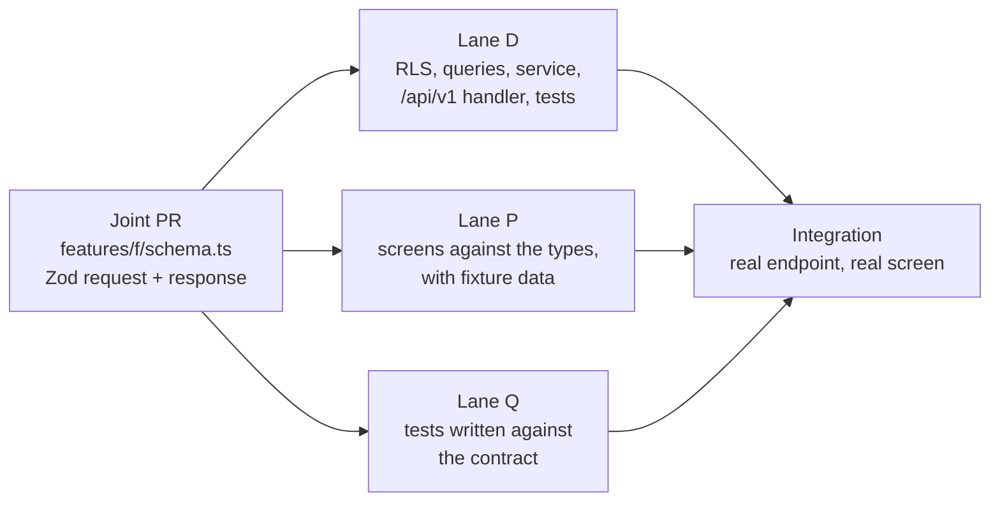
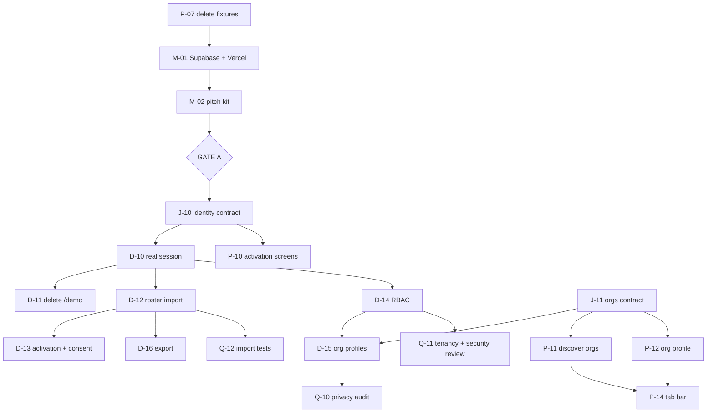

# Hiraya — Workstreams

**Status:** Active · **Version:** 2.0 · **Last updated:** 2026-09-22

The task board. `docs/MILESTONE_ROADMAP.md` says *what* and *in what order*;
`docs/BUILD_GUIDE.md` says *how*; this document says **who, what is next, and what blocks what.**

New here? Read [`CONTRIBUTING.md`](../CONTRIBUTING.md) first.

---

## 0. You are here

> **Updated by `/hiraya-checkpoint`. If this block and the tables below disagree, the tables win.**

**Phase 0 — Foundation, design system, demo tenant.** Every buildable task is built and on `main`, the
loop has been walked end to end against the real database, and **Hiraya is now deployed and publicly
reachable**. What remains is two demo defects and the pitch kit.

| | |
|---|---|
| **Current phase** | 0 of 7 · Gate A not yet reached |
| **Last work to land** | **M-01 — the deploy is live** at `https://hiraya-eosin.vercel.app` (2026-09-23, no commit: infrastructure, not code). Before it, D34 (`00965b3`) |
| **In flight** | Nothing. No open PRs |
| **Blocked on the maintainer** | Nothing blocking. **M-02** (pitch kit) is yours whenever you want it; Claude drafts all three pieces |
| **Open tasks, whole project** | 3 in Phase 0 · 17 queued behind Gate A in Phase 1 |

**▶ Next, in order:**

| | Task | Who | Say |
|---|---|---|---|
| 1 | **D-07** — the demo's live event goes stale hours after seeding | Lane D | `build D-07` |
| 2 | **P-08** — avatar keys outrun the assets; 404s on the *public* demo | Lane P | `build P-08` |
| 3 | **M-02** — pitch kit, then **Gate A** | **you**, with drafting help | `draft the pitch kit` |

**Four of Phase 0's six acceptance criteria are ticked** — unchanged by the deploy. The walkable loop
and the 500 KB budget closed on 2026-09-23; cross-tenant denial closed on 2026-09-21. Two remain:
**WCAG AA** is one finding short — **P-14**, the missing navigation landmark, deliberately booked into
Phase 1 (§6) — and **the phone-over-mobile-data load** is now *unblocked but untested*. The URL exists;
what it still needs is a real phone on real mobile data, which is a maintainer action and not a task
anyone can prompt.

**D-07 and P-08 are now public defects, not private ones.** Both were booked when the demo lived only
on `localhost`. A tenant seeded yesterday has no live event, so the check-in half of the pitch cannot
be shown at all — and check-in is the half the whole product argument rests on. P-08's missing avatars
404 on the roster, the board and the persona picker. Anyone given the URL today sees both.

## 1. Lanes

A lane is **a kind of work, not a person.** Anyone can claim a task in any lane; the lane tells you
which files you are likely to touch and which rules bite hardest there.

| Lane | Scope | Paths it owns by default |
|---|---|---|
| **D — data and API** | Schema, policies, services, endpoints, migrations | `src/db/**`, `drizzle/**`, `src/features/*/queries.ts`, `src/features/*/service.ts`, `src/app/api/**`, `src/lib/db/**`, `src/lib/auth/**`, `scripts/**`, `tests/integration/**`, `seed/**` |
| **P — product surface** | Screens, components, design system, i18n, assets | `src/app/` route groups, `src/features/*/components/**`, `src/design/**`, `src/i18n/**`, `public/**`, `tests/e2e/**` |
| **Q — quality and docs** | Tests, documentation, accessibility sweeps, audits, tooling | `tests/unit/**`, `docs/**`, `.github/**`, `SKILLS.md`, agent and skill definitions |
| **Joint** | The handshake files — smallest PR first | `src/features/*/schema.ts`, `src/lib/errors.ts`, `src/lib/types/**` |
| **M — maintainer only** | Infrastructure, secrets, gates | Nothing in the repo. See [`SETUP_GUIDE.md`](SETUP_GUIDE.md) |

**The lane is a default, not a fence.** Anyone may edit another lane's files — say so in the PR
description, and do not do it in the same PR as your own lane's work. The point of the boundary is that
several people can work a whole day without touching the same file, not that files are locked.

### Claiming a task

1. Pick a task from a table below whose dependencies have all merged and whose **Owner** column is `—`.
2. Say which one you are taking, in the PR description or an issue. Put your handle in the Owner column
   in the same PR that starts the work.
3. Branch as `feat/<task-id>-<short-name>`, e.g. `feat/d-12-roster-import`.
4. When it merges, strike the row and name the commit that closed it.

**If you are new to the project, start in Lane Q.** A test, a doc fix, or an accessibility sweep gets
you through the whole loop — clone, branch, PR, CI, merge — without a mistake being able to reach the
database. Lane D is the opposite: it holds four of the eight architecture rules, and a mistake there is
a cross-tenant read rather than a visual bug.

### Before your first Lane D task

Read `CLAUDE.md` §3 and §6, `src/db/README.md` end to end, and `src/db/rls/profiles.sql` as a worked
example. Run the `hiraya-tenancy-auditor` agent on your own diff before opening the PR, not after review
asks for it. Lane D holds R1 (tenancy in RLS), R2 (service-role confinement), R4 (the append-only
ledger) and R7 (Zod at the boundary).

---

## 2. The handshake: `schema.ts` merges first

This is the mechanism that makes lanes genuinely parallel rather than merely separate. It works for two
contributors and it works for six.

For every feature slice, the **Zod contract lands in its own small PR before any lane starts.** It is
the one file every lane reads and none owns alone. Once it is on `main`:

- **Lane D** builds downward — policy, queries, service, handler, tests. The response type is already
  fixed, so nothing is renegotiated at the end.
- **Lane P** builds upward — screens typed off `z.infer`, fed by a fixture until the endpoint exists.
- **Lane Q** can write the integration test from the contract alone, before either half exists.

**Changing a merged contract** is a joint PR that every affected lane approves, and it is the one change
that can invalidate work already in flight — so **widen rather than reshape** where you can. Adding an
optional field breaks nobody; renaming one breaks every open branch.

---

## 3. Shared files, and the rule for each

The files people collide on. Each protocol exists because the naive merge produces something that
typechecks and is wrong.

| File | Hazard | Rule |
|---|---|---|
| `src/db/schema.ts` + `drizzle/*.sql` | Two generated migrations with adjacent numbers, each valid alone, applying in an order nobody tested | **One open migration at a time, repo-wide.** Whoever holds it announces it, generates, merges, and keeps the branch short-lived. Nobody else runs `db:generate`. Need a column while one is open? Ask for it to go in that migration |
| `src/lib/errors.ts` | Two people add the same error code with different HTTP mappings | Append only, grouped as the taxonomy already is, one code per PR. Never renumber |
| `src/i18n/messages/en.json` · `fil.json` | JSON conflicts on nearly every PR; keys in `en` but not `fil` | Keys namespaced by feature (`events.register.full`). Add to **both** catalogues in the same commit. A conflict here is always "keep both" |
| `src/design/tokens.css` | A token renamed under a screen someone else is building | Lane P holds it. New tokens are additive; a rename is its own PR with the call-site sweep inside it |
| `docs/PROGRESS.md` | Append-only, newest first — everyone appends to the same line range | Everyone may append; **never edit a past entry**. On conflict, keep both, newest first. Each entry names its author |
| `docs/WORKSTREAMS.md` §0 | Several people updating "You are here" at once | Only `/hiraya-checkpoint` writes §0. On conflict, re-run it rather than merging by hand |
| `tests/integration/helpers/fixtures.ts` | The cross-tenant test enumerates tables from the live schema and fails on an unseeded one — so a new table breaks everyone's build | The migration PR that adds a table adds its fixture **in the same PR**. `npm test` on `main` is always green |
| `.env.example` | A new variable exists in one person's environment only | Any new variable lands in `.env.example` in the same PR, with a comment saying what breaks when it is unset |

---

## 4. What only the maintainer can do

Contributors work entirely against a **local Postgres with synthetic seed data** (`CONTRIBUTING.md` §2)
and are never given production keys. These tasks cannot be delegated, and nothing should be planned as
though they could. Full instructions: [`docs/SETUP_GUIDE.md`](SETUP_GUIDE.md).

- **Holding the real secrets** — `SUPABASE_SERVICE_ROLE_KEY`, `LRN_HMAC_PEPPER`, `QR_SIGNING_PRIVATE_KEY`
- **Vercel deploys** and the public demo URL
- **Repository settings** — collaborators, visibility, and the Gate B transfer to a school-owned org
- **Gate A** (the school conversations) and **Gate B** (DPO review, processor agreement, guardian
  consent, repository transfer)
- Store accounts at Phase 5

**Changed 2026-09-22 (D32):** applying migrations to Supabase is **no longer maintainer-only** — Claude
holds write access through the Supabase MCP server. The maintainer still owns the project and the keys.
This is the grant to revisit at Gate B, once real rosters exist.

---

## 5. Phase 0 — remaining work

Open acceptance criteria: **the walkable loop and a public URL.** Tier 1 assets closed with P-05; the
500 KB budget closed with P-06 at 200–209 KB per route across 14 routes, measured in the browser.

| # | Task | Lane | Owner | Depends on | Status |
|---|---|---|---|---|---|
| ~~J-01~~ | ~~`features/registration/schema.ts`~~ | Joint | jash-aeio | — | **Done 2026-09-22.** Also `eventDetailSchema` in `features/events/schema.ts` — a register control needs a detail read, and `SYSTEM_DESIGN.md` §5 listed only the collection |
| ~~D-01~~ | ~~Registration slice~~ | D | jash-aeio | J-01 | **Done 2026-09-22** (PR #11). Capacity settled in SQL: `register_for_event` counts and writes behind `SELECT … FOR UPDATE` on the event row; `cancel_event_registration` promotes the head of the waitlist and renumbers in the same transaction. Both SECURITY DEFINER, both taking tenant and profile from claims, never from an argument |
| ~~P-01~~ | ~~Event detail screen and register control~~ | P | jash-aeio | J-01 | **Done 2026-09-22.** Runs on fixtures until P-07 deletes them |
| ~~J-02~~ | ~~`features/checkin/schema.ts`~~ — Phase 0 subset only (D24) | Joint | jash-aeio | — | **Done 2026-09-22.** `jti` is the idempotency key; `checkinResultSchema` is per-item so Phase 3's `/checkins/sync` is an array of it |
| ~~D-02~~ | ~~Check-in write path + the D18 XP function~~ | D | jash-aeio | J-02, D-01 | **Done 2026-09-22** (PR #11). `award_checkin_xp` is the single bridge from a scan to a point; awards at most once per learner per event under the event lock. **Non-negotiable test 2 passes** |
| ~~P-02~~ | ~~Officer check-in screen~~ | P | jash-aeio | J-02 | **Done 2026-09-22.** Simulate-scan, narrated as the camera (D24). No `src/lib/qr`, no invented token path |
| ~~J-03~~ | ~~`features/xp/schema.ts`~~ | Joint | jash-aeio | — | **Done 2026-09-22.** `delta` is signed, so a reversal renders as a reversal |
| ~~D-03~~ | ~~`GET /me/xp`~~ | D | jash-aeio | J-03, D-02 | **Done 2026-09-22** (PR #11). Exercised as a learner, not as the owner |
| ~~P-03~~ | ~~Learner XP screen~~ | P | jash-aeio | J-03 | **Done 2026-09-22.** Every row names its source; a row with no check-in behind it says so |
| ~~J-04~~ | ~~`features/leaderboard/schema.ts`~~ | Joint | jash-aeio | — | **Done 2026-09-22.** `viewer` separate from `rows`, always returned |
| ~~D-04~~ | ~~`GET /leaderboard`~~ | D | jash-aeio | J-04, D-03 | **Done 2026-09-22** (PR #11). Computed on read; Phase 4 swaps in snapshots without a contract change |
| ~~P-04~~ | ~~Leaderboard screen~~ | P | jash-aeio | J-04 | **Done 2026-09-22.** Three scopes; the org board waits for P-12 |
| ~~D-05~~ | ~~Extend `db:seed:demo`~~ | D | jash-aeio | D-01…D-04 | **Done 2026-09-22** (PR #11). Also fixed a real defect: `eligibility_json` was double-encoded, so the Senior-High-only event silently admitted the whole school |
| ~~P-05~~ | ~~Tier 1 assets~~ | P | jash-aeio | — | **Done 2026-09-21.** Reviewable at `/design`. One caveat open: the OG card's typeface |
| ~~P-06~~ | ~~`hiraya-mobile-audit` on every demo screen~~ | P | jash-aeio | P-01…P-05 | **Done 2026-09-22** (`904f6d0`). 14 routes walked at 360×800 on a production build, P-04's deferred walk included. **Budget passes**: 200–209 KB per route. **Two a11y failures found and fixed**: `text-primary` at 4.44:1 on the canvas, and no `h1` on `/checkin/[eventId]` — which also never named the event it was scanning. **One left open**: no `nav` landmark anywhere, booked as P-14 |
| ~~P-07~~ | ~~Delete the fixture seam~~ | P | jash-aeio | — | **Done 2026-09-23** (PR #14). Six files and the `NEXT_PUBLIC_HIRAYA_FIXTURES` flag gone, 677 lines deleted. Closed the P-06 finding it was expected to: `/events/<id>` ignored its own id because `fixtureEventDetail` ignored its argument. Walked at 360×800 against the seeded tenant — 208 KB, no fixture chunk |
| **P-08** | **Avatar keys outrun the assets** — `scripts/seed-demo.ts` assigns `avatar-01`…`avatar-16`; `public/avatars/` holds 14 | P | — | — | **Open, unblocked.** Found by the P-07 browser walk (2026-09-23): every 15th and 16th person in the cast 404s on the gate roster, the leaderboard and the persona picker. **Since 2026-09-23 those 404s are public** — M-01 deployed the screens they appear on. Two ways to close it and they are not equivalent: take the seed script to `% 14` (one character, Lane D file), or author `avatar-15.svg` and `avatar-16.svg`. `ASSET_CHECKLIST.md` asks for 12–16, so 14 already satisfies it |
| ~~D-06~~ | ~~Registration answered VALIDATION_FAILED against every real database~~ | D | jash-aeio | — | **Done 2026-09-23** (PR #15). `tx.execute` returns postgres-js rows unparsed, so `r_registered_at` arrived as wire text where the row parser demanded a `Date`. The SQL was never wrong. Found by walking the loop, not by reading the diff, because `registration.test.ts` drove the SQL through raw postgres-js and the TypeScript wrapper had never run (D33). `asUserThroughDrizzle` is the seam that was missing |
| **D-07** | **The demo's live event goes stale hours after seeding** | D | — | — | **Open.** `db:seed:demo` gives Club Fair a five-hour window from seed time, so a tenant seeded yesterday has no event an officer can open a gate for and the check-in half of the demo cannot be walked at all. Confirmed 2026-09-23: `live_events_now = 0`. It makes the demo a same-day artefact, which is the wrong property for something now publicly deployed and about to be pitched (M-02). Either seed the window relative to each request, or give the demo a standing always-live event |
| ~~M-01~~ | ~~Apply the schema to Supabase; deploy to Vercel~~ | **M** | jash-aeio | D-05, P-06 | **Done 2026-09-23.** Live at `https://hiraya-eosin.vercel.app`; `/api/v1/health` answers `{"status":"ok","database":true}` and `/api/v1/demo/personas` offers 42. No commit — infrastructure, not code. **Two defects found and fixed in the deploying, both invisible locally**: the runtime had no `DATABASE_URL` (the variable existed but postdated the live build, and Vercel binds env at deploy time — the fix was a redeploy, not a new variable), and `HIRAYA_DEMO_SCHOOLS` did not match `halimbawa-demo`, so D25's allowlist discarded every persona and the public demo offered nobody. The second was hidden behind the first. R21 is answered: the SECURITY DEFINER functions read correctly where the caller is not a superuser |
| **M-02** | Pitch kit — 1-page PDF, 5-slide deck, 3-minute phone script | **M** | jash-aeio | M-01 | **Open.** Gate A input. Claude can draft all three |

**Critical path:** ~~J-01 → D-01 → D-02 → D-03 → D-04 → D-05 → P-06 → P-07 → M-01~~ → M-02 → **Gate A**. D-07 and P-08 are off the path but both are now visible on the public URL, so both want closing before it is shown to anyone.

---

## 6. Phase 1 — identity and organizations

Starts after Gate A. This is where the demo's session source is replaced by the real one, and it is the
phase with the most genuinely parallel work in the plan — good for onboarding contributors.

| # | Task | Lane | Owner | Depends on |
|---|---|---|---|---|
| **J-10** | `features/identity/schema.ts` — activate, login, `/me` | Joint | — | Gate A |
| **D-10** | Supabase Auth wiring; JWT claims stamped at login; `resolveSession` gets its **real** source | D | — | J-10 |
| **D-11** | **Delete the three `/demo` endpoints, the cookie path and the two SQL functions** | D | — | D-10 |
| **D-12** | CSV roster import — idempotent on `lrn_hmac`, per-row errors | D | — | D-10 |
| **D-13** | Activation codes in per-section batches; `CONSENT_REQUIRED` when `consent_records` is empty | D | — | D-12 |
| **D-14** | RBAC across every handler for the ten roles; admin-assisted password reset (D4) | D | — | D-10 |
| **J-11** | `features/orgs/schema.ts` — directory, profile, applications | Joint | — | — |
| **D-15** | Org profiles, officers, advisers and terms; membership applications with officer review | D | — | J-11, D-14 |
| **D-16** | `GET /admin/export` — complete CSV and JSON (NFR-12) | D | — | D-12 |
| **P-10** | Activation and login screens | P | — | J-10 |
| **P-11** | Discover Orgs with the six category filters, usable at 360×800 | P | — | J-11 |
| **P-12** | Org profile screen and the application flow; the org leaderboard scope | P | — | J-11 |
| **P-13** | School Admin console — import, codes, export | P | — | J-10, J-11 |
| **Q-10** | `hiraya-privacy-auditor` — LRN absent from every response below School Admin | Q | — | D-12, D-15 |
| **Q-11** | `hiraya-tenancy-auditor` and `/security-review` on the auth diff | Q | — | D-10, D-14 |
| **Q-12** | Integration tests for import idempotency — 1,000 rows twice is 1,000 profiles | Q | — | D-12 |
| **P-14** | **Bottom tab bar** (`DESIGN_SYSTEM.md` §7) — learner Home · Events · Orgs · Leaderboard · Me; officer adds the centre Scan; adviser Approvals · Events · Analytics · Me | P | — | P-11, P-12 |

**P-14 is a P-06 finding, deferred here on purpose.** The 2026-09-22 audit found **no `nav` landmark on
any screen and no navigation between screens at all** — a learner on `/xp` reaches `/events` only by
typing a URL. It is a real WCAG 2.1 AA gap against `DESIGN_SYSTEM.md` §8, and Phase 0 closes with it
open rather than with half a tab bar: two of the five learner tabs (Orgs, Me) are Phase 1 screens that
do not exist, and the Phase 0 demo is a scripted click-path that does not walk through a tab bar.
Building it to the spec's shape minus two items would be building it twice.

**D-11 is easy to postpone and is the highest-value deletion in the project so far.** Two session
sources is one more than this system can afford, and the second exists only because Phase 1 had not
happened yet.

**Good first tasks for a new contributor:** Q-12 (a clear, well-specified test), P-11 (a screen with no
security surface), or Q-10 (running an agent and writing up what it found).

---

## 7. Phases 2–6 — lane allocation

A task-level breakdown is written at the start of each phase, not now; written now it would be fiction.
What is settled is which lane leads and what blocks what.

| Phase | Lane D leads | Lane P leads | Lane Q leads | Hard dependency |
|---|---|---|---|---|
| **2 · Events** | proposal → approval state machine, SSLG dual approval, waitlist promotion, report generation, attendance CSV | officer proposal form, **adviser ≤3-tap approval**, calendar with conflict flags, post-event feedback | `hiraya-adviser-advocate` against the *design*, before the code | Phase 1. The advocate is a **blocking gate** |
| **3 · Check-in and XP** | `src/lib/qr` Ed25519, `/checkin/grant`, `/checkins/sync` idempotency, `xp_rules`, disputes, manual override | scanner UI, queue indicator, digital ID, dispute form | `hiraya-offline-scenario-tester` full matrix; both non-negotiable tests | Phase 2. **Open with the queue and sync endpoint, not the scanner UI** |
| **4 · Visibility** | snapshots, push delivery, analytics endpoints including the audited non-participant list | boards, merged announcement feed, notification preferences, charts (load `dataviz` first) | `hiraya-gamification-balancer` on the XP rules before launch | Phase 3 — boards need a populated ledger |
| **5 · Native** | nothing new server-side; verify no secret reaches a bundle | Capacitor shells, native camera, push, secure storage, store listings | re-run the offline matrix against the native shell | Phases 1–4, and the maintainer's store accounts |
| **6 · Hardening** | all five agents clean; backup restore **actually performed** | WCAG AA sweep, 500 KB budget | the manuals; `/security-review` across the codebase | Everything |

**Phase 3 is the one phase where the lanes cannot be fully parallel.** The scanner's local queue and the
sync endpoint are a single correctness argument, and splitting that argument across two people is how
duplicate XP ships. Pair on `/checkins/sync` and the queue, or give one person both sides of that slice.

---

## 8. Dependency graph — Phases 0 and 1

---

## 9. Keeping this document true

`/hiraya-checkpoint` reconciles this document along with everything else: §0 is rewritten, merged tasks
are struck and name the commit that closed them, and a phase's tasks are written at that phase's start.

**A workstream document describing last month's plan is worse than none at all**, because several people
read it and act in opposite directions. If you find it stale, that is a bug worth a PR of its own.
