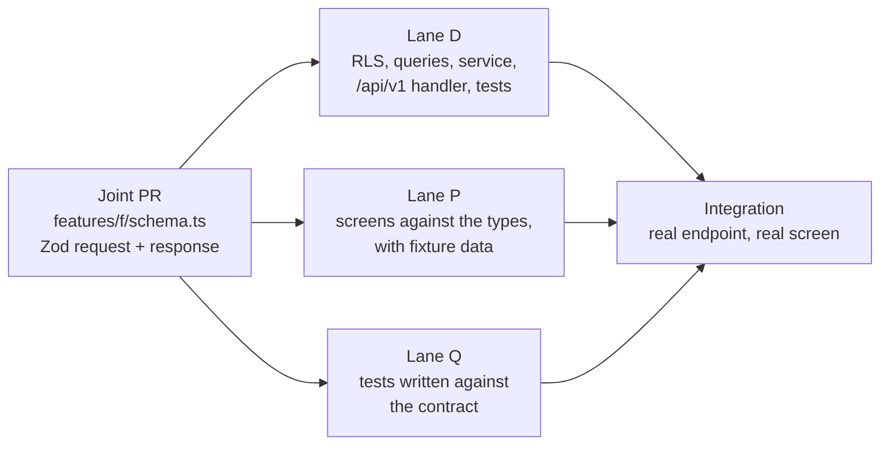
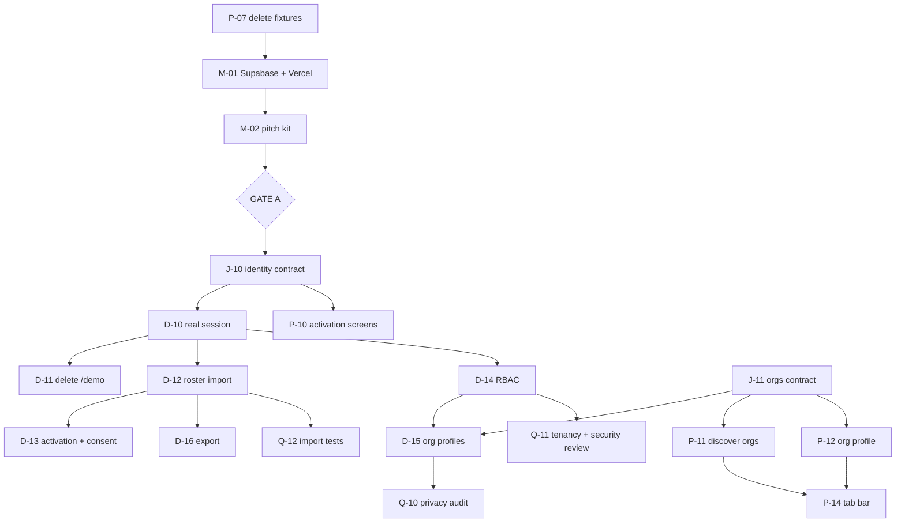

# Hiraya — Workstreams

**Status:** Active · **Version:** 2.0 · **Last updated:** 2026-09-26

The task board. `docs/MILESTONE_ROADMAP.md` says *what* and *in what order*;
`docs/BUILD_GUIDE.md` says *how*; this document says **who, what is next, and what blocks what.**

New here? Read [`CONTRIBUTING.md`](../CONTRIBUTING.md) first.

---

## 0. You are here

> **Updated by `/hiraya-checkpoint`. If this block and the tables below disagree, the tables win.**

**Phase 0 — Foundation, design system, demo tenant.** The last code task on the Phase 0 critical path is
closed: **M-04 landed and was measured**, so the API no longer crosses the Pacific on every call. What
remains on the path is the maintainer's — the phone re-test, then the pitch kit, then Gate A. Alongside
it, a **pitch-facing UI slice was added to Phase 0 on 2026-09-27** by maintainer decision: the demo has
no dashboard for either audience, and Gate A is a demo walked through on a phone with a teacher.

| | |
|---|---|
| **Current phase** | 0 of 7 · Gate A not yet reached |
| **Last work to land** | **M-04** (`9a87663`, PR #32) — the Vercel function region is pinned to `sin1` in `vercel.json`, so functions execute beside the database instead of in Washington DC. `X-Vercel-Id` went from `sin1::iad1` to `sin1::sin1`; `/api/v1/demo/personas` from **1.27–1.31 s to 0.15–0.44 s** on the same 200 and the same 7,280 bytes. ~0.87 s off every `/api/v1` call. Recorded as **D36** |
| **In flight** | **PR #31** — M-02's pitch kit, drafted, **awaiting the maintainer's read** rather than CI. It is content presented to a school; Claude does not merge it |
| **Blocked on the maintainer** | **M-03 re-test** (now unblocked by M-04) and **M-02** |
| **Open tasks, whole project** | 6 in Phase 0 — **J-12, P-16, P-17 and P-18 are code**, M-02 and the M-03 re-test are yours · 14 queued behind Gate A in Phase 1 |

**▶ Next, in order:**

| | Task | Who | Say |
|---|---|---|---|
| 1 | **M-03 re-test** — the phone test again, now that M-04 has landed | **you**, on a phone off wifi | `walk me through M-03` |
| 2 | **P-16** — responsive app chrome: the ≥1024px sidebar `DESIGN_SYSTEM.md` §7 promises, and the staff tab set | Lane P | `build P-16` |
| 3 | **P-17** — the learner Home dashboard, the screen the Home tab has never had | Lane P | `build P-17` |

**Phase 0 grew on 2026-09-27, deliberately and with its tension stated.** The maintainer asked for a
dashboard for each audience, matching the visual reference `DESIGN_SYSTEM.md` §1 is derived from, and
chose the **calm demo shell** option over building Phase 4's admin analytics early. Three tasks were
booked — **P-16** (chrome), **P-17** (learner Home), **P-18** (staff dashboard), behind one small handshake PR, **J-12** — and the roadmap's own
Phase 0 risk names the danger: *"Over-building the demo: it needs to be walkable, not complete."* The
line drawn is that these are **surfaces over endpoints that already exist**. P-17 composes
`/api/v1/me/xp`, `/api/v1/events` and `/api/v1/leaderboard`; P-18 shows pending approvals that the
`events` SELECT policy already returns to a `school_admin` and an `sslg_adviser` at any status. No new
table, no new policy, no analytics endpoint, and **nothing from Phase 4's admin analytics** — no
non-participant list, no health signals, no charts on sensitive data. If a dashboard needs a new
endpoint to look right, that is the signal it has crossed into Phase 1 or 4 and should stop.

**Why a dashboard is Gate A work and not decoration.** Two facts about the product as deployed today:
the Home tab points at `/`, which is still the Phase 0 placeholder landing page it has been since
2026-09-21 (`src/app/page.tsx` says so in its own comment), and **a staff persona has no screen at all**
— pick Marisol Tagapamahala (`school_admin`) or Rosalinda Tanglaw (`sslg_adviser`) in the persona picker
and you land on that same placeholder wearing learner tabs. `DESIGN_SYSTEM.md` §5 is explicit that
advisers decide whether this platform survives and judge it on paperwork saved. Walking a teacher
through a demo where the teacher's own view does not exist is the adoption argument lost before a
feature is evaluated.

**Five of Phase 0's six acceptance criteria are ticked. The sixth is measured, improved, and not yet
re-run.** *"Demo tenant loads on a real phone over mobile data in under 3 seconds"* was measured at
**3–4 s on 2026-09-26**, and the dominant cause — a 1.28 s flat round trip on every API call — is now
fixed and verified at **0.15–0.44 s**. That does not tick the box: the criterion is about a phone on
mobile data, and only M-03 can close it. What is known is that the largest measured contributor is gone
and that the remaining cost is the ~209 KB of JS that must download and hydrate before `/demo`'s client
fetch begins. **P-16 to P-18 must not spend that headroom** — the 500 KB budget and the re-test are both
gates they answer to, and `hiraya-mobile-audit` runs before each merges.

**A verification note worth keeping.** M-04 was nearly recorded as verified against the preview
deployment, which would have been wrong: previews sit behind Vercel deployment protection and answer
**302 at the edge**, so a timing run against one measures a redirect and never invokes a function — it
returns fast, with no `iad1` segment in `X-Vercel-Id`, and reads exactly like a pass. Anything measured
on this project is measured against production, or against a preview with the protection bypass, and a
timing number without an HTTP status beside it is not evidence.

## 1. Lanes

A lane is **a kind of work, not a person.** Anyone can claim a task in any lane; the lane tells you
which files you are likely to touch and which rules bite hardest there.

| Lane | Scope | Paths it owns by default |
|---|---|---|
| **D — data and API** | Schema, policies, services, endpoints, migrations | `src/db/**`, `drizzle/**`, `src/features/*/queries.ts`, `src/features/*/service.ts`, `src/app/api/**`, `src/lib/db/**`, `src/lib/auth/**`, `scripts/**`, `tests/integration/**`, `seed/**` |
| **P — product surface** | Screens, components, design system, i18n, assets | `src/app/` route groups, `src/features/*/components/**`, `src/design/**`, `src/i18n/**`, `public/**`, `tests/e2e/**` |
| **Q — quality and docs** | Tests, documentation, accessibility sweeps, audits, tooling | `tests/unit/**`, `docs/**`, `.github/**`, `SKILLS.md`, agent and skill definitions |
| **Joint** | The handshake files — smallest PR first | `src/features/*/schema.ts`, `src/lib/errors.ts`, `src/lib/types/**` |
| **M — maintainer only** | Infrastructure, secrets, gates | Nothing in the repo. See [`SETUP_GUIDE.md`](SETUP_GUIDE.md) |

**The lane is a default, not a fence.** Anyone may edit another lane's files — say so in the PR
description, and do not do it in the same PR as your own lane's work. The point of the boundary is that
several people can work a whole day without touching the same file, not that files are locked.

### Claiming a task

1. Pick a task from a table below whose dependencies have all merged and whose **Owner** column is `—`.
2. Say which one you are taking, in the PR description or an issue. Put your handle in the Owner column
   in the same PR that starts the work.
3. Branch as `feat/<task-id>-<short-name>`, e.g. `feat/d-12-roster-import`.
4. When it merges, strike the row and name the commit that closed it.

**If you are new to the project, start in Lane Q.** A test, a doc fix, or an accessibility sweep gets
you through the whole loop — clone, branch, PR, CI, merge — without a mistake being able to reach the
database. Lane D is the opposite: it holds four of the eight architecture rules, and a mistake there is
a cross-tenant read rather than a visual bug.

### Before your first Lane D task

Read `CLAUDE.md` §3 and §6, `src/db/README.md` end to end, and `src/db/rls/profiles.sql` as a worked
example. Run the `hiraya-tenancy-auditor` agent on your own diff before opening the PR, not after review
asks for it. Lane D holds R1 (tenancy in RLS), R2 (service-role confinement), R4 (the append-only
ledger) and R7 (Zod at the boundary).

---

## 2. The handshake: `schema.ts` merges first

This is the mechanism that makes lanes genuinely parallel rather than merely separate. It works for two
contributors and it works for six.

For every feature slice, the **Zod contract lands in its own small PR before any lane starts.** It is
the one file every lane reads and none owns alone. Once it is on `main`:

- **Lane D** builds downward — policy, queries, service, handler, tests. The response type is already
  fixed, so nothing is renegotiated at the end.
- **Lane P** builds upward — screens typed off `z.infer`, fed by a fixture until the endpoint exists.
- **Lane Q** can write the integration test from the contract alone, before either half exists.

**Changing a merged contract** is a joint PR that every affected lane approves, and it is the one change
that can invalidate work already in flight — so **widen rather than reshape** where you can. Adding an
optional field breaks nobody; renaming one breaks every open branch.

---

## 3. Shared files, and the rule for each

The files people collide on. Each protocol exists because the naive merge produces something that
typechecks and is wrong.

| File | Hazard | Rule |
|---|---|---|
| `src/db/schema.ts` + `drizzle/*.sql` | Two generated migrations with adjacent numbers, each valid alone, applying in an order nobody tested | **One open migration at a time, repo-wide.** Whoever holds it announces it, generates, merges, and keeps the branch short-lived. Nobody else runs `db:generate`. Need a column while one is open? Ask for it to go in that migration |
| `src/lib/errors.ts` | Two people add the same error code with different HTTP mappings | Append only, grouped as the taxonomy already is, one code per PR. Never renumber |
| `src/i18n/messages/en.json` · `fil.json` | JSON conflicts on nearly every PR; keys in `en` but not `fil` | Keys namespaced by feature (`events.register.full`). Add to **both** catalogues in the same commit. A conflict here is always "keep both" |
| `src/design/tokens.css` | A token renamed under a screen someone else is building | Lane P holds it. New tokens are additive; a rename is its own PR with the call-site sweep inside it |
| `docs/PROGRESS.md` | Append-only, newest first — everyone appends to the same line range | Everyone may append; **never edit a past entry**. On conflict, keep both, newest first. Each entry names its author |
| `docs/WORKSTREAMS.md` §0 | Several people updating "You are here" at once | Only `/hiraya-checkpoint` writes §0. On conflict, re-run it rather than merging by hand |
| `tests/integration/helpers/fixtures.ts` | The cross-tenant test enumerates tables from the live schema and fails on an unseeded one — so a new table breaks everyone's build | The migration PR that adds a table adds its fixture **in the same PR**. `npm test` on `main` is always green |
| `.env.example` | A new variable exists in one person's environment only | Any new variable lands in `.env.example` in the same PR, with a comment saying what breaks when it is unset |

---

## 4. What only the maintainer can do

Contributors work entirely against a **local Postgres with synthetic seed data** (`CONTRIBUTING.md` §2)
and are never given production keys. These tasks cannot be delegated, and nothing should be planned as
though they could. Full instructions: [`docs/SETUP_GUIDE.md`](SETUP_GUIDE.md).

- **Holding the real secrets** — `SUPABASE_SERVICE_ROLE_KEY`, `LRN_HMAC_PEPPER`, `QR_SIGNING_PRIVATE_KEY`
- **Vercel deploys** and the public demo URL
- **Repository settings** — collaborators, visibility, and the Gate B transfer to a school-owned org
- **Gate A** (the school conversations) and **Gate B** (DPO review, processor agreement, guardian
  consent, repository transfer)
- Store accounts at Phase 5

**Changed 2026-09-22 (D32):** applying migrations to Supabase is **no longer maintainer-only** — Claude
holds write access through the Supabase MCP server. The maintainer still owns the project and the keys.
This is the grant to revisit at Gate B, once real rosters exist.

---

## 5. Phase 0 — remaining work

Open acceptance criteria: **the phone test (M-03), and nothing else** — but it is now open on a
measurement rather than on nobody having run it. It came back at **3–4 s** against a <3 s bar on
2026-09-26, and what it found (**M-04**: functions in `iad1`, database in `ap-southeast-1`) is open
Phase 0 code work. The walkable loop and the public URL both closed on 2026-09-23 — this line claimed
otherwise until 2026-09-26. Tier 1 assets closed with P-05; the 500 KB budget closed with P-06 at
200–209 KB per route across 14 routes, measured in the browser. Note that the budget criterion is
unaffected by M-04 and remains closed: 209 KB of JS/CSS plus 28 KB of HTML still transfers today.
M-04 is latency, not weight.

| # | Task | Lane | Owner | Depends on | Status |
|---|---|---|---|---|---|
| ~~J-01~~ | ~~`features/registration/schema.ts`~~ | Joint | jash-aeio | — | **Done 2026-09-22.** Also `eventDetailSchema` in `features/events/schema.ts` — a register control needs a detail read, and `SYSTEM_DESIGN.md` §5 listed only the collection |
| ~~D-01~~ | ~~Registration slice~~ | D | jash-aeio | J-01 | **Done 2026-09-22** (PR #11). Capacity settled in SQL: `register_for_event` counts and writes behind `SELECT … FOR UPDATE` on the event row; `cancel_event_registration` promotes the head of the waitlist and renumbers in the same transaction. Both SECURITY DEFINER, both taking tenant and profile from claims, never from an argument |
| ~~P-01~~ | ~~Event detail screen and register control~~ | P | jash-aeio | J-01 | **Done 2026-09-22.** Runs on fixtures until P-07 deletes them |
| ~~J-02~~ | ~~`features/checkin/schema.ts`~~ — Phase 0 subset only (D24) | Joint | jash-aeio | — | **Done 2026-09-22.** `jti` is the idempotency key; `checkinResultSchema` is per-item so Phase 3's `/checkins/sync` is an array of it |
| ~~D-02~~ | ~~Check-in write path + the D18 XP function~~ | D | jash-aeio | J-02, D-01 | **Done 2026-09-22** (PR #11). `award_checkin_xp` is the single bridge from a scan to a point; awards at most once per learner per event under the event lock. **Non-negotiable test 2 passes** |
| ~~P-02~~ | ~~Officer check-in screen~~ | P | jash-aeio | J-02 | **Done 2026-09-22.** Simulate-scan, narrated as the camera (D24). No `src/lib/qr`, no invented token path |
| ~~J-03~~ | ~~`features/xp/schema.ts`~~ | Joint | jash-aeio | — | **Done 2026-09-22.** `delta` is signed, so a reversal renders as a reversal |
| ~~D-03~~ | ~~`GET /me/xp`~~ | D | jash-aeio | J-03, D-02 | **Done 2026-09-22** (PR #11). Exercised as a learner, not as the owner |
| ~~P-03~~ | ~~Learner XP screen~~ | P | jash-aeio | J-03 | **Done 2026-09-22.** Every row names its source; a row with no check-in behind it says so |
| ~~J-04~~ | ~~`features/leaderboard/schema.ts`~~ | Joint | jash-aeio | — | **Done 2026-09-22.** `viewer` separate from `rows`, always returned |
| ~~D-04~~ | ~~`GET /leaderboard`~~ | D | jash-aeio | J-04, D-03 | **Done 2026-09-22** (PR #11). Computed on read; Phase 4 swaps in snapshots without a contract change |
| ~~P-04~~ | ~~Leaderboard screen~~ | P | jash-aeio | J-04 | **Done 2026-09-22.** Three scopes; the org board waits for P-12 |
| ~~D-05~~ | ~~Extend `db:seed:demo`~~ | D | jash-aeio | D-01…D-04 | **Done 2026-09-22** (PR #11). Also fixed a real defect: `eligibility_json` was double-encoded, so the Senior-High-only event silently admitted the whole school |
| ~~P-05~~ | ~~Tier 1 assets~~ | P | jash-aeio | — | **Done 2026-09-21.** Reviewable at `/design`. One caveat open: the OG card's typeface |
| ~~P-06~~ | ~~`hiraya-mobile-audit` on every demo screen~~ | P | jash-aeio | P-01…P-05 | **Done 2026-09-22** (`904f6d0`). 14 routes walked at 360×800 on a production build, P-04's deferred walk included. **Budget passes**: 200–209 KB per route. **Two a11y failures found and fixed**: `text-primary` at 4.44:1 on the canvas, and no `h1` on `/checkin/[eventId]` — which also never named the event it was scanning. **One left open**: no `nav` landmark anywhere, booked as P-14 |
| ~~P-07~~ | ~~Delete the fixture seam~~ | P | jash-aeio | — | **Done 2026-09-23** (PR #14). Six files and the `NEXT_PUBLIC_HIRAYA_FIXTURES` flag gone, 677 lines deleted. Closed the P-06 finding it was expected to: `/events/<id>` ignored its own id because `fixtureEventDetail` ignored its argument. Walked at 360×800 against the seeded tenant — 208 KB, no fixture chunk |
| ~~P-08~~ | ~~Avatar keys outrun the assets~~ | P | jash-aeio | — | **Done 2026-09-26** (`1c8fb07`, PR #27). Closed by authoring `avatar-15.svg` and `avatar-16.svg` rather than taking the seed script to `% 14`. The two routes were not equivalent and the deployed data decided it: `profiles` already holds those four keys, so adding the files makes them resolve with no write to the database and no re-seed, where `% 14` would have needed one. Both follow the set's construction — 64×64, circle-clipped, one light geometric figure on a dark ground, non-figurative (§6); 285 and 433 bytes against a 2 KB ceiling. `ASSET_CHECKLIST.md` §1.5 asks for 12–16 and now records 16. The design gallery hardcoded 14 as well and now shows the whole set. Verified on the public URL: all 16 serve 200, `avatar-17` still 404s |
| ~~D-06~~ | ~~Registration answered VALIDATION_FAILED against every real database~~ | D | jash-aeio | — | **Done 2026-09-23** (PR #15). `tx.execute` returns postgres-js rows unparsed, so `r_registered_at` arrived as wire text where the row parser demanded a `Date`. The SQL was never wrong. Found by walking the loop, not by reading the diff, because `registration.test.ts` drove the SQL through raw postgres-js and the TypeScript wrapper had never run (D33). `asUserThroughDrizzle` is the seam that was missing |
| ~~D-07~~ | ~~The demo's live event goes stale hours after seeding~~ | D | jash-aeio | — | **Done 2026-09-25.** `happeningNow` is now a property of the event rather than of the moment it was seeded: the seed marks that one row `demo_rolls_live`, and `public.demo_roll_live_events` re-centres its window on now when a persona is picked, keeping the seeded five hours. The scan rule is untouched — `isWithinScanWindow` still decides every write against server time, so a scan can still fall outside the rolled window, which a never-ending event would have made impossible on the one event a teacher watches us scan into. Gated three ways: `s.is_demo`, the per-event flag, and a school id the caller has already cleared the D25 allowlist to learn. A partial unique index makes "one standing live event per school" a database fact rather than a check in the seed script — the tenancy audit's one finding |
| ~~D-08~~ | ~~An SSLG officer cannot check anyone in~~ | D | jash-aeio | — | **Done 2026-09-25** (`4a7bf73`, PR #26). Neither of the two fixes this row proposed was taken. Widening the SELECT policy to `sslg_officer` was written first and **blocked by `hiraya-privacy-auditor`**: with `profiles_select_tenant` already handing every learner the whole roster, school-wide attendance rows make roster-minus-attendees derivable — the non-participant list, which `SYSTEM_DESIGN.md` §2 denies to SSLG Officer and even to Guidance, and which `DATA_FLOW.md` T8 requires audited on every access. The role is held by learners. What shipped is narrower than either option: the SELECT policy grants `recorded_by = current_profile_id()`, so a session reads back only the rows it wrote — all `RETURNING id` needs — and the officer’s other question goes to `public.find_existing_checkin`, a SECURITY DEFINER bridge that re-states the INSERT policy and answers about one named learner with an id and no attendance detail. Same shape as `award_checkin_xp`, same reason. Ten integration tests, proven in both directions: four fail without the grant, two fail against the widened policy |
| ~~P-15~~ | ~~Phase 0 bottom navigation~~ | P | jash-aeio | — | **Done 2026-09-23.** Closes the last P-06 finding and with it Phase 0's **WCAG AA** criterion. A real `nav` landmark (`aria-label`, `aria-current="page"`) over the four screens that exist, plus **Scan** for the two officer roles. **Deliberately not P-14**: two of §7's five learner tabs (Orgs, Me) are Phase 1 screens, and a tab pointing at a 404 is worse than a tab that is not there yet — P-14 widens the item list and changes nothing else. Verified at 360×800: one landmark per screen, absent on `/demo` and `/design`, targets 83×54px, contrast 4.83:1 active and 6.0:1 inactive on `--surface`, focus ring on every tab, no horizontal scroll, 198 KB first load. 18 unit tests |
| ~~M-01~~ | ~~Apply the schema to Supabase; deploy to Vercel~~ | **M** | jash-aeio | D-05, P-06 | **Done 2026-09-23.** Live at `https://hiraya-eosin.vercel.app`; `/api/v1/health` answers `{"status":"ok","database":true}` and `/api/v1/demo/personas` offers 42. No commit — infrastructure, not code. **Two defects found and fixed in the deploying, both invisible locally**: the runtime had no `DATABASE_URL` (the variable existed but postdated the live build, and Vercel binds env at deploy time — the fix was a redeploy, not a new variable), and `HIRAYA_DEMO_SCHOOLS` did not match `halimbawa-demo`, so D25's allowlist discarded every persona and the public demo offered nobody. The second was hidden behind the first. R21 is answered: the SECURITY DEFINER functions read correctly where the caller is not a superuser |
| **M-03** | **The phone test** — load the demo on a real phone over mobile data, under 3 seconds | **M** | jash-aeio | M-01, **M-04** | **Run 2026-09-26 — did not pass. Still open, still blocking Phase 0.** Measured **3–4 s, occasionally near 3 s** on a real phone, mobile data, incognito, with Supabase pre-warmed. `SETUP_GUIDE.md` §5a puts 3–6 s in the *record the real number* band, and the maintainer chose that over ticking the box. The run was worth far more than the criterion: it is the only check that touches PRD assumptions A1–A3, and the first time anyone ran it, it surfaced **M-04**. Re-test once M-04 is deployed |
| ~~M-04~~ | ~~**Pin the Vercel function region to `sin1`**~~ | **D** | claude | — | **Done 2026-09-27** (`9a87663`, PR #32). One file, one key: `"regions": ["sin1"]` in `vercel.json`. Verified on production, not on the preview — the preview sits behind deployment protection and answers 302 at the edge, which times a redirect rather than a function and would have read as a pass. `X-Vercel-Id` went from `sin1::iad1` to `sin1::sin1`; `/api/v1/demo/personas` from **1.27–1.31 s to 0.15–0.44 s**, same 200, same 7,280 bytes. That is ~0.87 s off every `/api/v1` call in the product, not just the demo screen. Recorded as **D36** |
| **P-16** | **Responsive app chrome** — the ≥1024px sidebar `DESIGN_SYSTEM.md` §7 promises, plus the staff tab set | P | claude | — | **Open.** Booked 2026-09-27. `NavBar` is bottom-tabs-only today, so every screen is a phone screen on a laptop — which is what a pitch is often shown on. Same items, same `navItemsFor` decision, a second layout: vertical sidebar with the teal active pill at ≥1024px. Also extends `navItemsFor` to return a tab set for `school_admin` and the adviser roles, which today get learner tabs. Touches a shipped primitive and so every existing screen — its own PR for exactly that reason |
| **P-17** | **The learner Home dashboard** — the screen the Home tab has never had | P | claude | P-16 | **Open.** Booked 2026-09-27. `/` is still the Phase 0 placeholder landing page. Builds the reference's dashboard vocabulary per `DESIGN_SYSTEM.md` §7 — snap-scroll stat strip, 2-up category tiles, compact hero, leaderboard first — in the **learner** register. Composes `/api/v1/me/xp`, `/api/v1/events` and `/api/v1/leaderboard` in parallel; **no new endpoint**. `/` keeps rendering the landing page when there is no demo session, because it is also the public front door |
| **P-18** | **The staff dashboard** — the screen an adviser and a school admin have never had | P | claude | P-16, J-12 | **Open.** Booked 2026-09-27. Calm register (`DESIGN_SYSTEM.md` §5): counts and a dense table, no medals, no mascots, no celebration — `[data-register="staff"]` already zeroes `--duration-celebrate`. Hero is *pending approvals*, which the `events` SELECT policy already returns to `school_admin` and `sslg_adviser` at any status, so no policy changes. **Deliberately not Phase 4:** no non-participant list, no health signals, no charts. Seeded data holds one pending and one rejected event — the number is small and honest |
| **J-12** | `status` on the events list contract — `ListEventsQuery` filters scope, category and org, but not status | Joint | claude | — | **Open.** Booked 2026-09-27. The smallest PR of the three and it merges first (§2): a staff surface asking for *pending* events should say so in the query rather than over-fetch and filter in the browser, where a `limit` can hide the very rows the screen exists to show |
| **M-02** | Pitch kit — 1-page PDF, 5-slide deck, 3-minute phone script | **M** | jash-aeio | M-01 | **Open.** Gate A input. Claude can draft all three |

**Critical path:** ~~J-01 → D-01 → D-02 → D-03 → D-04 → D-05 → P-06 → P-07 → M-01 → M-04~~ → **M-03 re-test** → M-02 → **Gate A**. M-04 and M-03 entered the path on 2026-09-26, when the phone test was first actually run; M-04 left it on 2026-09-27, measured rather than assumed. ~~D-07~~ closed 2026-09-25; ~~D-08~~ and ~~P-08~~ closed 2026-09-25 and 2026-09-26. Both were off the path but visible on the public URL, and both are now gone from it.

---

## 6. Phase 1 — identity and organizations

Starts after Gate A. This is where the demo's session source is replaced by the real one, and it is the
phase with the most genuinely parallel work in the plan — good for onboarding contributors.

| # | Task | Lane | Owner | Depends on |
|---|---|---|---|---|
| **J-10** | `features/identity/schema.ts` — activate, login, `/me` | Joint | — | Gate A |
| **D-10** | Supabase Auth wiring; JWT claims stamped at login; `resolveSession` gets its **real** source | D | — | J-10 |
| **D-11** | **Delete the three `/demo` endpoints, the cookie path and the two SQL functions** | D | — | D-10 |
| **D-12** | CSV roster import — idempotent on `lrn_hmac`, per-row errors | D | — | D-10 |
| **D-13** | Activation codes in per-section batches; `CONSENT_REQUIRED` when `consent_records` is empty | D | — | D-12 |
| **D-14** | RBAC across every handler for the ten roles; admin-assisted password reset (D4) | D | — | D-10 |
| **J-11** | `features/orgs/schema.ts` — directory, profile, applications | Joint | — | — |
| **D-15** | Org profiles, officers, advisers and terms; membership applications with officer review | D | — | J-11, D-14 |
| **D-16** | `GET /admin/export` — complete CSV and JSON (NFR-12) | D | — | D-12 |
| **P-10** | Activation and login screens | P | — | J-10 |
| **P-11** | Discover Orgs with the six category filters, usable at 360×800 | P | — | J-11 |
| **P-12** | Org profile screen and the application flow; the org leaderboard scope | P | — | J-11 |
| **P-13** | School Admin console — import, codes, export | P | — | J-10, J-11 |
| **Q-10** | `hiraya-privacy-auditor` — LRN absent from every response below School Admin | Q | — | D-12, D-15 |
| **Q-11** | `hiraya-tenancy-auditor` and `/security-review` on the auth diff | Q | — | D-10, D-14 |
| **Q-12** | Integration tests for import idempotency — 1,000 rows twice is 1,000 profiles | Q | — | D-12 |
| **P-14** | **Bottom tab bar** (`DESIGN_SYSTEM.md` §7) — learner Home · Events · Orgs · Leaderboard · Me; officer adds the centre Scan; adviser Approvals · Events · Analytics · Me | P | — | P-11, P-12 |

**P-14 is now a widening, not a gap.** **P-15** (2026-09-23) shipped the Phase 0 bar and closed the WCAG criterion; P-14 adds the Orgs and Me tabs once those screens exist, and the adviser set. The component and its tests do not change — only the item list in `navView.ts` does.

**The original reasoning, kept because it is why P-15 is scoped the way it is.** The 2026-09-22 audit found **no `nav` landmark on
any screen and no navigation between screens at all** — a learner on `/xp` reaches `/events` only by
typing a URL. It is a real WCAG 2.1 AA gap against `DESIGN_SYSTEM.md` §8, and Phase 0 closes with it
open rather than with half a tab bar: two of the five learner tabs (Orgs, Me) are Phase 1 screens that
do not exist, and the Phase 0 demo is a scripted click-path that does not walk through a tab bar.
Building it to the spec's shape minus two items would be building it twice.

**D-11 is easy to postpone and is the highest-value deletion in the project so far.** Two session
sources is one more than this system can afford, and the second exists only because Phase 1 had not
happened yet.

**Good first tasks for a new contributor:** Q-12 (a clear, well-specified test), P-11 (a screen with no
security surface), or Q-10 (running an agent and writing up what it found).

---

## 7. Phases 2–6 — lane allocation

A task-level breakdown is written at the start of each phase, not now; written now it would be fiction.
What is settled is which lane leads and what blocks what.

| Phase | Lane D leads | Lane P leads | Lane Q leads | Hard dependency |
|---|---|---|---|---|
| **2 · Events** | proposal → approval state machine, SSLG dual approval, waitlist promotion, report generation, attendance CSV | officer proposal form, **adviser ≤3-tap approval**, calendar with conflict flags, post-event feedback | `hiraya-adviser-advocate` against the *design*, before the code | Phase 1. The advocate is a **blocking gate** |
| **3 · Check-in and XP** | `src/lib/qr` Ed25519, `/checkin/grant`, `/checkins/sync` idempotency, `xp_rules`, disputes, manual override | scanner UI, queue indicator, digital ID, dispute form | `hiraya-offline-scenario-tester` full matrix; both non-negotiable tests | Phase 2. **Open with the queue and sync endpoint, not the scanner UI** |
| **4 · Visibility** | snapshots, push delivery, analytics endpoints including the audited non-participant list | boards, merged announcement feed, notification preferences, charts (load `dataviz` first) | `hiraya-gamification-balancer` on the XP rules before launch | Phase 3 — boards need a populated ledger |
| ~~**5 · Native**~~ **DEFERRED (D35)** | — | — | — | Out of MVP scope from 2026-09-23. `MILESTONE_ROADMAP.md` §8 holds what it would take to resume |
| **6 · Hardening** | all five agents clean; backup restore **actually performed** | WCAG AA sweep, 500 KB budget | the manuals; `/security-review` across the codebase | Everything |

**Phase 3 is the one phase where the lanes cannot be fully parallel.** The scanner's local queue and the
sync endpoint are a single correctness argument, and splitting that argument across two people is how
duplicate XP ships. Pair on `/checkins/sync` and the queue, or give one person both sides of that slice.

---

## 8. Dependency graph — Phases 0 and 1

---

## 9. Keeping this document true

`/hiraya-checkpoint` reconciles this document along with everything else: §0 is rewritten, merged tasks
are struck and name the commit that closed them, and a phase's tasks are written at that phase's start.

**A workstream document describing last month's plan is worse than none at all**, because several people
read it and act in opposite directions. If you find it stale, that is a bug worth a PR of its own.
