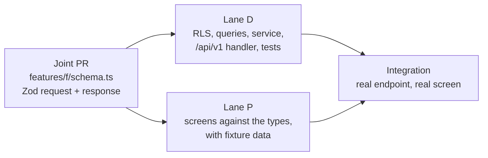
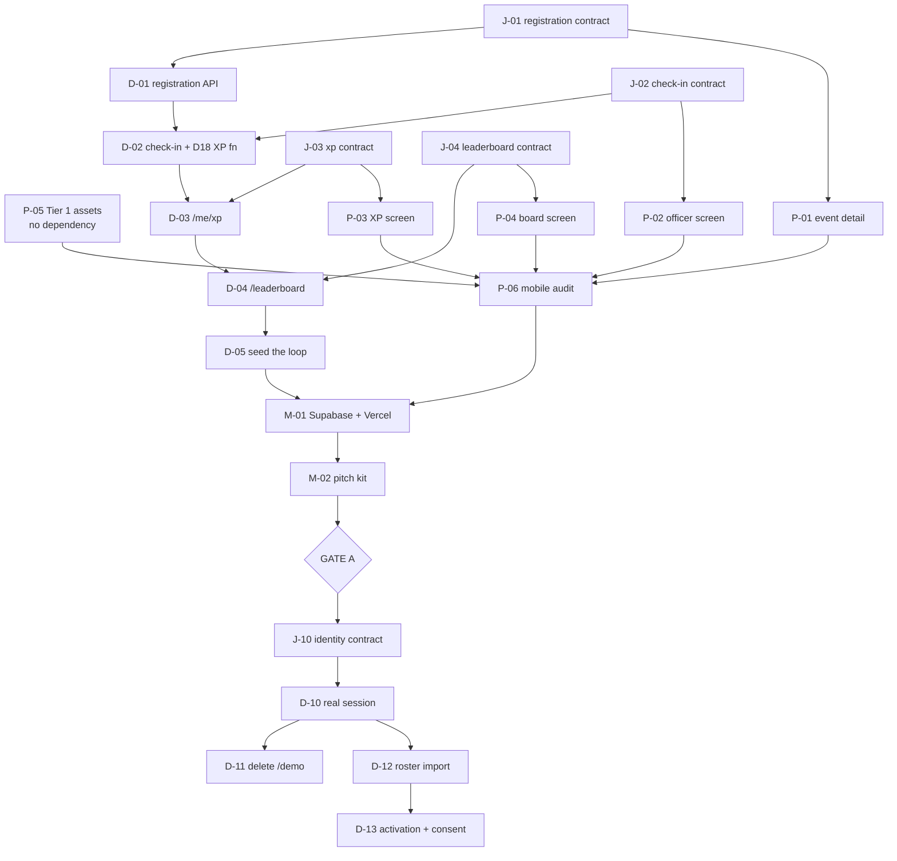

# Hiraya — Workstreams

**Status:** Active · **Version:** 1.0 · **Last updated:** 2026-09-21

How two developers work on Hiraya at the same time without stepping on each other, and what depends on
what. `docs/MILESTONE_ROADMAP.md` says *what* and *when*; this document says *who*, *in what order*, and
*what unblocks what*.

Read `CONTRIBUTING.md` first if you have just joined.

---

## 1. Two lanes

| Lane | Owner | Owns these paths |
|---|---|---|
| **Lane D — data and API** | incoming developer | `src/db/**`, `drizzle/**`, `src/features/*/queries.ts`, `src/features/*/service.ts`, `src/app/api/**`, `src/lib/db/**`, `src/lib/auth/**`, `scripts/**`, `tests/integration/**`, `seed/**` |
| **Lane P — product surface** | maintainer (jash-aeio) | `src/app/` route groups, `src/features/*/components/**`, `src/design/**`, `src/i18n/**`, `assets/**`, `public/**`, `tests/e2e/**`, the pitch kit |
| **Joint** | both, smallest PR first | `src/features/*/schema.ts`, `src/lib/errors.ts`, `docs/**` |

**The lane is a default, not a fence.** Either developer may edit the other's files — but say so in the
PR description, and do not do it in the same PR as your own lane's work. The point of the boundary is
that two people can work a whole day without touching the same file, not that the files are locked.

### Why Lane D carries the heavier onboarding

Lane D holds four of the eight architecture rules: R1 (tenancy in RLS), R2 (the service-role
confinement), R4 (the append-only ledger) and R7 (Zod at the boundary). A mistake in Lane P is a visual
bug; a mistake in Lane D is a cross-tenant read. Before writing a first migration, Lane D should have
read `CLAUDE.md` §3 and §6, `src/db/README.md` end to end, and `src/db/rls/profiles.sql` as a worked
example — and should run the `hiraya-tenancy-auditor` agent on their own diff before opening the PR,
not after review asks for it.

---

## 2. The handshake: `schema.ts` merges first

This is the mechanism that makes the lanes genuinely parallel rather than merely separate.

For every feature slice, the **Zod contract lands in its own small PR before either lane starts**. It is
the one file both lanes read and neither owns alone. Once it is on `main`:

- Lane D builds downward from it — policy, queries, service, handler, tests — and the response type is
  already fixed, so there is nothing to renegotiate at the end.
- Lane P builds upward from it — screens typed off `z.infer`, fed by a fixture until the endpoint exists.

`hiraya-feature-slice` already prescribes this order for one developer (schema → RLS → contract →
service → handler → UI → tests). With two people, the contract step becomes a merge point instead of a
passing moment.

**Changing a merged contract** is a joint PR both approve, and it is the one change that can invalidate
work already in flight — so widen rather than reshape where you can. Adding an optional field breaks
nobody; renaming one breaks the other lane's open branch.

---

## 3. Shared files, and the rule for each

These are the files two people will collide on. Each has a protocol, and each protocol exists because
the naive merge produces something that typechecks and is wrong.

| File | Hazard | Rule |
|---|---|---|
| `src/db/schema.ts` + `drizzle/*.sql` | Two generated migrations with adjacent numbers, each valid alone, applying in an order neither author tested | **One open migration at a time, repo-wide.** Lane D announces it, generates, merges, and keeps the branch short-lived. Lane P never runs `db:generate`. If a migration is open and you need a column, ask for it to go in that migration |
| `src/lib/errors.ts` | Two people add the same error code with different HTTP mappings | Append only, grouped as the taxonomy already is, one code per PR. Never renumber |
| `src/i18n/messages/en.json` · `fil.json` | JSON conflicts on nearly every PR, and keys present in `en` but not `fil` | Keys are namespaced by feature (`events.register.full`). Add to **both** catalogues in the same commit. A conflict here is always "keep both" |
| `src/design/tokens.css` | A token renamed under a screen someone else is building | Lane P owns it. New tokens are additive; a rename is its own PR with the call-site sweep inside it |
| `docs/PROGRESS.md` | Append-only, newest first — so both people append to the same line range | Both may append; **never edit a past entry**. On conflict, keep both, newest first. Each entry names its author |
| `tests/integration/helpers/fixtures.ts` | The cross-tenant test enumerates tables from the live schema and fails on an unseeded one — so a new table from Lane D breaks Lane P's green build | The migration PR that adds a table adds its fixture **in the same PR**. `npm test` on `main` is always green |
| `.env.example` | A new variable exists in one person's environment only | Any new variable lands in `.env.example` in the same PR, with a comment saying what breaks when it is unset |

---

## 4. What only the maintainer can do

Lane D works entirely against a **local Postgres with synthetic seed data** (`CONTRIBUTING.md` §2).
These tasks cannot be delegated, and nothing should be planned as though they could:

- **Applying migrations to the Supabase project.** Lane D authors the migration; the maintainer applies
  it and reports the result. Supabase is not a superuser environment, and `FORCE ROW LEVEL SECURITY`,
  default privileges and the `rls_auto_enable()` event trigger have already produced surprises there
  that a local Postgres does not reproduce
- **Vercel deploys** and the public demo URL
- Anything holding a real secret: `SUPABASE_SERVICE_ROLE_KEY`, `LRN_HMAC_PEPPER`,
  `QR_SIGNING_PRIVATE_KEY`
- **Gate A** (the school conversations) and **Gate B** (DPO review, processor agreement, guardian
  consent, repository transfer)
- Repository settings: branch protection, visibility, and the Gate B transfer to a school-owned org

---

## 5. Phase 0 — remaining work

Phase 0's open acceptance criteria are the walkable loop, Tier 1 assets, the 500 KB budget, WCAG AA on
every demo screen, and a public URL. Browse (`GET /events` plus the learner events screen) has landed.

| # | Task | Lane | Depends on | Notes |
|---|---|---|---|---|
| **J-01** | `features/registration/schema.ts` — register, cancel, capacity and waitlist responses | Joint | — | First handshake. Include the *ineligibility reason* shape: the PRD requires telling a learner which criterion excluded them |
| **D-01** | Registration slice — `event_registrations` policy review, queries, service, `POST`/`DELETE /events/:id/register`, capacity and waitlist promotion, tests | D | J-01 | Capacity is a race. Settle it in SQL, not in the service |
| **P-01** | Event detail screen and register control, with the full → waitlist and ineligible states | P | J-01 | Runs on fixtures until D-01 merges |
| **J-02** | `features/checkin/schema.ts` — the Phase 0 subset only (D24 simulate-scan) | Joint | — | Shape it so the Phase 3 real scanner extends it rather than replaces it |
| **D-02** | Check-in write path — `POST /checkins` under officer claims, plus the **D18 `SECURITY DEFINER` XP function** | D | J-02, D-01 | The check-in row and the ledger row commit together or not at all. `hiraya-checkin-integrity` applies to every commit here |
| **P-02** | Officer check-in screen — the simulate-scan button, narrated as the camera (D24) | P | J-02 | No `src/lib/qr` until Phase 3. Do not invent an unsigned token path to fill the gap |
| **J-03** | `features/xp/schema.ts` — ledger entries with their sources, level, progress | Joint | — | |
| **D-03** | `GET /me/xp` over `xp_balances` and the ledger, with the four Filipino level titles | D | J-03, D-02 | Reads the `security_invoker` view (D19) |
| **P-03** | Learner XP screen — level, progress, and "this point came from this check-in" | P | J-03 | The screen that makes the load-bearing claim visible |
| **J-04** | `features/leaderboard/schema.ts` — four scopes, season | Joint | — | |
| **D-04** | `GET /leaderboard` at section, grade, org and school scope | D | J-04, D-03 | The demo may compute; Phase 4 moves it to `leaderboard_snapshots` |
| **P-04** | Leaderboard screen, including the hidden-learner case | P | J-04 | |
| **D-05** | Extend `db:seed:demo` with registrations, check-ins and ledger rows | D | D-01…D-04 | Boards must be non-empty *before* the demo walks the loop |
| **P-05** | **Tier 1 assets** — wordmark, PWA icons, 4 level badges, 6 category icons, 12–16 avatars, 5 empty states, hero | P | — | **Not started: `assets/` and `public/` do not exist.** Blocks the demo per `ASSET_CHECKLIST.md` §1 |
| **P-06** | `hiraya-mobile-audit` on every demo screen — 360×800, a11y tree, ≤500 KB first load | P | P-01…P-05 | The floor is already ≈183 KB gzipped on an almost empty page |
| **M-01** | Apply the schema to Supabase, deploy to Vercel, confirm the repository is private | maintainer | D-05, P-06 | R13: the free project sleeps. Wake it the morning of a pitch |
| **M-02** | Pitch kit — 1-page PDF, 5-slide deck, 3-minute phone script | maintainer | M-01 | Gate A input |

**Critical path to a walkable demo:** J-01 → D-01 → D-02 → D-03 → D-04 → D-05 → M-01. Lane P runs
alongside the whole of it, and P-05 has no dependency at all — it can start today.

---

## 6. Phase 1 — identity and organizations

Starts after Gate A. This is where the demo's session source is replaced by the real one, and it is the
phase with the most genuinely parallel work in the plan.

| # | Task | Lane | Depends on |
|---|---|---|---|
| **J-10** | `features/identity/schema.ts` — activate, login, `/me` | Joint | Gate A |
| **D-10** | Supabase Auth wiring; JWT claims stamped at login; `resolveSession` gets its **real** source | D | J-10 |
| **D-11** | **Delete the three `/demo` endpoints, the cookie path and the two SQL functions** once D-10 lands | D | D-10 |
| **D-12** | CSV roster import — idempotent on `lrn_hmac`, per-row errors | D | D-10 |
| **D-13** | Activation codes in per-section batches; `CONSENT_REQUIRED` when `consent_records` is empty | D | D-12 |
| **D-14** | RBAC across every handler for the ten roles; admin-assisted password reset (D4) | D | D-10 |
| **J-11** | `features/orgs/schema.ts` — directory, profile, applications | Joint | — |
| **D-15** | Org profiles, officers, advisers and terms; membership applications with officer review | D | J-11, D-14 |
| **D-16** | `GET /admin/export` — complete CSV and JSON (NFR-12) | D | D-12 |
| **P-10** | Activation and login screens | P | J-10 |
| **P-11** | Discover Orgs with the six category filters, usable at 360×800 | P | J-11 |
| **P-12** | Org profile screen and the application flow | P | J-11 |
| **P-13** | School Admin console — import, codes, export | P | J-10, J-11 |
| **A-10** | `hiraya-privacy-auditor` — LRN absent from every response below School Admin | both | D-12, D-15 |
| **A-11** | `hiraya-tenancy-auditor` and `/security-review` on the auth diff | both | D-10, D-14 |

D-11 is easy to postpone and is the highest-value deletion in the project so far: two session sources is
one more than this system can afford, and the second one exists only because Phase 1 had not happened.

---

## 7. Phases 2–6 — lane allocation

A task-level breakdown is written at the start of each phase, not now; written now it would be fiction.
What is settled is which lane leads, and what blocks what.

| Phase | Lane D leads | Lane P leads | Hard dependency |
|---|---|---|---|
| **2 · Events** | proposal → approval state machine, SSLG dual approval, waitlist promotion, report generation, attendance CSV | officer proposal form, **adviser ≤3-tap approval**, calendar with conflict flags, post-event feedback | Phase 1. `hiraya-adviser-advocate` is a **blocking gate** on the approval flow — run it against the design, before the code |
| **3 · Check-in and XP** | `src/lib/qr` Ed25519, `/checkin/grant`, `/checkins/sync` idempotency, `xp_rules`, disputes, manual override | scanner UI, queue indicator, digital ID, dispute form | Phase 2. **Start week 11.** `hiraya-offline-scenario-tester` and both non-negotiable tests gate the close |
| **4 · Visibility** | snapshots, push delivery, analytics endpoints including the audited non-participant list | boards, merged announcement feed, notification preferences, charts (load `dataviz` first) | Phase 3 — boards need a populated ledger |
| **5 · Native** | nothing new server-side; verify no secret reaches a bundle | Capacitor shells, native camera, push, secure storage, store listings | Phases 1–4, and the maintainer's developer accounts |
| **6 · Hardening** | all five agents clean; backup restore **actually performed** | WCAG AA sweep, 500 KB budget, the manuals | Everything |

Phase 3 is the one phase where the lanes cannot be fully parallel. The scanner's local queue and the
sync endpoint are a single correctness argument, and splitting that argument across two people is how
duplicate XP ships. Plan to pair on `/checkins/sync` and the queue, or give one person both sides of
that one slice.

---

## 8. Dependency graph — Phases 0 and 1

---

## 9. Keeping this document true

`docs/WORKSTREAMS.md` is reconciled by `hiraya-checkpoint` along with everything else. A merged task is
struck from its table, naming the commit that closed it, and a phase's tasks are written at that phase's
start. A workstream document describing last month's plan is worse than none at all, because two people
will read it and act in opposite directions.
